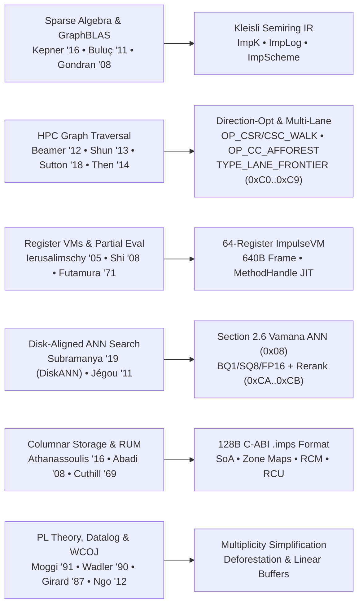

# Research Literature, Annotated Bibliography & Design Lineage

**Impulse Graph Engine** synthesizes four decades of peer-reviewed research across **sparse linear algebra**, **shared-memory HPC graph algorithms**, **virtual machine architecture**, **columnar database storage**, **disk-aligned vector search**, and **programming language theory**.

This page maps each architectural decision in `.imps`, `ImpulseVM`, and the `ImpScheme` compiler back to the foundational papers that motivated or bounded its design, distinguishes established prior art from Impulse's novel contributions, and examines three core systems design trade-offs.

---

## 1. Cross-Disciplinary Lineage Map

---

## 2. Prior Art vs. Novel Synthesis in Impulse Graph

Rigorous systems engineering separates well-established algorithms from genuinely new architectural combinations:

| Subsystem / Technique | Relationship to Prior Art | Primary Prior Art | What Impulse Adds or Synthesizes |
| :--- | :--- | :--- | :--- |
| **Multiplicity-Driven Bytecode Simplification** | **Novel Compiler Optimization** | Distant analogue in SQL foreign-key join elimination | Exploits exact immutable `.imps` catalog degree bounds ($1:1, 1:N, N:1$) in `InjectiveDeduplicationBypassPass` and `KernelFusionPass` to statically elide monoid folds, deduplication, and intermediate bitsets. |
| **128-Byte C-ABI `.imps` Multi-Domain Snapshot** | **Novel Format Specification** | Apache Arrow IPC (tabular), GAPBS `.sg` (single-matrix) | Unifies independent per-domain dense IDs ($0 \dots N_d-1$, `uint16`/`32`/`64`), CSR/CSC matrices, SoA nullable columns, MPH key indices, and Vamana ANN slabs in one `mmap`-ready file. |
| **Fused Vamana ANN $\to$ 64-Lane Quorum Walk** | **Novel Hybrid Graph-Vector ISA** | DiskANN (Subramanya '19) + MS-BFS (Then '14) | `OP_VECTOR_ANN_SEARCH (flags=1)` (`0xCA`) seeds 64 ANN anchors directly into `TYPE_LANE_FRONTIER`, walks $h$ hops in one CSR pass (`0xC3`), filters consensus bridges via `popcount >= q` (`0xC6`), and SIMD-reranks (`0xCB`). |
| **Four-Way `ICTX` v1 Deterministic VM Parity** | **Novel Polyglot Verification Architecture** | McKeeman '98; Yang et al. '11 (CSmith) | Enforces bitwise register, PC, flag, and SHA-256 `ICTX` v1 state-hash identity across C++ (`-O3`/`-O0`), Pure Java 25 FFM, and a pure functional OCaml reference oracle across 166 opcodes. |
| **Direction-Optimizing Push / Pull** | **Established Algorithm** | Beamer et al. (SC '12); Shun & Blelloch (PPoPP '13) | Adapted to cross-domain heterogeneous relations ($D_{\text{Src}} \to D_{\text{Dst}}$) with compile-time and runtime density switching (`OP_ADAPTIVE_WALK`). |
| **Subgraph-Sampled Connected Components** | **Established Algorithm** | Sutton, Ben-Nun & Barak (IPDPS '18 — Afforest) | Implemented directly as a zero-allocation VM instruction (`OP_CC_AFFOREST`) in both C++20 OpenMP and Pure Java 25 FFM. |
| **64-Register Bytecode VM + `MethodHandle` JIT** | **Established VM Techniques** | Lua 5.0 (Ierusalimschy '05); Futamura '71; Truffle ('13) | Specializes 64-bit `impOps` and CEL shaders into `java.lang.invoke.MethodHandle` trees compiled by standard OpenJDK C2 without requiring GraalVM or JNI. |
| **Lock-Free Snapshot Rotation** | **Established Concurrency Pattern** | McKenney & Slingwine '98 (RCU); Athanassoulis '16 (RUM) | Paired with JDK Foreign Function & Memory `Arena.ofShared()` epoch reference counting (`SnapshotLifecycleManager`) for zero-segfault unmapping. |

---

## 3. Three Core Systems Architecture Debates

### 3.1 Why `mmap` Works in Impulse Despite CIDR '22 (*"Are You Sure You Want to Use MMAP in Your DBMS?"*)

In their influential CIDR 2022 paper, **Crotty, Leis, and Pavlo** demonstrated why general-purpose *mutable* transactional DBMSs suffer severe engineering and performance problems when built on OS `mmap` instead of an explicit user-space buffer pool. Every database architect evaluating Impulse rightfully asks how `.imps` avoids those pitfalls:

| Mutable DBMS `mmap` Hazard (Crotty, Leis & Pavlo, CIDR '22) | Why Mutable OLTP Engines Fail | Why Read-Only `.imps` Snapshots Are Immune |
| :--- | :--- | :--- |
| **1. Transactional Safety & Torn Dirty-Page Flush** | The OS kernel can flush dirty `mmap` pages to disk before Write-Ahead Log (WAL) records are persisted, violating ARIES write-ahead invariants. | `.imps` mappings are strictly `MAP_PRIVATE` / `MapMode.READ_ONLY`. **Zero dirty pages and zero in-place writes ever occur**; new snapshots are streamed sequentially to a fresh file and SHA-256 verified before mounting. |
| **2. Page-Table Contention & TLB Shootdowns** | Random read-write eviction across thousands of mutable 4KB B-tree pages triggers costly cross-core TLB shootdown IPIs (`munmap` / page reclaim). | Snapshots map contiguous 128B-aligned segments backed by **2MB Transparent Huge Pages (`madvise`)**, cutting TLB entries by `512x`. Clean read-only pages drop without writeback I/O, and old epochs `munmap` only once per Blue/Green swap after active readers drain. |
| **3. Synchronous Page-Fault Stalls on Worker Threads** | An unexpected major page fault stalls an OS thread holding internal latches, cascading tail latency across concurrent transactions. | Readers hold **zero latches** on the hot path, and `BinarySnapshotLoader` / `impulse_snapshot_open` issues asynchronous `MADV_WILLNEED` kernel readahead during `startupProbe` warmup before serving traffic. |
| **4. `SIGBUS` / Truncation Hazards** | Concurrent file truncation or corruption crashes the process unless wrapped in OS-specific signal handlers. | `SnapshotContractValidator` and CRC-16 / SHA-256 / Ed25519 checks validate file length and section bounds *before* publication, while `SnapshotLifecycleManager` keeps the file descriptor and `Arena.ofShared()` open until active epoch leases reach `0`. |

By trading away in-place mutability (the **RUM Conjecture**, Athanassoulis et al., EDBT '16), Impulse captures the $O(1)$ cold-start (`38 µs` C++ / `9.75 ms` Java 25 on 6.04 GB `twitter-2010.imps`) and multi-process page-cache sharing benefits of `mmap` without inheriting its transactional failure modes.

### 3.2 Why Single-Layer Vamana (`DiskANN`) Instead of Multi-Layer HNSW

While **HNSW** (Malkov & Yashunin, TPAMI '20) is the standard in-RAM mutable vector index, its variable-height hierarchical skip-list assigns each node a random level $\ell \sim \lfloor -\ln(\mathrm{unif}(0,1)) \cdot m_L \rfloor$, resulting in jagged per-level pointer arrays that fragment contiguous file layouts and complicate SSD/page-cache prefetching.

**Vamana / DiskANN** (Jayaram Subramanya et al., NeurIPS '19) instead builds a **single-layer, bounded-out-degree ($R$) directed proximity graph** rooted at the global dataset medoid using two-pass $\alpha$-RNG robust pruning ($\alpha \ge 1.2$). Adding long-range routing edges directly into a single flat layer lets `.imps` Section 2.6 (`IMP_INDEX_VAMANA_ANN = 0x08`) pack the entire index into two **fixed-stride, 128-byte-aligned arrays**:

1. **Adjacency Slab**: $N \times (R + 1) \times \texttt{uint32\_t}$ (zero pointer chasing; neighbor list of node $u$ is a single base-plus-stride slice).
2. **Quantized Routing Slab**: Compact `BQ1` (1-bit), `SQ8` (8-bit), or `FP16` codes scanned in L1/L2 cache during beam search, deferring full `Float32[D]` loads to the final top-$K$ SIMD rerank (`OP_VECTOR_RERANK_DOT`, `0xCB`)—and pairing naturally with `--vamana-locality` BFS node reordering.

### 3.3 Why a 64-Register VM (`ImpulseVM`) Instead of a Stack Bytecode Machine

Stack virtual machines (JVM bytecode, WebAssembly, Python CPython, SQLite pre-VDBE register rewrite) push and pop operands implicitly, inflating instruction dispatch counts and memory traffic for binary operations. Following **Lua 5.0** (Ierusalimschy et al., 2005) and **Shi et al.** (ACM TACO 2008)—and echoing SQLite 3's own migration from a stack VDBE to a register VDBE—`ImpulseVM` encodes explicit register operands (`R0`..`R63`) inside fixed 64-bit `impOps` words:

* Loop-invariant frontiers, bitsets, and scalar thresholds stay pinned in named registers across fixed-point loops without repeated `LOAD`/`PUSH`/`POP` instructions.
* The entire 64-register architectural state (`impulse_vm_state_t`) occupies **640 bytes (10 cache lines)**, staying hot in L1 data cache.
* In Pure Java 25, `ImpulseMethodHandleCompiler` applies the **First Futamura Projection** (partial evaluation of an interpreter with respect to a fixed `impOps` program via `MethodHandle` combinators), enabling HotSpot C2 to inline per-edge CEL shaders into register-allocated machine code.

---

## 4. Annotated Bibliography by Research Pillar

### Pillar 1: Sparse Linear Algebra, Semirings & GraphBLAS

1. **Jeremy Kepner, Peter Aaltonen, David Bader, Aydın Buluç, Franz Franchetti, John Gilbert, Dylan Hutchison, Manoj Kumar, Andrew Lumsdaine, Henning Meyerhenke, Scott McMillan, Carl Yang, Marcin Zalewski, and Timothy Mattson.** *"Mathematical Foundations of the GraphBLAS."* IEEE High Performance Extreme Computing Conference (**HPEC**), 2016.
   - **Core Result**: Formalizes graph algorithms (BFS, shortest paths, centrality, subgraphs) as sparse matrix-vector (`MxV` / `vXM`) and matrix-matrix (`MxM`) operations over algebraic semirings and masks.
   - **Realization in Impulse**: Direct mathematical basis for the **ImpK (`.impk`)** DSL, `OP_MXV` / `OP_VXM` opcodes, and masked frontier propagation over CSR/CSC segments.

2. **Aydın Buluç and John R. Gilbert.** *"The Combinatorial BLAS: Design, Implementation, and Applications."* The International Journal of High Performance Computing Applications (**IJHPCA**), 25(4):496–509, 2011.
   - **Core Result**: Demonstrates how customizable semiring `plus` ($\oplus$) and `times` ($\otimes$) combinators decouple parallel sparse matrix communication/storage from domain-specific graph logic.
   - **Realization in Impulse**: Motivates Impulse's separation of topological walk instructions from customizable monoidal reducers (`Reducer.SUM`, `MIN`, `MAX`, `ANY`).

3. **Mehryar Mohri.** *"Semiring Frameworks and Algorithms for Shortest-Distance Problems."* Journal of Automata, Languages and Combinatorics, 7(3):321–350, 2002; and **Michel Gondran and Michel Minoux**, *Graphs, Dioids and Semirings: New Models and Algorithms*, Springer, 2008.
   - **Core Result**: Establishes $k$-closedness and idempotency conditions guaranteeing finite convergence of generalized shortest-distance and transitive-closure iterations over dioids/semirings.
   - **Realization in Impulse**: Governs termination and asynchronous safety rules for `repeatUntilStable` and `ImpLog` fixed-point loops ([Mathematical Foundations §6.1](../academic.md#6-fixed-point-convergence-bit-sliced-algebras-direction-optimization)).

---

### Pillar 2: Direction-Optimizing Traversal, Connectivity & Multi-Source Bit-Slicing

4. **Scott Beamer, Krste Asanović, and David Patterson.** *"Direction-Optimizing Breadth-First Search."* IEEE/ACM International Conference for High Performance Computing, Networking, Storage and Analysis (**SC '12**), 2012; and *"The GAP Benchmark Suite"*, arXiv:1508.03619, 2015.
   - **Core Result**: Switching dynamically between top-down CSR Push (sparse frontiers) and bottom-up CSC Pull with early exit (dense frontiers) eliminates redundant edge inspections on low-diameter scale-free graphs; GAPBS standardizes empirical graph benchmarking (`twitter-2010`).
   - **Realization in Impulse**: Implemented in `DirectionSelectionPass` and `OP_ADAPTIVE_WALK` over paired CSR/CSC `.imps` sections, and used as the canonical baseline in [Benchmarks](../benchmarks.md) (`145.00 ms` C++20 / `240.29 ms` Java 25 on `twitter-2010`).

5. **Julian Shun and Guy E. Blelloch.** *"Ligra: A Lightweight Graph Processing Framework for Shared Memory."* ACM SIGPLAN Symposium on Principles and Practice of Parallel Programming (**PPoPP**), 2013.
   - **Core Result**: Introduces dual sparse-array vs. dense-bitset `vertexSubset` representations with adaptive threshold switching across `EdgeMap` and `VertexMap` operators.
   - **Realization in Impulse**: Mirrors `ImpulseVM`'s dual `TYPE_NODE_VECTOR` (sparse ID list) and `OffHeapBitSet` (dense $\lceil N_d / 64 \rceil$ words) frontier representations.

6. **Michael Sutton, Tal Ben-Nun, and Amnon Barak.** *"Optimizing Parallel Graph Connectivity Computation via Subgraph Sampling."* IEEE International Parallel and Distributed Processing Symposium (**IPDPS**), 2018 (**Afforest**).
   - **Core Result**: Sampling just $k = 2$ outgoing edges per vertex discovers the giant connected component in power-law graphs, allowing subsequent full-CSR sweeps to skip >90% of vertices already linked to the dominant root.
   - **Realization in Impulse**: Directly implemented as `OP_CC_AFFOREST` across both C++20 and Pure Java 25 (`39,681,514` components on `twitter-2010` in `156.73 ms` C++ / `311.23 ms` Graal JIT).

7. **Manuel Then, Moritz Kaufmann, Fernando Chirigati, Tuan-Anh Hoang-Vu, Kien Pham, Alfons Kemper, Thomas Neumann, and Huy T. Vo.** *"The More the Merrier: Efficient Multi-Source Graph Traversal."* Proceedings of the VLDB Endowment (**PVLDB**), 8(4):449–460, 2014 (**MS-BFS**).
   - **Core Result**: Packs multiple concurrent BFS frontiers into machine bit-width lanes (64/128/256/512 bits) so one CSR adjacency scan advances dozens of traversals simultaneously, turning memory-bound walks into compute-dense bitwise operations.
   - **Realization in Impulse**: Core inspiration for `v0.10.0` **Multi-Lane Bit-Sliced Frontiers (`TYPE_LANE_FRONTIER = 0x10`, `0xC0`..`0xC9`)**, generalized in Impulse to support edge-outage trip masks (`OP_LANE_SET_EDGE_MASK`) for $N-1$/$N-2$ grid contingency sweeps and multi-anchor quorum filtering (`OP_LANE_FILTER_QUORUM`).

8. **Yunming Zhang, Mengjiao Yang, Riyadh Baghdadi, Shoaib Kamil, Julian Shun, and Saman Amarasinghe.** *"GraphIt: A High-Performance Graph DSL."* Proceedings of the ACM on Programming Languages (**OOPSLA**), 2018.
   - **Core Result**: Separates declarative graph algorithm specification from physical optimization schedules (direction, parallelization, data layout, kernel fusion).
   - **Realization in Impulse**: Reflected in Impulse's split between Stage 1 (logical snapshot-agnostic AST rewrites) and Stage 2 (snapshot-bound physical schedule & kernel selection).

---

### Pillar 3: Register Virtual Machines, Threaded Dispatch & Partial-Evaluation JIT

9. **Roberto Ierusalimschy, Luiz Henrique de Figueiredo, and Waldemar Celes.** *"The Implementation of Lua 5.0."* Journal of Universal Computer Science (**J.UCS**), 11(7):1159–1176, 2005.
   - **Core Result**: Introduces a mainstream register-based bytecode virtual machine packing opcode and explicit register indices into fixed-width 32-bit words, sharply cutting instruction count per loop iteration compared to stack VMs.
   - **Realization in Impulse**: Primary inspiration for `ImpulseVM`'s 64-register (`R0`..`R63`) architecture and fixed 64-bit `impOps` instruction format (`opcode[8] | flags[8] | dst[16] | payload[32]`).

10. **Yunhe Shi, Kevin Casey, M. Anton Ertl, and David Gregg.** *"Virtual Machine Showdown: Stack Versus Registers."* ACM Transactions on Architecture and Code Optimization (**TACO**), 4(4), 2008 (extended from **ACM VEE** 2005).
    - **Core Result**: Demonstrates empirically that register bytecode architectures execute ~45% fewer VM instructions and reduce dispatch overhead, especially when paired with direct/computed-`goto` threading.
    - **Realization in Impulse**: Guides `impulse_vm.cpp`'s computed-`goto` dispatch loop and register-pinned loop invariants.

11. **Yoshihiko Futamura.** *"Partial Evaluation of Computation Process—An Approach to a Compiler-Compiler."* Systems, Computers, Controls, 2(5):45–50, 1971 (reprinted in *Higher-Order and Symbolic Computation*, 12(4):381–391, 1999); and **Thomas Würthinger, Christian Wimmer, Andreas Wöß, Lukas Stadler, Gilles Duboscq, Christian Humer, Gregor Richards, Doug Simon, and Mario Wolczko**, *"One VM to Rule Them All"*, **ACM Onward!**, 2013.
    - **Core Result**: Specializing an interpreter with respect to a known target program (the **First Futamura Projection**) produces a compiled native executable without maintaining a separate machine-code backend per CPU ISA.
    - **Realization in Impulse**: `ImpulseMethodHandleCompiler` and `ShaderCompiler` specialize `impOps` instructions and CEL ASTs into `java.lang.invoke.MethodHandle` combinator trees, letting HotSpot C2 constant-fold the interpreter away on standard JDK 21/25.

---

### Pillar 4: Disk-Aligned Approximate Nearest Neighbor (ANN) & Vector Quantization

12. **Suhas Jayaram Subramanya, Fnu Devvrit, Rohan Kadekodi, Ravishankar Krishnaswamy, and Harsha Vardhan Simhadri.** *"DiskANN: Fast Accurate Billion-Point Nearest Neighbor Search on a Single Node."* Advances in Neural Information Processing Systems (**NeurIPS**), 32, 2019.
    - **Core Result**: Introduces the single-layer **Vamana** $\alpha$-RNG graph ($\alpha > 1$ long-range pruning from the medoid) paired with compressed in-RAM routing codes and full-precision on-SSD vectors for low-hop, disk-friendly beam search.
    - **Realization in Impulse**: Directly realized in `.imps` **Section 2.6 `IMP_INDEX_VAMANA_ANN` (`0x08`)**, `OP_VECTOR_ANN_SEARCH` (`0xCA`), and `impulse snapshot optimize --vamana-locality`.

13. **Yu. A. Malkov and D. A. Yashunin.** *"Efficient and Robust Approximate Nearest Neighbor Search Using Hierarchical Navigable Small World Graphs."* IEEE Transactions on Pattern Analysis and Machine Intelligence (**TPAMI**), 42(4):824–836, 2020.
    - **Core Result**: Establishes logarithmic-scaling navigable small-world proximity graphs for high-recall ANN search.
    - **Realization in Impulse**: Serves as the architectural baseline motivating Impulse's choice of single-layer fixed-stride Vamana slabs over jagged multi-layer HNSW skip-lists in immutable `.imps` files (§3.2).

14. **Hervé Jégou, Matthijs Douze, and Cordelia Schmid.** *"Product Quantization for Nearest Neighbor Search."* IEEE Transactions on Pattern Analysis and Machine Intelligence (**TPAMI**), 33(1):117–128, 2011.
    - **Core Result**: Pioneers asymmetric compressed-domain distance estimation during candidate search followed by exact reranking over top candidates.
    - **Realization in Impulse**: Underpins Impulse's two-stage quantized beam routing (`BQ1` 1-bit hamming, `SQ8` 8-bit scalar, `FP16`) paired with exact SIMD `Float32[D]` reranking (`OP_VECTOR_RERANK_DOT`, `0xCB`).

---

### Pillar 5: Columnar Storage, RUM Conjecture, `mmap` Analysis & Graph Reordering

15. **Manos Athanassoulis, Michael S. Kester, Lukas M. Maas, Radu Stoica, Stratos Idreos, Anastasia Ailamaki, and Mark Callaghan.** *"Designing Access Methods: The RUM Conjecture."* International Conference on Extending Database Technology (**EDBT**), 2016 (and *Communications of the ACM*, 66(4), 2023).
    - **Core Result**: Any data access method can optimize at most two of **Read overhead**, **Update overhead**, and **Memory/storage overhead**.
    - **Realization in Impulse**: Explicit architectural justification for `.imps`: by moving **Update** out-of-band (streaming Blue/Green snapshot rebuilds), Impulse simultaneously attains minimal **Read** overhead (contiguous 128B CSR/CSC) and minimal **Memory** overhead (zero B-tree pointers or MVCC headers).

16. **Mike Stonebraker, Daniel J. Abadi et al.** *"C-Store: A Column-Oriented DBMS"*, **VLDB**, 2005; and **Daniel J. Abadi, Samuel R. Madden, and Nabil Hachem**, *"Column-Stores vs. Row-Stores: How Different Are They Really?"*, **ACM SIGMOD**, 2008.
    - **Core Result**: Proves that **late materialization**—propagating compact position bitmaps/lists through filter stages before fetching projected columns—dramatically outperforms early tuple construction.
    - **Realization in Impulse**: All node and edge attributes in `.imps` are stored as disjoint SoA columns, materialized only for surviving `OffHeapBitSet` frontier IDs at terminal `collect()` or `RowView` cursor iteration.

17. **Peter A. Boncz, Marcin Zukowski, and Niels Nes.** *"MonetDB/X100: Hyper-Pipelining Query Execution."* Conference on Innovative Data Systems Research (**CIDR**), 2005.
    - **Core Result**: Replaces Volcano tuple-at-a-time virtual method calls with vectorized array primitives fitting inside CPU L1/L2 caches.
    - **Realization in Impulse**: Motivates SIMD-vectorized CEL predicate loops (`FloatVector.SPECIES_PREFERRED` in Java 25 and Google Highway in C++20).

18. **Guido Moerkotte.** *"Small Materialized Aggregates: A Light Weight Index Structure for Data Warehousing."* **VLDB**, 1998.
    - **Core Result**: Introduces lightweight min/max/count synopses (**Zone Maps**) enabling compile-time and scan-time block pruning with negligible storage cost.
    - **Realization in Impulse**: Section 2 attribute statistics (`min`, `max`, `null_count`) drive `ZoneMapPruningPass` branch elimination.

19. **Andrew Crotty, Viktor Leis, and Andrew Pavlo.** *"Are You Sure You Want to Use MMAP in Your Database Management System?"* Conference on Innovative Data Systems Research (**CIDR**), 2022.
    - **Core Result**: Catalogs the transactional safety, page-eviction, TLB shootdown, and I/O stall hazards of using `mmap` in mutable read-write DBMSs.
    - **Realization in Impulse**: Directly informs `.imps` operational safeguards (§3.1): strictly read-only immutable mappings, pre-swap SHA-256 validation, 2MB THP `madvise`, `MADV_WILLNEED` startup warmup, and Kubernetes `cgroups v2` page-cache sizing.

20. **Elizabeth Cuthill and James McKee.** *"Reducing the Bandwidth of Sparse Symmetric Matrices."* Proceedings of the 24th ACM National Conference, 1969; and **Hao Wei, Jeffrey Xu Yu, Can Lu, and Xuemin Lin**, *"Speedup Graph Processing by Graph Ordering"* (**Gorder**), **ACM SIGMOD**, 2016.
    - **Core Result**: Permuting dense vertex IDs so structurally proximate nodes have numerically proximate IDs dramatically increases L1/L2 cache-line hit rates and bitset word density during CSR walks.
    - **Realization in Impulse**: Implemented directly in `impulse snapshot optimize --rcm` (Reverse Cuthill-McKee), `--degree-sort`, and `--vamana-locality` (medoid BFS ordering).

21. **Djamal Belazzougui, Fabiano C. Botelho, and Martin Dietzfelbinger.** *"Hash, Displace, and Compress"* (**CHD**), **ESA**, 2009; and **Antoine Limasset, Guillaume Rizk, Rayan Chikhi, and Pierre Peterlongo**, *"Fast and Scalable Minimal Perfect Hashing for Massive Key Sets"* (**BBHash**), **SEA**, 2017.
    - **Core Result**: Constructs static, collision-free Minimal Perfect Hash Functions (MPHF) mapping $N$ static keys to $\{0 \dots N - 1\}$ in $O(1)$ probes with near-information-theoretic space.
    - **Realization in Impulse**: Underpins `.imps` Section 2.6 `_domain_index` external key-to-dense-ID resolution (`fromKey(...)`).

---

### Pillar 6: Category Theory, Datalog, Relational Joins & Lock-Free Concurrency

22. **Eugenio Moggi.** *"Notions of Computation and Monads."* Information and Computation, 93(1):55–92, 1991 (preliminary version **IEEE LICS**, 1989); and **Philip Wadler**, *"Deforestation: Transforming Programs to Eliminate Trees"*, Theoretical Computer Science, 73(2):231–248, 1990.
    - **Core Result**: Models effectful/weighted pipelines via Kleisli composition ($\mathbf{Kl}(M)$) and proves compile-time fusion laws eliminating intermediate data structures.
    - **Realization in Impulse**: Formalizes Impulse's domain-to-domain fluent traversal model and `OP_CSR_WALK_2HOP` intermediate-frontier elimination.

23. **Jean-Yves Girard.** *"Linear Logic."* Theoretical Computer Science, 50(1):1–101, 1987.
    - **Core Result**: Distinguishes unrestricted shared truth ($!A$, exponential modality) from single-use linear resources ($A \multimap B$) consumed without garbage collection.
    - **Realization in Impulse**: Models the split between shared read-only `mmap` snapshots ($!\mathcal{G}$) and linearly recycled VM register scratch buffers (`R0`..`R63`).

24. **Alfred Tarski.** *"A Lattice-Theoretical Fixpoint Theorem and its Applications"*, Pacific Journal of Mathematics, 5(2):285–309, 1955; **Patrick Cousot and Radhia Cousot**, *"Abstract Interpretation: A Unified Lattice Model for Static Analysis of Programs by Construction or Approximation of Fixpoints"*, **ACM POPL**, 1977; and **François Bancilhon**, *"Naive Evaluation of Recursively Defined Relations"*, 1986 (**Semi-Naive Datalog**).
    - **Core Result**: Guarantees unique least fixed points for monotonic operators over complete lattices and accelerates recursive Datalog rules via delta-frontier propagation.
    - **Realization in Impulse**: Powers `ImpLog` recursive rule compilation, `ScmFixpoint` (`repeatUntilStable`), and delta-frontier bitset tracking.

25. **Hung Q. Ngo, Ely Porat, Christopher Ré, and Atri Rudra.** *"Worst-Case Optimal Join Algorithms"*, Journal of the ACM (**JACM**), 65(3), 2018 (**ACM PODS** 2012); and **Michael Freitag, Maximilian Bandle, Tobias Schmidt, Alfons Kemper, and Thomas Neumann**, *"Adopting Worst-Case Optimal Joins in Relational Database Systems"*, **PVLDB**, 13(11), 2020.
    - **Core Result**: Proves binary join plans are asymptotically suboptimal on cyclic graph patterns (triangles, cliques) and achieves AGM-bound optimality ($O(N^{\rho^*})$) via multi-way sorted set intersection.
    - **Realization in Impulse**: Defines the boundary where linear Kleisli CSR walks hand off to sorted CSR slice / bitset intersection (`OP_BITSET_AND`) on cyclic motifs.

26. **Ruoming Pang, Ramón Cáceres, Mike Burrows, Zhifeng Chen, Pratik Dave, Nathan Germer, Alexander Golynski, Kevin Graney, Nina Kang, Lea Kissner, Jeffrey L. Korn, Abhishek Parmar, Christopher D. Richards, and Mengzhi Wang.** *"Zanzibar: Google's Consistent, Global Authorization System."* **USENIX ATC**, 2019.
    - **Core Result**: Establishes tuple-based Relationship-Based Access Control (ReBAC) via recursive group/hierarchy set-union and intersection reachability checks at microsecond tail latency.
    - **Realization in Impulse**: Primary enterprise motivation for `ImpLog` and the `impulse-authz` showcase (`0.026 µs – 0.552 µs` multi-hop ReBAC evaluation in Pure Java 25).

27. **Paul E. McKenney and John D. Slingwine.** *"Read-Copy Update: Using Execution History to Solve Concurrency Problems."* Parallel and Distributed Computing and Systems (**PDCS**), 1998 (**RCU**).
    - **Core Result**: Enables zero-lock, wait-free concurrent reads alongside updates by publishing new immutable versions via atomic pointer swap and deferring reclamation of old epochs until all pre-existing readers complete.
    - **Realization in Impulse**: Exact lifecycle mechanism of `SnapshotLifecycleManager` and `SnapshotSwapManager` (`AtomicReference` swap + `LongAdder` epoch reader draining before `Arena.ofShared().close()`).

---

### Pillar 7: Graph Neural Networks & Differential Compiler Verification

28. **Justin Gilmer, Samuel S. Schoenholz, Patrick F. Riley, Oriol Vinyals, and George E. Dahl.** *"Neural Message Passing for Quantum Chemistry"* (**MPNN**), **ICML**, 2017; and **William L. Hamilton, Rex Ying, and Jure Leskovec**, *"Inductive Representation Learning on Large Graphs"* (**GraphSAGE**), **NeurIPS**, 2017.
    - **Core Result**: Unifies GNNs under neighborhood message aggregation + node update functions and introduces bounded-fanout $k$-hop neighborhood sampling for scalable mini-batch training.
    - **Realization in Impulse**: Implemented natively in `impulse-gnn` (`sample_neighbors` over `mmap` CSR slices + zero-copy `[N, D]` SoA feature tensors).

29. **William M. McKeeman.** *"Differential Testing for Software"*, Digital Technical Journal, 10(1):100–107, 1998; and **Xuejun Yang, Yang Chen, Eric Eide, and John Regehr**, *"Finding and Understanding Bugs in C Compilers"* (**CSmith**), **ACM PLDI**, 2011.
    - **Core Result**: Running randomized, grammar/contract-valid programs across independent compiler and VM implementations exposes subtle semantic, optimization, and corner-case bugs without requiring manual test oracles.
    - **Realization in Impulse**: Directly drives `impulse-verification` (`four_way_validation.py`, `fuzz_vm_contracts.py`, `cross_compiler_parity.py`, and `cli_side_by_side_parity.py`), enforcing bitwise `ICTX` v1 consensus across C++ (`-O3`), C++ (`-O0`), Pure Java 25, and OCaml.

---

## 5. Open Research Problems & Future Directions

Several active extensions of the Impulse architecture connect directly to open systems and database research questions:

1. **Direct GPU DMA & Warp-Coalesced SpMV (`cuFile` GPUDirect Storage)**: Because every `.imps` section is 128-byte aligned (matching 32-thread $\times$ 4-byte NVIDIA warp memory transactions), CSR/CSC and `[N, D]` embedding slabs can stream directly from NVMe into GPU HBM via `cuFile` without staging through host CPU RAM.
2. **Cross-Snapshot Federated Morphisms (`OP_REMAP_ID_SPACE`)**: Extending $\mathbf{C}_{\text{Schema}}$ across independently versioned `.imps` snapshots (e.g., a static reference ontology paired with a 5-minute transactional edge snapshot) via zero-copy dense-ID translation morphisms.
3. **Worst-Case Optimal Join (WCOJ) Lowering in `ImpScheme`**: Compiling cyclic `openCypher` and `ImpLog` conjunctive patterns (triangles, 4-cycles) directly into multi-way sorted CSR slice intersections (Leapfrog Triejoin / GenericJoin style).
4. **Probabilistic Sketch Monoids in $\mathbf{Kl}(\mathcal{W}_R)$**: Embedding mergeable approximate sketches (HyperLogLog for distinct neighborhood cardinality, Count-Min / KLL quantile sketches) as fixed-width register monoids for billion-edge approximate graph analytics.
5. **Property-Based & SMT Verification of Custom Monoid Laws**: Statically or fuzz-verifying associativity, commutativity, and idempotency before enabling parallel/chaotic reduction schedules on user-supplied CEL state reducers.

---

## Related Guides

* **[Mathematical, Categorical & GraphBLAS Foundations](../academic.md)**: Formal semiring algebra, Grothendieck fibrations, multiplicity proofs, and linear buffer typing.
* **[Polyglot Validation & Testing](../contributing/polyglot-validation.md)**: How the four-way differential validation suite and contract fuzzer enforce specification compliance.
* **[Why Impulse Graph?](../concepts/why-impulse.md)**: Architectural motivation and empirical latency breakdowns.
