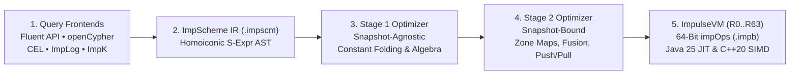

# Compiler Pipeline & ImpulseVM Execution

Every query in **Impulse Graph Engine**—whether written in the Fluent API, openCypher, Google CEL, ImpLog (Datalog), or ImpK (GraphBLAS)—compiles through a single multi-pass pipeline into **64-bit `impOps` bytecode** and executes on **`ImpulseVM`**.



---

## 1. The Immutable Snapshot Optimization Thesis

In traditional relational and graph databases, query optimizers operate under **probabilistic uncertainty**: because the database is mutating concurrently, the planner relies on sampled histograms and must compile conservative execution plans.

> **Because an `.imps` snapshot is 100% immutable, every structural statistic—domain cardinalities ($N_d$), degree bounds, relation multiplicities ($1:1, 1:N, N:1$), null counts, and per-attribute `[min, max]` Zone Maps—is exact.**

Binding a query AST to an `.imps` snapshot turns heuristic query planning into **deterministic algebraic simplification**.

### Two-Stage Optimization Pipeline

To support sub-microsecond plan caching across Blue/Green snapshot swaps, optimization is split into two stages:

| Stage | When It Runs | Key Optimization Passes | Concrete Impact |
| :--- | :--- | :--- | :--- |
| **Stage 1: Snapshot-Agnostic** | Once when a query is registered or parsed | • **AST Normalization & Parameter Binding**<br>• **Constant Folding & CEL Math Inversion**<br>• **Algebraic Type & Monotonicity Inference**<br>• **Monotonic Homomorphism Pushdown** | • Rewrites monotonic math filters ($\sqrt{x} < c \implies x < c^2$) to eliminate per-node `sqrt` calls.<br>• Commutes monotonic functions across reductions ($\max(f(X)) \to f(\max(X))$), evaluating $f$ once instead of $N$ times. |
| **Stage 2: Snapshot-Bound** | When binding a query to a specific `.imps` file (`< 2 µs`) | • **Zone Map & Nullability Pruning**<br>• **Multiplicity Deduplication Bypass**<br>• **2-Hop Kernel Fusion (`OP_CSR_WALK_2HOP`)**<br>• **Direction Selection (CSR Push vs. CSC Pull)**<br>• **Multi-Lane Width Selection & ANN Fusion (`v0.9.1`)**<br>• **Filter Pushdown & Register Allocation** | • Prunes unreachable branches (`u.age > 250` when `age.max == 114` folds to `FALSE`).<br>• Strips null-bitmap checks when `NullCount == 0`.<br>• Eliminates intermediate bitsets on low-multiplicity 2-hop walks and bypasses deduplication on $1:N$ injective relations.<br>• Selects minimal bit-sliced lane width (`WIDTH_8`/`16`/`32`/`64`) for $k \le 64$ seeds (`0xC0`..`0xC9`) and fuses `OP_VECTOR_ANN_SEARCH` (`0xCA`, `flags=1`) directly into a `TYPE_LANE_FRONTIER` when a Section 2.6 Vamana (`0x08`) index is present. |

### Inspecting Bytecode Disassembly (`.impas`)

Any compiled query can be disassembled into canonical human-readable **ImpAsm (`.impas`)** text assembly (via `ImpAsmDisassembler.disassemble(program)` in Java or `impulse disassemble` in the CLI):

```impas
.version 0.9.0
.instructions 4

  0x0000: OP_CSC_WALK       flags=0x03, dst=R1, payload=0x00240000 ; Walk src=R0 -> dst=R1 via rel[36] [seed-inlined]
  0x0001: OP_CSR_WALK       flags=0x01, dst=R0, payload=0x00080001 ; Walk src=R1 -> dst=R0 via rel[8]  [early-exit]
  0x0002: OP_COLLECT_BITSET flags=0x00, dst=R0, payload=0x00000000 ; Materialize surviving bitset in R0
  0x0003: OP_HALT           flags=0x00, dst=R0, payload=0x00000000 ; Execution complete
```

---

## 2. Inside `ImpulseVM`: Registers, JIT & Parallelism

Once emitted as fixed 8-byte `impOps` instructions (`opcode[8] | flags[8] | dst_reg[16] | payload[32]`), the program executes on **`ImpulseVM`**:

### 2.1 640-Byte Cache-Aligned Register Frame (`R0`..`R63`)
Inspired by Lua 5+ and LuaJIT, `ImpulseVM` is a **register-based virtual machine** rather than a stack machine. Source and destination registers (`R0`..`R63`) are encoded directly in each 64-bit instruction word, eliminating `PUSH`/`POP` traffic and keeping the entire VM execution state (`impulse_vm_state_t`) inside a single **640-byte frame (10 CPU cache lines)** that stays resident in L1 cache.

### 2.2 Pure Java 25 `MethodHandle` JIT Combinators
In the Pure Java 25 engine (`impulse-graph-java`), queries do not sit inside a slow bytecode `switch` loop when evaluating per-edge or per-node filter/projection shaders (`OP_CSR_WALK_STREAM`, `OP_CSC_WALK_STREAM`):

* `ImpulseMethodHandleCompiler` and `ShaderCompiler` translate `impOps` instructions and CEL predicates into composable trees of `java.lang.invoke.MethodHandle` combinators (`MethodHandles.insertArguments`, `foldArguments`, `guardWithTest`).
* The JVM's **C2 JIT compiler** constant-folds the register offsets and inlines the entire chain of shader operations into a single contiguous block of native machine code with **zero virtual method or interpreter dispatch overhead**.
* Full 7-stage AST compilation + `MethodHandle` JIT tree generation completes in **under 10 microseconds**.

### 2.3 Single-Threaded (High-QPS) vs. Multi-Threaded (Batch Analytics) Execution
`ImpulseVM` supports two complementary concurrency modes depending on your workload:

1. **Inter-Query Concurrency (Default for Microservices & APIs)**:
   * Each query executes single-threaded (`threads = 1`) in its own isolated 640-byte register frame and caller buffer over the shared `mmap` snapshot.
   * Because `threads == 1` is checked once outside the inner opcode loop, the VM executes non-atomic bitset writes (`w_dst |= mask`), avoiding hardware `LOCK` prefix overhead while allowing thousands of concurrent gRPC/HTTP requests to scale linearly across all CPU cores.
2. **Intra-Instruction Parallelism (For Massive Batch Analytics & GNNs)**:
   * For analytical workloads over multi-billion-edge graphs (PageRank, Connected Components, full-graph BFS), configuring `OP_SET_MAX_DOP` (`0x75`) or the `IMPULSE_MAX_DOP` environment variable parallelizes individual `impOps` kernels across cores using OpenMP (`#pragma omp parallel for`) in C++20 and parallel vector partitions in Java 25.

---

## Next Steps

* **[Mathematical & GraphBLAS Foundations](../academic.md)**: Formal semiring algebra, Kleisli composition, $1:1 / 1:N / N:1$ multiplicity proofs, and the CSR/CSC/COO analytical cost model.
* **[ImpulseVM & `impOps` ISA Specification](../reference/spec/vm-specification.md)**: Normative bytecode instruction set reference (`0x00`..`0xCB`).
