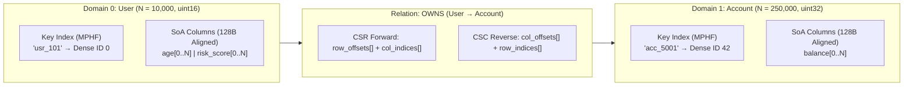

# Binary Snapshots, Domains & Schema (`.imps`)

An **Impulse Binary Snapshot (`.imps`)** is a single, self-contained, read-only file where the on-disk byte layout *is* the in-memory data structure. Every topology array, attribute column, and key catalog is aligned to **128-byte boundaries** so applications can `mmap` the file in `< 1 ms` and execute queries immediately with zero deserialization.

---

## 1. The Typed Graph Schema: Domains, Dense IDs & Relations

Every `.imps` snapshot is organized around an explicit, strongly-typed schema—defined either declaratively in `manifest.json` (for the [Rust `impulse` CLI](../getting-started/snapshot-builder-reference.md)) or programmatically via [Java `SnapshotBuilder`](../getting-started/building-snapshots.md).



### 1.1 Independent Per-Domain Dense IDs ($0 \dots N_d - 1$)
Unlike graph databases that assign a global 64-bit ID across all vertices, **every Node Domain (`User`, `Account`, `Product`) has its own independent, 0-indexed dense integer space ($0 \dots N_d - 1$)**:

* **Disjoint ID Spaces**: Dense ID `0` in `User` and Dense ID `0` in `Account` are distinct entities in separate namespaces.
* **Direct Array Indexing**: Because IDs are contiguous from $0$ to $N_d - 1$, a node's Dense ID *is* its array index ($O(1)$ offset lookup) into CSR `row_offsets[]` and Structure-of-Arrays (SoA) attribute columns.
* **Configurable Integer Widths**: Each domain configures its physical integer width based on cardinality (`uint16` up to 65,536 nodes, `uint32` up to 4.29B nodes, or `uint64`), minimizing CPU cache footprint.

### 1.2 External Business Keys & Boundary Resolution
Applications identify entities using external primary keys (`String`, `UUID`, or integer/float keys). Each domain optionally embeds a **Minimal Perfect Hash (`_domain_index`)** or sorted permutation index inside the `.imps` file:

1. **Input Resolution (`fromKey` / `impulse_snapshot_resolve_key`)**: Resolves external keys (e.g., `"usr_101"`) to internal Dense IDs once at the start of a query in $O(1)$ or $O(\log N)$ time.
2. **Dense Traversal**: All multi-hop walks, bitset operations, and SIMD attribute filters execute strictly on primitive Dense IDs.
3. **Output Materialization (`toKeyList` / `impulse_snapshot_resolve_dense_id`)**: Maps surviving target Dense IDs back to external business keys via zero-copy `mmap` pointers.

### 1.3 Directed Relations & Columnar Attributes
* **Directed Relations (`SrcDomain` $\to$ `TgtDomain`)**: Each relation is stored as its own isolated **CSR** (forward `.out(...)`) matrix and optional **CSC** (reverse `.in(...)`) transpose. During snapshot compilation and Stage 2 query binding, human-readable names (`"User"`, `"OWNS"`, `"age"`) resolve to compact **16-bit catalog IDs** encoded directly in the 64-bit `impOps` instruction word.
* **Node & Edge Attributes (SoA)**: Stored as contiguous, 128-byte-aligned primitive vectors (`int8`..`int64`, `float16`..`float64`, timestamps, strings, or fixed-width `[N, D]` vector embeddings) with optional Arrow-compatible validity bitmaps.

---

## 2. Physical `.imps` File Layout

An `.imps` file is written sequentially in five hardware-aligned sections:

```text
┌────────────────────────────────────────────────────────────────────────────┐
│ Section 1: Page 0 Header (Fixed 4 KB, 64-byte active baseline)             │
│   Magic: 0x494D5053 ("IMPS") | DataOffset: 4096 | Counts, UUID & Flags     │
├────────────────────────────────────────────────────────────────────────────┤
│ Section 2: Shared String Table, Domain Catalog & Relation Directory        │
│   Global UTF-8 string pool, Domain descriptors (N_d, width), Relation IDs  │
├────────────────────────────────────────────────────────────────────────────┤
│ Section 3: Relation Topology Blocks (128-Byte Aligned)                     │
│   Per-relation CSR (row_offsets[], col_indices[]) & optional CSC transpose │
├────────────────────────────────────────────────────────────────────────────┤
│ Section 4: Node & Edge SoA Attribute & Key Index Blocks (128-Byte Aligned) │
│   Contiguous scalar columns, [N, D] vector tensors, MPHF & Null bitmaps    │
├────────────────────────────────────────────────────────────────────────────┤
│ Section 5: Footer & Integrity Block (EOF)                                  │
│   Key-value build metadata, SHA-256 payload checksum, 16-byte "IMPS" Magic │
└────────────────────────────────────────────────────────────────────────────┘
```

* **128-Byte Hardware Alignment**: Every topology and attribute array starts on a 128-byte offset (2 CPU cache lines), enabling unpenalized AVX-512 / ARM Neon vector loads and direct NVIDIA GPUDirect Storage (`cuFile`) warp coalescing.
* **Single-Pass Sequential Streaming**: Because sections are written sequentially without backward file seeks, both `impulse build -o -` and Java `SnapshotBuilder` can stream `.imps` files directly to Amazon S3 or Google Cloud Storage in $O(\text{chunk})$ RAM.

---

## 3. Specification Limits & Supported Data Types

### 3.1 Structural Capacity Limits

| Snapshot Component | Header / Descriptor Field | Maximum Limit | Notes |
| :--- | :--- | :--- | :--- |
| **Node Domains per Snapshot** | `DomainCount` (`uint16_t`) | **`65,536` (`2^16`)** | `DomainID` ranges from `0` to `65,535`. |
| **Relations per Snapshot** | `RelationCount` (`uint16_t`) | **`65,536` (`2^16`)** | `RelationID` ranges from `0` to `65,535`. |
| **Nodes per Domain ($N_d$)** | `NodeIDWidth` (`2`, `4`, or `8` bytes) | • `uint16`: **`65,536`**<br>• `uint32`: **`4,294,967,296` (~4.29B)**<br>• `uint64`: **`2^64 - 1` (~1.84 × 10^19)** | Configured independently per domain to minimize cache footprint. |
| **Edges per Relation ($E$)** | `EdgeIndexWidth` (`4` or `8` bytes) | • `uint32` offsets: **`4,294,967,295` (~4.29B)**<br>• `uint64` offsets: **`2^64 - 1`** | Controls the byte width of `csrRowOffsets[]` and `cscRowOffsets[]`. |
| **Attributes per Domain / Relation** | `AttrCount` (`uint16_t`) | **`65,536` (`2^16`)** | Applies independently to each domain and each relation. |
| **Shared String Table (`Section 2`)** | `StringTableBytes` (`uint32_t`) | **`4 GB` (`2^32 - 1` bytes)** | Stores schema identifiers and shared dictionary strings (`NameOffset` is `uint32_t`). |
| **Total Snapshot File Size** | 64-bit Section Offsets (`uint64_t`) | **Multi-Terabyte (`2^64 - 1` bytes)** | All topology and attribute `DataOffset` and `DataBytes` fields are 64-bit unsigned integers. |

### 3.2 Attribute & Key Data Types (`impulse_attribute_descriptor_t`)

Every node or edge attribute is described by a 44-byte descriptor (`TypeCode`, `Dimension`, 64-bit `DataOffset` / `DataBytes`, and optional `OffsetsOffset`). Bit 7 (`0x80`) of `TypeCode` is the **Nullability Flag**:

* **Non-Nullable (`Bit 7 == 0`)**: 0 bytes of bitmap overhead; 100% of space is contiguous values.
* **Nullable (`Bit 7 == 1`)**: Prepends a 128-byte-aligned **Arrow Validity Bitmap** ($\lceil K / 64 \rceil \times 8$ bytes, 1 bit per element: `1` = valid, `0` = null) immediately before the 128-byte-aligned value array.

| Type Code | Base Type | Element Width | Vector Dimension (`D`) | Physical Layout & Size Limits |
| :---: | :--- | :--- | :---: | :--- |
| `0x01` | `INT8` / `UINT8` | `1 Byte` | $D \ge 1$ | Contiguous $K \times D$ bytes (`1` = scalar, $D > 1$ = quantized `int8` embedding). Unlimited 64-bit column size. |
| `0x02` | `INT16` / `UINT16` | `2 Bytes` | $D \ge 1$ | Contiguous $K \times D \times 2$ bytes. Unlimited 64-bit column size. |
| `0x03` | `INT32` / `UINT32` | `4 Bytes` | $D \ge 1$ | Contiguous $K \times D \times 4$ bytes. Unlimited 64-bit column size. |
| `0x04` | `INT64` / `UINT64` | `8 Bytes` | $D \ge 1$ | Contiguous $K \times D \times 8$ bytes. Unlimited 64-bit column size. |
| `0x05` | `FLOAT16` | `2 Bytes` | $D \ge 1$ | Contiguous $K \times D \times 2$ bytes (`fp16` / `bfloat16` scalar or vector tensor). Unlimited 64-bit column size. |
| `0x06` | `FLOAT32` | `4 Bytes` | $D \ge 1$ | Contiguous $K \times D \times 4$ bytes (IEEE-754 float scalar, edge weights, or `[K, D]` embedding tensor). |
| `0x07` | `FLOAT64` | `8 Bytes` | $D \ge 1$ | Contiguous $K \times D \times 8$ bytes (IEEE-754 double). Unlimited 64-bit column size. |
| `0x08` | `TIMESTAMP_MS` | `8 Bytes` | $D \ge 1$ | 64-bit Unix epoch milliseconds (`uint64_t`). |
| `0x09` | `TIMESTAMP_NS` | `8 Bytes` | $D \ge 1$ | 64-bit Unix epoch nanoseconds (`uint64_t`). |
| `0x0A` | `FIXED_BYTES` | `D Bytes` | $D \ge 1$ | Fixed-width binary value per row (e.g. `D = 16` for 128-bit `UUID`, `D = 32` for `SHA-256`). |
| `0x0B` | `VAR_STRING` | Variable | `0` | UTF-8 string column stored as `uint32_t offsets[K + 1]` + contiguous byte blob (up to **`4 GB`** payload per column) or 32-bit string pool IDs. |
| `0x0C` | `VAR_BYTES` | Variable | `0` | Variable-length binary column stored as `uint32_t offsets[K + 1]` + contiguous byte blob (up to **`4 GB`** payload per column). |
| `0x0D` | `INTERVAL_SEC_32` | `8 Bytes` | $D \ge 1$ | Packed temporal validity interval (`uint32_t start_sec`, `uint32_t duration_sec`). |
| `0x0E` | `INTERVAL_MS_64` | `16 Bytes` | $D \ge 1$ | Packed temporal validity interval (`uint64_t start_ms`, `uint64_t duration_ms`). |

---

## 4. Lock-Free `GraphView` & Atomic Blue/Green Swaps

At runtime, an `ImpulseGraphSnapshot` (or `GraphView`) wraps the read-only `mmap` region. Because the mapped file is strictly immutable:

* **Zero Reader Locks**: Thousands of threads can traverse the same snapshot simultaneously without mutexes or `ReadWriteLock` cache-line bouncing.
* **Zero-Downtime Updates**: When upstream data changes, an out-of-band builder compiles a new `.imps` generation (`B`), maps it in `< 1 ms`, and atomically swaps the active snapshot pointer while in-flight queries on generation `A` drain cleanly (see **[Changing Data & Live Updates](../getting-started/handling-mutations.md)**).

---

## Next Steps

* **[Zero-Allocation Execution & Buffers](key-mapping-and-projections.md)**: See how fixed domain cardinalities allow Impulse to pre-calculate exact query memory before a query runs.
* **[Compiler Pipeline & ImpulseVM](compiler-architecture.md)**: Explore how queries compile into 64-bit `impOps` bytecode and execute on `ImpulseVM`.
* **[Normative Binary Snapshot Specification](../reference/spec/format-specification.md)**: Byte-level struct definitions and protocol tables.
