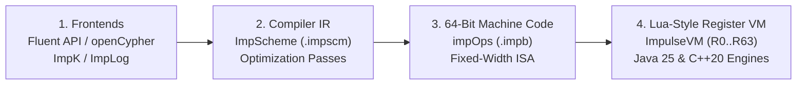

# Why Impulse Graph? The Story & Architecture

> **"How fast can you traverse a graph?"**
>
> Turns out, really fast—if you throw away the requirements that slow you down.

---

## 1. Rethinking Joins, Pointer Chasing, and Immutability

Even in modern relational databases like SQL Server or graph databases like Neo4j, multi-hop joins and traversals have always felt like they were held back by something. Because those systems are built around **in-place mutability**, they are forced into B-trees, pointer-linked heap objects, or row-oriented `(source, target)` join tables (**Coordinate List / COO**). Every hop pays a heavy tax in pointer chasing, lock acquisition, dynamic memory allocations, and garbage collection (GC) pauses.

What happens if you throw all of those requirements away and make the graph **strictly immutable and read-only**?

Committing to immutability unlocks compact, hardware-native data representations beyond simple `(source, target)` edge tables. Digging into high-performance computing and sparse linear algebra research papers led to **Compressed Sparse Row (CSR)** and **Compressed Sparse Column (CSC)** matrices—where every outgoing and incoming neighbor of a vertex sits side-by-side in contiguous CPU cache lines.

When the first in-memory CSR proof-of-concept ran—with no mutability, no locks, no heap allocations, and no GC pauses—the traversal numbers came back so fast we didn't believe them at first and had to triple-check that the code was actually doing the work. That PoC became **Impulse Graph Engine**.

---

## 2. The Fear of Reinventing the Wheel—and Finding a Real Open-Source Gap

Once the in-memory CSR/CSC proof-of-concept proved how fast read-only traversal could be, the next requirement was an **on-disk binary format**:

1. It needed to represent **rich, strongly-typed labeled property networks** (multiple node domains, directed relations, and typed attributes on both nodes and edges).
2. Every internal data structure needed **strict hardware memory alignment (128-byte boundaries)** so an application could simply **`mmap` the file and start querying immediately** ("mmap and go") with zero deserialization or heap loading.

Throughout the early design, there was a nagging fear of reinventing the wheel—surely an existing open-source format already solved this? Yet evaluating existing standards revealed a genuine gap in the open-source ecosystem:

| Format | On-Disk File Container? | Memory-Aligned ("Mmap & Go")? | Multi-Domain CSR/CSC Graph Topologies? | Why It Didn't Fit |
| :--- | :---: | :---: | :---: | :--- |
| **Apache Parquet** | Yes | **No** | No | Column pages are compressed/encoded on disk and **not memory-aligned**; requires decoding and materializing into RAM before traversal. |
| **Apache Arrow (IPC)** | Stream / RecordBatches | **Yes** | No | Memory-aligned for zero-copy access, but designed for flat/nested tabular data—lacks native multi-domain CSR/CSC adjacency directories, key catalogs, and single-file graph indexing. |
| **Graph Databases (Neo4j, etc.)** | Proprietary Store Files | **No** | No | Record-oriented mutable page stores linked by pointers; requires heavy server processes, page caches, and lock managers. |
| **Impulse Snapshot (`.imps`)** | **Yes** | **Yes (128-Byte Aligned)** | **Yes (CSR, CSC, COO + SoA)** | Purpose-built to fill the open-source gap: a single immutable file you `mmap` and traverse immediately in Pure Java 25 or C++20. |

---

## 3. Enterprise Java First, Zero Inherited CVEs, and the Pull of Python

The original motivation for Impulse Graph was **Enterprise Java applications**. We wanted an expressive **Fluent API** for Java that ran in-process without an external database server—and we wanted the core engine to be **100% dependency-free**, so enterprise teams would never have to deal with **inherited CVEs** from transitive third-party libraries.

Yet as soon as the `.imps` binary format took shape, it was hard not to think about **Python** as a target for data analysis, scientific computing, PyTorch, and math/graph libraries.

Supporting both a 100% pure Java engine and a native C/C++ engine (for Python and polyglot SDKs) presented an architectural fork in the road: writing and maintaining separate high-level query evaluators in each language would inevitably lead to behavioral drift and duplicated bugs. Counterintuitively, **for a polyglot system, it was much simpler to add a layer of architectural structure**:

Splitting the query stack into a **Frontend**, an **Intermediate Representation (`ImpScheme`)**, **64-bit VM machine code (`impOps`)**, and a **Virtual Machine (`ImpulseVM`)** reduced cross-language compatibility to a single, strictly testable contract: *given the same `.imps` file and the same 64-bit `impOps` instructions, every engine must produce the exact same register values.*

### "Isn't Java Inherently Slower Than C++?" — Memory Bandwidth, JFR, and the JSON Bottleneck

A common assumption in systems engineering is that Java is inherently `10x–50x` slower than C++, or that any fast Java library must secretly wrap C++ via JNI.

Historically, Java graph libraries *were* slow—not because of the JVM's JIT compiler, but because idiomatic Java modeled graphs as millions of heap-allocated `Node`, `Edge`, and `HashMap` objects. Every hop incurred a 64-byte cache-line miss, object header overhead, and eventual Stop-The-World GC pauses.

Impulse Graph's **Pure Java 25 Engine (`impulse-graph-java`)** eliminates those bottlenecks by operating over off-heap `MemorySegment` arenas, `jdk.incubator.vector` SIMD intrinsics, and `MethodHandle` combinator JIT chains. Once both C++20 and Java 25 are scanning the exact same 128-byte-aligned CSR/CSC arrays off-heap:

1. **Memory Bandwidth Dominates Query Speed**: Graph traversal over contiguous integer arrays has low arithmetic intensity; execution time is dominated by **DRAM memory bandwidth and L1/L2/L3 cache-line transfers**, which are identical in C++ and Java.
2. **The Honest `1.5x–2.0x` (`1.65x`) C++ Edge**: On a full-graph BFS across the **1.47-billion-edge `twitter-2010` snapshot** (10 threads), the Native C++20 kernel executes in **`145.00 ms`** (`91.8x` faster than 1-thread GAPBS C++) while the warmed Pure Java 25 engine executes in **`240.29 ms`** (`55.4x` faster than 1-thread GAPBS C++)—a **`1.65x` ratio**, with **zero heap allocations** inside the traversal loop (confirmed via **JFR allocation profiling**). C++ retains that `1.65x` edge because raw pointers avoid Java's `MemorySegment` bounds checks (~1 cycle/read), JVM loop back-edge safepoint polls, and `ForkJoinPool` task dispatch overhead.
3. **In Enterprise Services, JSON Serialization Is Slower Than the Graph Query**: When we profiled enterprise ReBAC authorization and navigation queries with **Java Flight Recorder (JFR)** and benchmarked 100,000 requests against Jackson (`ObjectMapper`), we found that **formatting the output as JSON took `3.46x` to `73.4x` more CPU time than the Impulse Graph query took to compute the answer**:

| Operation (100,000-Request Benchmark) | Avg Latency | Relative CPU Cost vs. Graph Query (`large`) |
| :--- | :---: | :--- |
| **Impulse Java 25 Multi-Hop Query (`small` profile)** | **`0.026 µs` (`26 ns`)** | `0.047x` (`73.4x` faster than JSON stream) |
| **Impulse Java 25 Multi-Hop Query (`medium` profile)** | **`0.088 µs` (`88 ns`)** | `0.159x` (`21.7x` faster than JSON stream) |
| **Impulse Java 25 Multi-Hop Query (`large`, 600k users)** | **`0.552 µs` (`552 ns`)** | **`1.00x` Baseline** |
| **Jackson Streaming JSON Serialization (`/dev/null`)** | **`1.908 µs` (`1,908 ns`)** | **`3.46x` slower than the graph query** |
| **Jackson JSON String + UTF-8 Byte Array Output** | **`2.558 µs` (`2,558 ns`)** | **`4.63x` slower than the graph query** |

For enterprise JVM workloads (Spring Boot, gRPC/REST microservices, Kafka processors), the Pure Java 25 engine is wholly suitable: when marshaling the HTTP/JSON response takes several times longer than traversing the graph, you get near-C++ memory-bandwidth speed without native `.so`/`.dll` deployment friction or inherited CVEs.

---

## 4. How We Knew the Architecture Was on the Right Track

The best litmus test for any systems abstraction is whether extending it feels like fighting the design or simply snapping pieces together. Once the `.imps` binary layout and the `ImpScheme` $\to$ `impOps` VM pipeline were in place, capabilities that would normally be major standalone projects simply fell out of the existing primitives:

* **Datalog (`ImpLog`)**: Recursive rules and transitive reachability turned out to be just a thin frontend parser compiling down to the exact same fixed-point bitset and CSR walk loops the VM already executed.
* **GraphBLAS Matrix Math (`ImpK`)**: Because CSR and CSC *are* sparse matrices, semiring matrix-vector (`OP_MXV`) and element-wise operations mapped 1:1 onto the existing topology arrays.
* **A Read-Only Subset of openCypher**: Supporting parameterized `MATCH ... WHERE ... RETURN` queries (with practical caveats around read-only semantics) wasn't much harder—just another frontend targeting the same IR, with zero changes to the execution engines.
* **Thin, Idiomatic Wrappers for Every Ecosystem**: On the native side, exposing a clean **C-ABI (`impulse_graph.h`)** meant supporting **Python, Node.js, C# / .NET, Go, Rust, and C++** took only a thin layer of idiomatic FFI glue. Likewise, on the JVM side, **Java 25, Kotlin, and Scala 3** share the pure Java engine directly—thin, idiomatic wrappers for everyone.
* **A Stable, Extensible On-Disk Format**: Meanwhile, the `.imps` section-directory and shared-string layout absorbed multi-domain schemas, node/edge attributes, and secondary indices without needing structural rewrites.

---

## 5. Standing on the Shoulders of SQLite and the Lua VM

Two classic open-source projects served as primary inspirations for Impulse Graph's execution engine and engineering culture:

### SQLite: Architectural Model & Quality North Star
* **VM-Based Query Engine**: Just as SQLite compiles SQL statements into bytecode for its Virtual Database Engine (VDBE), Impulse Graph compiles graph traversals, Datalog rules, and matrix operations into `impOps` bytecode executed by `ImpulseVM`.
* **Embedded Single-File & C-ABI Ergonomics**: Like SQLite, Impulse Graph operates over a single self-contained file (`.imps`) with zero external dependencies and a clean `prepare` / `bind` / `execute` / `finalize` C-ABI lifecycle (`impulse_stmt_prepare`, `impulse_stmt_bind_*`, `impulse_stmt_execute`), where exact query buffer memory (`impulse_stmt_buffer_size`) is known at prepare time and passed in by the caller.
* **The Gold Standard of Software Quality**: With its exhaustive boundary tests, anomaly injection, and **MC/DC (Modified Condition/Decision Coverage)** discipline, SQLite is the undisputed gold standard of reliable software. While we would never claim to be anywhere near the legendary quality and maturity SQLite has earned over decades, **SQLite is our aspirational north star** for what this project could become—directly inspiring our spec-first assembly test vectors, 100% opcode coverage CI gates, and [Four-Way Polyglot Validation Suite](../contributing/polyglot-validation.md).

### Lua 5+ & LuaJIT: Register-Based VM Mechanics
While SQLite inspired the VM-based database architecture, **Lua 5+ and LuaJIT** inspired the internal mechanics of `ImpulseVM` itself:
* **64-Register Architecture (`R0`..`R63`) Instead of a Stack**: Traditional stack VMs spend up to 40–50% of their instructions executing `PUSH`, `POP`, and `DUP`. Like Lua, `ImpulseVM` encodes source and destination register indices directly inside a fixed 64-bit instruction word (`OP_CSR_WALK R5, R4, REL_0`), keeping all execution state inside a single **640-byte, L1-cache-aligned register frame (`impulse_vm_state_t`)**.

---

## Next Steps

* **[Data-Oriented Design](data-oriented-design.md)**: Dive into the six hardware-level transformations (Dense IDs, CSR/CSC cache locality, SoA SIMD columns, Bitset frontiers, pre-allocated zero-allocation query buffers, and Java 25 `MethodHandle` JIT fusion).
* **[Binary Snapshots (`.imps`)](snapshots.md)**: Explore the 5-section physical file layout and Blue/Green snapshot rotation.
