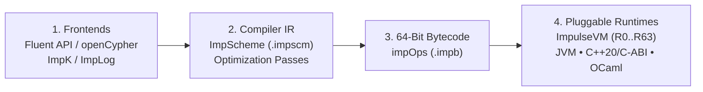

# Why Impulse Graph? The Story & Architecture

> **"How fast can you traverse a graph?"**
>
> Turns out, very fast—once you drop in-place mutability, locking, and per-hop heap allocations.

---

## 1. Rethinking Joins, Pointer Chasing, and Immutability

Relational databases and mutable graph databases rely on B-trees, heap-linked `Node` objects, or row-oriented `(source, target)` edge tables (COO) to support in-place writes. Every hop pays for pointer chasing, lock acquisition, and heap allocation.

Making the graph **immutable and read-only** unlocks **Compressed Sparse Row (CSR)** and **Compressed Sparse Column (CSC)** adjacency layouts, where a node's neighbors sit contiguously in CPU cache lines. An early in-memory CSR prototype—without locks or dynamic allocations—was fast enough to justify building a reusable format and bytecode specification around it.

---

## 2. Filling a Real Open-Source Format Gap

To persist multi-domain property graphs without paying a load/deserialization tax, the on-disk format needed:
1. Multiple typed node domains, directed relations, and node/edge attribute columns.
2. Hardware-aligned sections (128-byte boundaries) so applications can `mmap` the file and query immediately.

Existing formats did not quite fit:

| Format | Single On-Disk File? | Memory-Aligned (`mmap`)? | Multi-Domain CSR/CSC? | Trade-off |
| :--- | :---: | :---: | :---: | :--- |
| **Apache Parquet** | Yes | No | No | Compressed columnar pages require decoding into RAM before traversal. |
| **Apache Arrow (IPC)** | Stream / Batches | Yes | No | Built for tabular data; lacks multi-domain CSR/CSC directories and graph key catalogs. |
| **Mutable Graph DBs (Neo4j, etc.)** | Store Files | No | No | Pointer-linked mutable record stores requiring a server process, page cache, and locks. |
| **Impulse Snapshot (`.imps`)** | **Yes** | **Yes** | **Yes** | Single immutable file mapped directly into virtual memory by any compliant runtime. |

---

## 3. Enterprise Java First, Zero Dependencies, and Pluggable Runtimes

Impulse Graph started for **Enterprise Java** services that needed an in-process graph API without running an external database or pulling in third-party runtime dependencies (and their CVEs) or JNI `.so`/`.dylib` binaries. Supporting **Python** (NumPy, SciPy, PyTorch) and systems languages alongside pure Java meant multiple execution runtimes had to evaluate the same graphs identically.

Rather than duplicating high-level query evaluators in each language, the architecture separates the **portable data and bytecode contract** (`.imps` + `impOps`) from **pluggable execution runtimes** across four layers:

Cross-language compatibility reduces to one testable contract: given the same `.imps` file and `impOps` bytecode, every runtime—currently the **Pure JVM Engine** (`impulse-graph-java`), the **Native C++20 / C-ABI Engine** (`impulse-graph-core`), and the **OCaml Reference Oracle** (`impulse-ocaml`), with a clean specification boundary for future pure managed `.NET` or `WebAssembly` targets—produces bitwise-identical register values and status flags.

### "Isn't Java Inherently Slower Than C++?"

Java graph libraries were historically slow because they allocated millions of `Node`, `Edge`, and `HashMap` objects on the heap, triggering cache misses and GC pauses. Once `impulse-graph-java` scans the same off-heap CSR/CSC arrays via FFM `MemorySegment`, the Vector API, and `MethodHandle` JIT chains:

1. **Memory Bandwidth Dominates**: Traversal over contiguous integer arrays has low arithmetic intensity, so DRAM bandwidth and cache-line transfers dominate in both C++ and Java.
2. **The `1.65x` C++ Edge**: On a 10-thread full-graph BFS over the 1.47-billion-edge `twitter-2010` snapshot, C++20 finishes in **`145.00 ms`** and warmed Java 25 in **`240.29 ms`** (`1.65x`, confirmed allocation-free via JFR). The delta comes from `MemorySegment` bounds checks, JVM safepoint polls, and `ForkJoinPool` vs. OpenMP scheduling.
3. **JSON Serialization Costs More Than the Query**: On a 600k-user enterprise directory ReBAC benchmark (100,000 multi-hop permission checks), JFR profiling shows traversal takes **`0.026 µs – 0.552 µs`**, while serializing the response with Jackson takes **`1.908 µs – 2.558 µs` (`3.46x–73.4x` slower)**:

| Operation (100,000-Request Benchmark) | Avg Latency | Relative CPU Cost vs. `large` Query |
| :--- | :---: | :--- |
| **Impulse Java 25 Query (`small`, ~1.8k users)** | **`0.026 µs`** | `0.047x` |
| **Impulse Java 25 Query (`medium`, ~48k users)** | **`0.088 µs`** | `0.159x` |
| **Impulse Java 25 Query (`large`, 600k users)** | **`0.552 µs`** | `1.00x` Baseline |
| **Jackson Streaming JSON (`/dev/null`)** | **`1.908 µs`** | **`3.46x` slower** |
| **Jackson JSON String + UTF-8 Bytes** | **`2.558 µs`** | **`4.63x` slower** |

*(600k refers to the user corpus size in the directory snapshot, not concurrent network clients.)*

---

## 4. Extensibility Without Rewriting the Core

Once the `.imps` layout and `ImpScheme` → `impOps` pipeline existed, additional capabilities mapped cleanly onto the same primitives:

* **Datalog (`ImpLog`)**: Compiles recursive rules down to the VM's fixed-point bitset and CSR walk loops.
* **GraphBLAS (`ImpK`)**: Maps sparse matrix-vector ops (`OP_MXV`) directly onto CSR/CSC arrays.
* **Read-Only openCypher**: Compiles parameterized `MATCH ... WHERE ... RETURN` queries into the same IR.
* **Language Ecosystems**: One C-ABI (`impulse_graph.h`) powers Python, Rust, Go, .NET (P/Invoke), Node.js, and C++; one pure JVM core powers Java, Kotlin, Scala 3, and Clojure—and new standalone runtimes only need to implement the 64-register `ImpulseVM` specification.
* **Multi-Lane Bit-Sliced Execution (`v0.10.0`, `0xC0`..`0xC9`)**: Generalizes 1-bit frontiers to 8/16/32/64-bit `TYPE_LANE_FRONTIER` buffers for batched seeds and $N-1$ contingency walks without altering the 640-byte VM frame.
* **Embedded Vamana ANN (`v0.10.0`, `0x08`, `0xCA`..`0xCB`)**: Adds a Section 2.6 Vamana index with `BQ1`/`SQ8`/`FP16` routing codes and two VM opcodes (`OP_VECTOR_ANN_SEARCH`, `OP_VECTOR_RERANK_DOT`) for hybrid graph-vector search.

---

## 5. Design Inspirations: SQLite and Lua

* **SQLite**: Inspired the single-file embedded model, bytecode VM pipeline, `prepare` / `bind` / `execute` / `finalize` C-ABI lifecycle (with caller-allocated buffers sized via `impulse_stmt_buffer_size`), and test-first rigor (spec assembly vectors, 100% opcode coverage, and [Polyglot Validation](../contributing/polyglot-validation.md)).
* **Lua 5+ / LuaJIT**: Inspired the 64-register VM (`R0`..`R63`) with fixed 64-bit instructions (`OP_CSR_WALK R5, R4, REL_0`), avoiding stack `PUSH`/`POP` traffic and keeping execution state inside a 640-byte register frame (`impulse_vm_state_t`).

---

## Next Steps

* **[Data-Oriented Design](data-oriented-design.md)**: Dense IDs, CSR/CSC locality, SoA columns, bitset frontiers, and `MethodHandle` JIT fusion.
* **[Binary Snapshots (`.imps`)](snapshots.md)**: Physical layout, `.imps.schema.yaml` contracts, and Blue/Green snapshot rotation.
