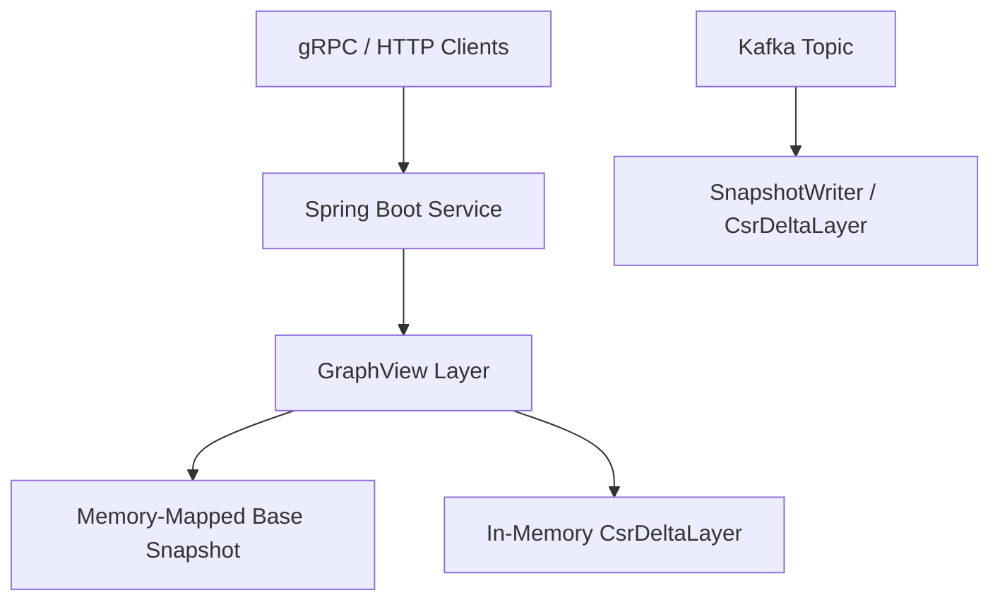

# Archetype 1: Long-Lived Dynamic Service

The **Long-Lived Dynamic Service** archetype is designed for environments where graph data is constantly changing (e.g., streaming in via Kafka), and you need to serve low-latency queries concurrently without interruption. This is typically built using Java 25 or Kotlin alongside a framework like Spring Boot or gRPC.

## Architecture Overview

In this archetype, the Impulse Graph Engine acts as an embedded database within your application server. The engine combines:
1. An **immutable base snapshot** memory-mapped from disk.
2. A **live delta overlay** (`CsrDeltaLayer`) residing in memory that absorbs incoming writes.



## Atomic Snapshot Swap

Because memory-mapping large files (TB scale) can take a non-trivial amount of time, you cannot simply block queries while loading a new base snapshot. Impulse Graph uses an **A/B atomic reference swap** to manage background compaction and rotation.

1. **Background Compaction**: A background thread (or separate `impulse-platform` process) periodically merges the base snapshot with the current delta layer and writes a new `.imps` snapshot file to disk.
2. **Atomic Swap**: The application maps the new snapshot in the background. Once loaded, it atomically swaps the `GraphView` reference (`VarHandle`) to point to the new snapshot, simultaneously resetting the in-memory delta.
3. **Zero Downtime**: Queries already in flight complete against the old memory-mapped region. Once all old queries finish, the old region is unmapped.

=== "Java"
    ```java
    ImpulseGraph liveGraph = ImpulseGraph.open(baseSnapshotPath);

    // In background compaction thread:
    Snapshot newSnapshot = loadNewSnapshotInBackground();
    liveGraph.swapAtomic(newSnapshot);
    ```

## Live Delta Overlay

The `CsrDeltaLayer` tracks:
- **Additions**: New nodes or edges appended since the last snapshot.
- **Tombstones**: Deletions recorded as sparse bitsets (e.g., `RoaringBitmap`).

When queries traverse the graph via `GraphView.of(liveGraph)`, the engine automatically routes memory reads, masking out tombstones and injecting new edges seamlessly into the result sets.

## Resource Pool Adaptation

As graph sizes grow over time, internal buffer sizes (like the `QueryContext` scratch pads) need to adjust dynamically. Impulse provides pool adaptation to resize allocation pools without restarting the service.

```java
liveGraph.pool().adaptTo(newCapacityLimits);
```
