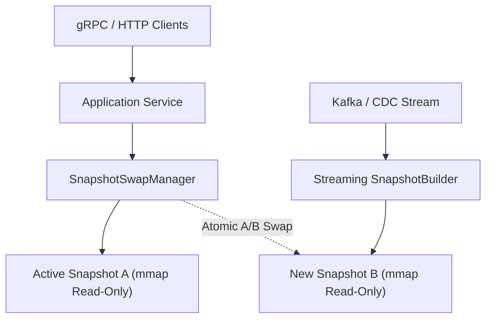

# Archetype 1: Long-Lived Dynamic Service

The **Long-Lived Dynamic Service** archetype is designed for environments where upstream data changes over time and you need to serve sub-microsecond, read-only graph queries concurrently without interruption.

> [!TIP]
> **The Near-Real-Time (< 5 Min) & Blob Storage Sweet Spot**
> Because an `.imps` file is essentially a collection of flat, contiguous arrays, most reasonably sized graphs can be rebuilt from scratch in just a few seconds. Periodically building a fresh `.imps` file, pushing it to **Blob Storage (S3/GCS)**, and performing an atomic Blue/Green swap across stateless pods is the sweet spot for near-real-time graph services. See **[Changing Data & Live Updates: "Wait—My Data Isn't Read-Only!"](../getting-started/handling-mutations.md)** for the full breakdown.

## Architecture Overview

To guarantee 100% lock-free, SIMD-accelerated traversal speed, Impulse Graph never mutates an active graph in place. Instead, it separates **read-only query execution** from **out-of-band snapshot compilation**:

1. **Active Read-Only Snapshot (`Snapshot A`)**: Memory-mapped (`mmap`) into the service with zero locks and zero GC overhead.
2. **Out-of-Band Streaming Compiler**: Consumes upstream CDC events and streams a new immutable `.imps` snapshot (`Snapshot B`) direct to disk or object storage.
3. **Atomic A/B Pointer Swap (`SnapshotSwapManager`)**: Atomically redirects new queries to `Snapshot B` once ready, draining in-flight queries on `Snapshot A` before unmapping.



## Atomic A/B Snapshot Swap

Because memory-mapping large `.imps` files is an $O(1)$ OS operation, rotating to a fresh snapshot never blocks active reader threads:

1. **Out-of-Band Build**: A background worker or `impulse-platform` pipeline writes a new `.imps` snapshot file (`Snapshot B`) to disk.
2. **Atomic Reference Swap**: The application memory-maps `Snapshot B` and calls `swapManager.swap(newSnapshot)`, atomically updating the active reference.
3. **Zero Downtime & Lock-Free Draining**: Queries already in flight complete against `Snapshot A`. Once the last reader releases its reference, `Snapshot A`'s `Arena` is closed and unmapped.

=== "Java 25"
    ```java
    SnapshotSwapManager<GraphSnapshot> swapManager = new SnapshotSwapManager<>(initialSnapshot);

    // Reader thread: zero-lock acquisition
    try (var holder = swapManager.acquireCurrent()) {
        GraphSnapshot active = holder.getResource();
        // Execute read-only traversal...
    }

    // Background updater thread: atomic A/B pointer swap
    swapManager.swap(newlyLoadedSnapshot);
    ```
