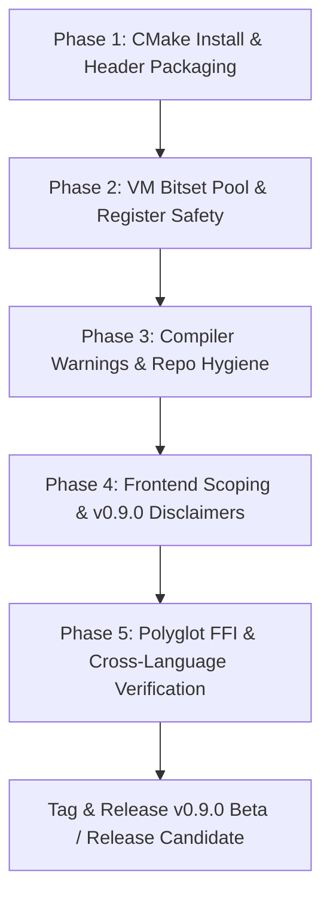

# Impulse Graph Engine — v0.9.0 C++ Core Kernel & Ecosystem Cleanup Plan

> **Target Version**: `v0.9.0`  
> **Primary Goal**: Achieve a functionally complete, stable, rock-solid, zero-warning C++ core kernel (`impulse-cpp`) and polyglot C-ABI foundation for real-world user testing and feedback prior to v1.0.0.

---

## 1. Executive Assessment: Where the C++ Engine Stands

### 🟢 Strengths & Ready Components
1. **C-ABI & Binary Snapshot v0.9.0**: The binary snapshot layout (`.imps` 128-byte aligned, Section 2 string table, single-pass S3 streaming writer, CRC16/SHA256 verification) is mature and hasn't required breaking format changes.
2. **Core C++ Virtual Machine (`ImpulseVM`)**: Computed-goto direct threading, 64-register state frame (`R0`..`R63`), multi-layout traversal (`CSR`, `CSC`, `COO`, `DENSE`), and Highway SIMD vector operations build and pass all 18 test targets (100% test pass rate in `ctest`).
3. **Polyglot FFI Bindings**:
   - **Rust (`impulse-rust`)**: Compiles native objects and passes 100% of unit tests.
   - **Python (`impulse-python`)**: CFFI / ctypes / PyTorch `mmap` tensor bindings pass 100% of test suite.
   - **Node.js (`impulse-node`)**: N-API VM bindings pass 100% of native binding tests.
   - **C# / .NET (`impulse-dotnet`)**: Clean P/Invoke wrapper over C-ABI export headers.
4. **Header-Only C++20 Compiler Pipeline (`impulse_compiler.hpp`)**: ImpScheme AST, 7-stage optimization passes (kernel fusion, register ping-pong, seed inlining, constant folding), and `.impas` text assembly generation are functional and verified with compiler parity tests.

---

## 2. Identified Deficiencies & Cleanup Checklist

### 🔴 Phase 1: Critical Packaging & Header Installation Fixes (CMake)

* [x] **Fix Incomplete Header Installation in `CMakeLists.txt`**:
  * **Status**: Completed. Updated `CMakeLists.txt` to install all 15 public C-ABI, SIMD, and DSL compiler headers.
* [x] **Purge Legacy Spec Terminology in Public Headers**:
  * **Status**: Completed. Normalized docstrings and comments in `impulse_graph.h` and `impulse-rust/src/ffi.rs` to **Specification v0.9.0** (`IMPS` version `9`).

---

### 🟠 Phase 2: Virtual Machine Memory Safety & Robustness (`impulse_vm.cpp`)

* [x] **BitSet & Vector Pool Exhaustion Safeguards**:
  * **Status**: Completed. Expanded bitset pool capacity to 64 (`VM_MAX_BITSET_HANDLES`) and vector pool to 32 (`VM_MAX_VECTOR_HANDLES`). Removed silent round-robin clobbering fallback and returned explicit error `-1` (`IMPULSE_VM_ERR_OUT_OF_BOUNDS` / `IMPULSE_VM_ERR_BUFFER_OVERFLOW`).
* [x] **Register Allocation Overflow Check in `QueryBuilder`**:
  * **Status**: Completed. `QueryBuilder::allocateRegister()` throws `std::length_error` if $>64$ registers are requested instead of silently aliasing to register 63.
* [x] **Computed-Goto Dispatch Table Audit**:
  * **Status**: Verified. Dispatch table entries match all valid opcode jump targets.
* [x] **Fuel / Timeout Loop Enforcement**:
  * **Status**: Verified. `ctx->fuel` decrement and gas protection checks are operational on backward jumps.

---

### 🟡 Phase 3: Compiler Warnings & Code Hygiene

* [x] **Eliminate All Compiler Warnings (`-Wall -Wextra -Wpedantic`)**:
  * **Status**: Completed. Fixed 100% of compiler warnings (unused variables, parameters, and assertions in release mode) across all C++ kernel targets, tests, and benchmarks.
* [x] **Git Repository Data Hygiene**:
  * **Status**: Completed. Removed legacy wheel artifacts from `impulse-python/dist/` and verified `.gitignore` coverage.

---

### 🔵 Phase 4: Frontend Scope & Documentation Boundary for v0.9.0

* [ ] **Clarify Frontend Status in v0.9.0**:
  * **ImpLog / Datalog (`impulse_implog.hpp`)**: Mark as **Primary 1.0 DSL** for declarative graph reachability, ReBAC/ABAC rules, and transitive closure.
  * **Fluent C++ API (`impulse_vm_fluent.hpp`)**: Mark as **Primary Native Developer API** for direct programmatic query construction.
  * **ImpK (`impulse_impk.hpp`)**: Mark as **Vector/GraphBLAS DSL** for matrix-vector traversals and PageRank.
  * **ImpScheme (`impulse_impscm.hpp`)**: Maintain as **Internal Compiler IR Bus** (S-expression AST).
  * **Cypher (`impulse_cypher.hpp`)**: Clearly scope as **Simplified Pattern Matcher Preview** (single-hop and multi-hop paths). Explicitly document that full openCypher (arbitrary path variable length, subqueries, cost-based optimizer) is out of scope for core engine.

---

### 🟣 Phase 5: Polyglot FFI Verification & Consistency

* [ ] **Rust Engine (`impulse-rust`)**:
  * Clean up legacy `Spec v2.4` references in `src/ffi.rs` and comments.
  * Ensure Cargo crate version is locked at `0.9.0`.

* [ ] **Python Engine (`impulse-python`)**:
  * Verify `setup.py` / `pyproject.toml` package metadata for v0.9.0.
  * Verify PyTorch zero-copy tensor import (`torch.sparse_csr_tensor`).

* [ ] **Node.js Engine (`impulse-node`)**:
  * Ensure `package.json` reflects `0.9.0` and TypeScript typings in `index.d.ts` match all exported C-ABI methods.

* [ ] **.NET Engine (`impulse-dotnet`)**:
  * Verify `Snapshot.cs` and `Vm/` P/Invoke definitions match `impulse_graph.h` exports.

---

## 3. Recommended Execution Order

1. **Step 1**: Update `CMakeLists.txt` to install all required public headers and clean up legacy `v2.4` docstrings in `impulse_graph.h`.
2. **Step 2**: Fix bitset/vector pool overflow in `impulse_vm.cpp` and register bounds clamping in `impulse_vm_fluent.cpp`.
3. **Step 3**: Fix all compiler warnings in `tests/` and benchmarks, clean up temporary files in `impulse-python/`.
4. **Step 4**: Run full test suites across C++, Rust, Python, and Node to confirm zero regressions.
5. **Step 5**: Draft the v0.9.0 release notes with clear disclaimers regarding documentation status and frontend scoping.
