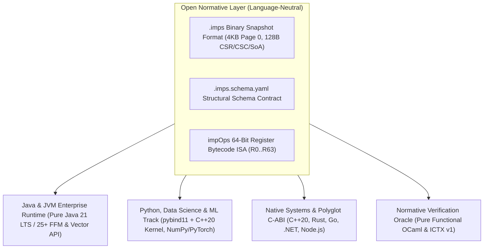

# Ecosystems, Runtimes & Developer Hubs

**Impulse Graph Engine** separates graph storage, schema contracts, and execution semantics from any single host programming language. Rather than wrapping one monolithic server or forcing every ecosystem through a foreign-function bottleneck, Impulse pairs an **open specification layer** with **pluggable, idiomatic execution runtimes**.

---

## Shared Architectural Foundation

Every runtime track in the ecosystem operates directly against three identical, versioned artifacts:

1. **[Impulse Binary Snapshot (`.imps`)](../reference/spec/format-specification.md)**: An immutable, 4KB-page-aligned and 128-byte-section-aligned file containing per-domain catalogs, CSR/CSC adjacency arrays, Structure-of-Arrays (SoA) node and edge columns, optional Section 2.6 Vamana ANN indices, and a trailing SHA-256 checksum. Any `.imps` file built in Python, Rust, or C++ mounts without conversion in pure Java—and vice versa.
2. **[Declarative Schema Contract (`.imps.schema.yaml`)](../reference/spec/schema-specification.md)**: Defines disjoint node domains ($0 \dots N_d - 1$), primary key types, typed relations, traversal directions (`[out, in]`), and nullable/optional evolution rules enforced both at build time and prior to live snapshot swaps.
3. **[`impOps` Bytecode ISA & Multi-Frontend Compiler](../reference/spec/vm-specification.md)**: Queries written in `openCypher`, `ImpK`, `ImpLog`, `CEL`, or fluent language SDKs lower through the homoiconic `ImpScheme` (`.impscm`) IR into packed 64-bit `impOps` (`.impb`) register instructions.

---

## Runtime & Ecosystem Track Matrix

Choose the developer hub matching your primary deployment environment and toolchain:

| Ecosystem Track | Execution Engine & Memory Model | Build & CLI Tooling | Primary Workloads | Developer Hub |
| :--- | :--- | :--- | :--- | :--- |
| **1. Java & JVM Enterprise** | **100% Pure Java 21 LTS / 25+** (`java.lang.foreign` FFM + `jdk.incubator.vector`). Zero JNI, zero `.so`/`.dylib` native libraries, zero third-party runtime dependencies in core modules. | `impulse-bom`, `impulse-maven-plugin` (7 Mojos), `impulse-codegen` AOT builders, pure-Java `impulse-j` CLI, Kotlin / Scala 3 / Clojure DSLs. | Spring Boot / Quarkus / gRPC services, ReBAC authorization, AML screening, Kubernetes zero-downtime hot-swap (`SnapshotLifecycleManager`). | **[Java & JVM Hub](java/index.md)** |
| **2. Python, Data Science & ML** | Pre-built **`pybind11` wheels** (`pip install impulse-graph`) embedding the C++20 SIMD kernel (`libimpulse_graph_static`). | `impulse build` Parquet/CSV compiler, zero-copy `memoryview` / NumPy / SciPy CSR / PyTorch tensor views. | Graph analytics notebooks, disk-backed GNN neighbor sampling over multi-hundred-GB graphs, GraphRAG & Vamana ANN vector retrieval. | **[Python & ML Hub](python/index.md)** |
| **3. Native Systems & Polyglot C-ABI** | Zero-dependency **C++20 / Highway SIMD kernel** (`libimpulse_graph`), self-contained **Rust** crate, Go (CGo), .NET 8+ (P/Invoke), Node.js (N-API). | Native **`impulse-graph` (`impulse`) CLI** with Parquet ingestion, RCM / Vamana-locality reordering, and Ed25519 signing. | Embedded systems, Rust services, high-density C++ engines, power-grid contingency simulation, CI data pipelines. | **[Native & C-ABI Hub](native/index.md)** |
| **4. Normative Verification Oracle** | Pure functional **OCaml** reference interpreter (`impulse-ocaml`) computing canonical `ICTX` v1 state hashes. | Four-Way Polyglot Validation Suite (`four_way_validation.py`) & differential contract fuzzer. | Formal ISA semantics, cross-engine bitwise parity verification across C++ (`-O3` / `-O0`), Java 25, and OCaml. | **[Polyglot Validation](../contributing/polyglot-validation.md)** |

---

## Cross-Ecosystem Interoperability in Practice

Because `.imps` snapshots and `.imps.schema.yaml` contracts are strictly host-independent, production teams routinely mix tracks across their data and serving tiers:

* **Python / Native Data Plane → Pure Java Serving Plane**: An Airflow, Spark, or dbt job compiles Parquet exports from Snowflake/BigQuery into an RCM-reordered `.imps` file using the native `impulse build` CLI (see [Snapshots from Parquet & CSV](python/snapshots-from-parquet-csv.md)) and uploads it to S3 or GCS. Stateless Java 25 microservices poll the bucket via `SnapshotLifecycleManager`, validate structural compatibility against their compiled `.imps.schema.yaml` contract, and atomically swap epochs with zero JNI dependencies in the serving container.
* **Java JDBC Ingestion → Python ML Training**: A Java batch job streams relational tables via `SnapshotBuilder` or `CsvManifestSnapshotBuilder` (see [Building Snapshots in Java](java/building-snapshots.md)), producing an `.imps` artifact that data scientists immediately memory-map in Python for PyTorch Geometric training or hybrid vector/graph retrieval (see [AI & GraphRAG Overview](../ai/index.md)).

---

## Extensibility to Future Runtime Tracks

Decoupling the binary data layout (`.imps`) and instruction set (`impOps`) from any single language runtime makes the architecture cleanly extensible to new execution environments without changing existing data pipelines, schemas, or queries:

* **Pure Managed `.NET` Runtime Track**: A pure C# implementation built on `System.IO.MemoryMappedFiles.MemoryMappedFile`, `Span<T>`, and `System.Runtime.Intrinsics.Vector512` can mount `.imps` files directly without P/Invoke native binaries.
* **WebAssembly (`wasm32` SIMD128) Edge & Browser Track**: A compact `wasm32` `ImpulseVM` runtime using 128-bit WebAssembly SIMD instructions can execute `.impb` programs directly over range-fetched or OPFS-mounted `.imps` snapshots inside Cloudflare Workers or browser tabs.

Any new runtime implementation achieves full ecosystem compatibility by passing the normative **531-vector `ImpulseVM` compliance suite** (`impulse-graph-spec/test-vectors/`) and matching the OCaml oracle's `ICTX` v1 register, flag, and status hashes bit-for-bit.

---

## Where to Go Next

* **Evaluating architectural fit?** Read **[Embedded Snapshot Engine vs. Graph Databases](../getting-started/embedded-vs-graph-db.md)** and **[Changing Data & Live Updates](../getting-started/handling-mutations.md)**.
* **Building on the JVM?** Enter the **[Java & JVM Enterprise Hub](java/index.md)**.
* **Working with Parquet, Pandas, or PyTorch?** Enter the **[Python, Data Science & ML Hub](python/index.md)**.
* **Integrating C++20, Rust, Go, or the native CLI?** Enter the **[Native Systems & C-ABI Hub](native/index.md)**.
* **Looking for Maven Central, PyPI, or crates.io coordinates?** See **[Packages & Distribution](../reference/packages.md)**.
