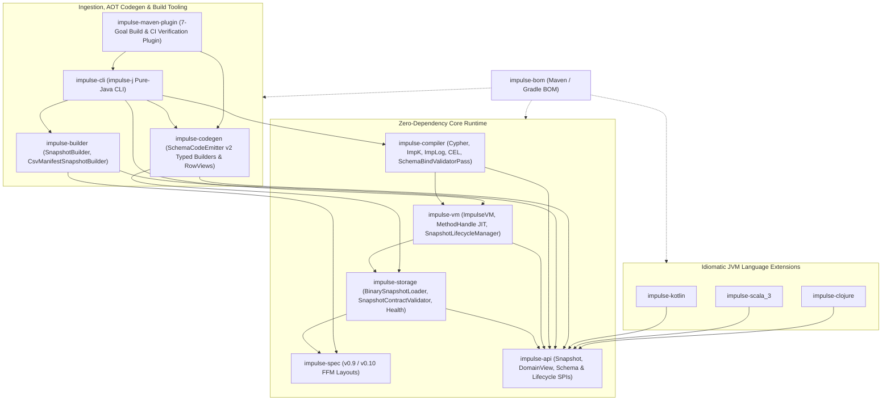

# Java & JVM Enterprise Hub

`impulse-graph-java` (`org.impulsegraph`) is a **100% pure Java** implementation of the Impulse Graph Engine, `ImpulseVM`, multi-frontend query compiler, and streaming snapshot builder targeting **Java 21 LTS** and **Java 22+ / Java 25 LTS**.

It mounts `.imps` binary snapshots directly off-heap using the JDK Foreign Function & Memory (FFM) API (`java.lang.foreign.MemorySegment`, `Arena`) and executes vectorized CSR/CSC walks and attribute filters via the JDK Vector API (`jdk.incubator.vector`) and `MethodHandle` C2 JIT combinators.

---

## Why Pure Java FFM (Zero JNI)?

Enterprise JVM teams traditionally face an architectural tradeoff when embedding high-throughput engines such as RocksDB or DuckDB: JNI wrappers bundle platform-specific `.so` / `.dylib` / `.dll` binaries (`glibc` vs. `musl`, `x86_64` vs. `aarch64`), opaque native C++ allocators invisible to JFR, and native library CVE surface area.

`impulse-graph-java` eliminates JNI completely:

* **Zero Native Binaries**: Pure `.jar` artifacts run identically on Linux (`glibc` and `musl`/Alpine), macOS (`arm64`/`x86_64`), and Windows without native shared libraries.
* **Zero Third-Party Runtime Dependencies**: Core runtime modules (`impulse-spec`, `impulse-api`, `impulse-storage`, `impulse-vm`, `impulse-compiler`, `impulse-builder`) depend strictly on `java.*` and `jdk.incubator.vector`—zero Jackson, Guava, Netty, or Protobuf version conflicts on your application classpath.
* **Empirical C++ Parity & Zero-Allocation Hot Path**: Because CSR/CSC traversals over 128-byte-aligned segments are memory-bandwidth bound, warmed-up Java 25 executes within **`1.65x`** of the 10-thread C++20 kernel on the 1.47B-edge `twitter-2010` BFS benchmark (`240.29 ms` Java vs. `145.00 ms` C++) with `0.00 ms` GC pauses.
* **Sub-Microsecond Service Latency**: On a 600,000-user enterprise ReBAC directory benchmark, JFR profiling records **`0.026 µs – 0.552 µs`** per multi-hop authorization check—`3.5x` to `73x` less CPU time than Jackson JSON response serialization (`1.91 µs – 2.56 µs`). See [Benchmarks](../../benchmarks.md) and [JVM Ecosystem Comparison](../../benchmarks/jvm-ecosystem-comparison.md).

---

## Module Architecture & Bill of Materials (`impulse-bom`)

!!! info "Version Note: v0.11 Tooling Suite"
    Core runtime and JVM language artifacts (`impulse-spec`, `impulse-api`, `impulse-storage`, `impulse-vm`, `impulse-compiler`, `impulse-builder`, `impulse-kotlin`, `impulse-scala_3`, `impulse-clojure`) are published on Maven Central at **`0.10.1`**.
    The enterprise developer tooling suite—**`impulse-bom`**, **`impulse-codegen` v2**, **`impulse-maven-plugin`** (7-Mojo lifecycle suite), **`impulse-cli`** (`impulse-j`), **`SchemaYamlCodec`**, and **`SnapshotLifecycleManager`**—ships in **`0.11.0`** (`v0.11`).



| Artifact (`org.impulsegraph`) | Scope | Third-Party Runtime Deps | Purpose |
| :--- | :--- | :--- | :--- |
| **`impulse-bom`** *(v0.11)* | `import` | None | Aligns versions across all `org.impulsegraph` modules. |
| **`impulse-api`** | `compile` | **Zero** | Public interfaces (`ImpulseGraphSnapshot`, `DomainView`, `Traversal`, `ImpulseStatement`, `SchemaYamlCodec`, `SnapshotResolver`). |
| **`impulse-spec`** | `runtime` | **Zero** | Binary Snapshot Format FFM memory layouts and constants. |
| **`impulse-storage`** | `compile` / `runtime` | **Zero** | `BinarySnapshotLoader`, `SnapshotSwapManager`, `SnapshotContractValidator`, `SnapshotSchemaExtractor`, `ImpulseHealthIndicator`. |
| **`impulse-vm`** | `runtime` | **Zero** | `ImpulseVmInterpreter`, `ImpulseMethodHandleCompiler`, multi-lane handlers, and `SnapshotLifecycleManager`. |
| **`impulse-compiler`** | `runtime` | **Zero** | `openCypher`, `ImpK`, `ImpLog`, `ImpScheme`, and `CEL` compilers, optimizer passes, and `QueryRegistry`. |
| **`impulse-builder`** | `compile` (ETL / tests) | **Zero** | Off-heap streaming `SnapshotBuilder` and `CsvManifestSnapshotBuilder`. |
| **`impulse-codegen`** *(v0.11)* | Build-time | **Zero** | Emits zero-dependency schema-typed Java wrappers, traversals, CEL metamodels, and flyweight `RowView` cursors. |
| **`impulse-cli`** *(v0.11)* | CLI / CI | `info.picocli:picocli` | Pure-Java `impulse-j` CLI jar and launcher script. |
| **`impulse-maven-plugin`** *(v0.11)* | Maven `<plugin>` | Maven Plugin API | AOT codegen (`generate`), query validation (`aot-compile`), test fixture builds, and compatibility gates. |
| **`impulse-kotlin`** / **`impulse-scala_3`** / **`impulse-clojure`** | `compile` | Language stdlib | Idiomatic Kotlin Coroutines, Scala 3 context functions/opaque types, and Clojure homoiconic macros. |

---

## JDK 21 LTS vs. JDK 22+ / JDK 25 LTS Flag Matrix

Impulse Graph relies on two modern JDK subsystems:

1. **Foreign Function & Memory API (`java.lang.foreign.Arena`, `MemorySegment`)**: Finalized as a standard API in **JDK 22 (JEP 454)**. In **JDK 21 LTS**, FFM is a preview API (JEP 442) and therefore requires `--enable-preview`. Calling `FileChannel.map` / restricted FFM operations requires `--enable-native-access=ALL-UNNAMED` at runtime.
2. **Vector API (`jdk.incubator.vector`)**: Remains an incubator module across JDK 21–25 and requires `--add-modules jdk.incubator.vector` at both compile time and runtime.

| Target JDK | `javac` Compiler Flags | `java` Runtime / Test Runner Flags | Notes |
| :--- | :--- | :--- | :--- |
| **JDK 21 LTS** | `--release 21 --enable-preview --add-modules jdk.incubator.vector` | `--enable-preview --add-modules jdk.incubator.vector --enable-native-access=ALL-UNNAMED` | FFM (`Arena` / `MemorySegment`) is a preview API in JDK 21 (JEP 442). |
| **JDK 22 – 24** | `--release 22 --add-modules jdk.incubator.vector` | `--add-modules jdk.incubator.vector --enable-native-access=ALL-UNNAMED` | **No `--enable-preview` required**—FFM was finalized in JEP 454. |
| **JDK 25 LTS (Recommended)** | `--release 25 --add-modules jdk.incubator.vector` | `--add-modules jdk.incubator.vector --enable-native-access=ALL-UNNAMED` | Supports Project Leyden AOT Class/Method Caching (`-XX:AOTCache=impulse.aotcache`) for `< 10 ms` cold start. |

!!! tip "Compiler vs. Runtime Flag Distinction"
    `--enable-native-access=ALL-UNNAMED` is strictly a **`java` JVM runtime flag**—do not pass it to `javac`, which rejects unknown launcher flags. Conversely, `--add-modules jdk.incubator.vector` is required by both `javac` (when compiling code referencing vector types) and `java`.

---

## Copy-Paste Build, IDE & Container Setup

=== "Maven (`pom.xml`)"

    ```xml
    <properties>
        <!-- Use 0.10.1 on Maven Central today, or 0.11.0 for the v0.11 BOM + AOT suite -->
        <impulse.version>0.11.0</impulse.version>
    </properties>

    <dependencyManagement>
        <dependencies>
            <dependency>
                <groupId>org.impulsegraph</groupId>
                <artifactId>impulse-bom</artifactId>
                <version>${impulse.version}</version>
                <type>pom</type>
                <scope>import</scope>
            </dependency>
        </dependencies>
    </dependencyManagement>

    <dependencies>
        <dependency>
            <groupId>org.impulsegraph</groupId>
            <artifactId>impulse-api</artifactId>
        </dependency>
        <dependency>
            <groupId>org.impulsegraph</groupId>
            <artifactId>impulse-storage</artifactId>
        </dependency>
        <dependency>
            <groupId>org.impulsegraph</groupId>
            <artifactId>impulse-vm</artifactId>
        </dependency>
        <dependency>
            <groupId>org.impulsegraph</groupId>
            <artifactId>impulse-compiler</artifactId>
        </dependency>
    </dependencies>

    <build>
        <plugins>
            <plugin>
                <groupId>org.apache.maven.plugins</groupId>
                <artifactId>maven-compiler-plugin</artifactId>
                <version>3.13.0</version>
                <configuration>
                    <!-- On JDK 21 LTS: set <release>21</release> and add <arg>--enable-preview</arg> -->
                    <release>25</release>
                    <compilerArgs>
                        <arg>--add-modules</arg>
                        <arg>jdk.incubator.vector</arg>
                    </compilerArgs>
                </configuration>
            </plugin>

            <plugin>
                <groupId>org.apache.maven.plugins</groupId>
                <artifactId>maven-surefire-plugin</artifactId>
                <version>3.5.2</version>
                <configuration>
                    <!-- Add --enable-preview when running on JDK 21 LTS -->
                    <argLine>@{argLine} --add-modules jdk.incubator.vector --enable-native-access=ALL-UNNAMED</argLine>
                </configuration>
            </plugin>

            <plugin>
                <groupId>org.apache.maven.plugins</groupId>
                <artifactId>maven-failsafe-plugin</artifactId>
                <version>3.5.2</version>
                <configuration>
                    <argLine>@{argLine} --add-modules jdk.incubator.vector --enable-native-access=ALL-UNNAMED</argLine>
                </configuration>
            </plugin>
        </plugins>
    </build>
    ```

=== "Gradle Kotlin DSL (`build.gradle.kts`)"

    ```kotlin
    plugins {
        java
        application
    }

    val impulseVersion = "0.11.0" // or "0.10.1" on Maven Central today

    java {
        toolchain {
            languageVersion.set(JavaLanguageVersion.of(25)) // or 21 for JDK 21 LTS
        }
    }

    dependencies {
        implementation(platform("org.impulsegraph:impulse-bom:$impulseVersion"))
        implementation("org.impulsegraph:impulse-api")
        implementation("org.impulsegraph:impulse-storage")
        implementation("org.impulsegraph:impulse-vm")
        implementation("org.impulsegraph:impulse-compiler")
    }

    val isJdk21 = java.toolchain.languageVersion.get().asInt() == 21

    tasks.withType<JavaCompile>().configureEach {
        options.compilerArgs.addAll(
            buildList {
                if (isJdk21) add("--enable-preview")
                add("--add-modules")
                add("jdk.incubator.vector")
            }
        )
    }

    tasks.withType<Test>().configureEach {
        useJUnitPlatform()
        jvmArgs(
            buildList {
                if (isJdk21) add("--enable-preview")
                add("--add-modules=jdk.incubator.vector")
                add("--enable-native-access=ALL-UNNAMED")
            }
        )
    }

    tasks.withType<JavaExec>().configureEach {
        jvmArgs(
            buildList {
                if (isJdk21) add("--enable-preview")
                add("--add-modules=jdk.incubator.vector")
                add("--enable-native-access=ALL-UNNAMED")
            }
        )
    }
    ```

=== "IntelliJ IDEA"

    When importing a Maven or Gradle project configured as above, IntelliJ IDEA automatically picks up compiler arguments from `maven-compiler-plugin` / `JavaCompile`. If running `main()` classes or JUnit tests directly via the IntelliJ runner rather than delegated Maven/Gradle execution:

    1. **Compiler Settings** (*Settings → Build, Execution, Deployment → Compiler → Java Compiler*):
       Under **Override compiler parameters per-module** (or **Additional command line parameters**), ensure:
       ```text
       --add-modules jdk.incubator.vector
       ```
       *(Add `--enable-preview` if Project SDK is JDK 21).*
    2. **Run / Debug & JUnit Template VM Options** (*Run → Edit Configurations → Edit configuration templates... → JUnit / Application → Modify options → Add VM options*):
       ```text
       --add-modules jdk.incubator.vector --enable-native-access=ALL-UNNAMED
       ```
       *(Add `--enable-preview` if running on JDK 21).*

=== "Production Container (`Dockerfile`)"

    Keep `-Xmx` lean (`2g–4g`) so container memory stays available to the Linux page cache backing read-only `mmap` `.imps` snapshots (see [Kubernetes Memory Sizing](kubernetes-and-lifecycle.md#4-kubernetes-memory-sizing-avoiding-the-cgroups-v2-mmap-oomkilled-trap)):

    ```dockerfile
    FROM eclipse-temurin:25-jre-noble

    WORKDIR /app
    COPY target/my-graph-service.jar /app/app.jar

    # Generational ZGC + Vector API + FFM native access + lean heap
    ENV JAVA_TOOL_OPTIONS="--add-modules jdk.incubator.vector \
      --enable-native-access=ALL-UNNAMED \
      -Xms2g -Xmx4g \
      -XX:+UseZGC -XX:+ZGenerational"

    ENTRYPOINT ["java", "-jar", "/app/app.jar"]
    ```

    **Optional JDK 25 Project Leyden AOT Warmup (`< 10 ms` Cold Start)**:
    ```bash
    # Step 1 (CI / Docker build): Record AOT class & method profile
    java -XX:AOTMode=record -XX:AOTConfiguration=impulse.aotconf -jar /app/app.jar --warmup-exit
    java -XX:AOTMode=create -XX:AOTConfiguration=impulse.aotconf -XX:AOTCache=impulse.aotcache -jar /app/app.jar

    # Step 2 (Production entrypoint): Mount pre-compiled AOT cache
    java -XX:AOTCache=impulse.aotcache -jar /app/app.jar
    ```

---

## Day-1 to Day-2 Developer Guide Map

Follow this sequence to go from raw relational/CSV data to a zero-downtime Kubernetes service:

| Stage | Guide | What You Will Build |
| :--- | :--- | :--- |
| **1. Data Ingestion** | **[Building Snapshots in Java](building-snapshots.md)** | Stream PostgreSQL/JDBC result sets via `SnapshotBuilder` or compile CSV/TSV/JSONL manifests in pure Java via `CsvManifestSnapshotBuilder`. |
| **2. Type-Safe APIs** | **[Schema-First Development & AOT Codegen](aot-codegen.md)** | Author `.imps.schema.yaml` contracts (or extract them from `.imps` files) and generate domain-distinct `<Domain>Id` records, typed `<Domain>Traversal` builders, CEL metamodels, and zero-allocation `<Domain>RowView` cursors. |
| **3. Build & CI Gates** | **[Maven Plugin & Build-Time AOT Pipeline](maven-and-build-tooling.md)** | Wire all 7 `impulse-maven-plugin` goals (`generate`, `generate-test`, `aot-compile`, `build-snapshot`, `extract-schema`, `validate`, `check-compat`) into `mvn verify`. |
| **4. CLI & Inspection** | **[Pure-Java CLI (`impulse-j`)](cli-impulse-j.md)** | Run `build`, `inspect`, `validate`, `stats`, `schema check-compat`, `codegen`, `compile`, `explain`, and `run` on any JVM without native binaries. |
| **5. Production Ops** | **[Kubernetes, Hot-Swap Lifecycle & Schema Evolution](kubernetes-and-lifecycle.md)** | Configure `SnapshotLifecycleManager`, K8s startup/readiness/liveness probes, rolling `Expand -> Migrate -> Contract` schema evolution, and `cgroups v2` memory limits. |
| **6. Polyglot JVM & Core SDK** | **[Kotlin, Scala 3, Clojure & Java API](jvm-languages.md)** · **[Java SDK Reference](../../reference/java-api.md)** | Combine AOT-generated classes with Kotlin Coroutines, Scala 3 context functions, Clojure S-expressions, and low-level `ImpulseVM` APIs. |
