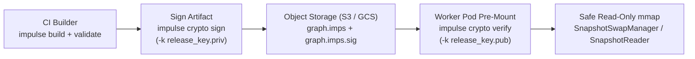

# Native CLI Optimization, Deep Audits & Supply-Chain Signing

The native `impulse-graph` (`impulse`) binary in `impulse-graph-core/impulse-cli` combines dataset compilation (`impulse build`) with offline physical layout optimization, multi-tier structural auditing, and Ed25519 cryptographic attestation for production CI/CD pipelines.

!!! info "Full Command Syntax & Pure-JVM Alternative"
    * For the complete subcommand tree and flag list, see the **[CLI Reference (`impulse`)](../../reference/cli.md)**.
    * Working inside a strict JVM-only container where native binaries are prohibited? Use the **[Pure-Java CLI (`impulse-j`)](../java/cli-impulse-j.md)** instead.

---

## 1. Physical Graph Layout Optimization (`impulse snapshot optimize`)

When `impulse build` compiles raw CSV or Parquet files, dense node IDs (`0 .. N_d - 1`) initially follow the encounter order of rows in the input files. On sparse real-world graphs, arbitrary node numbering scatters adjacent neighbors across distant memory pages, causing L2/L3 cache-line misses and TLB thrashing during multi-hop traversals or GNN message passing.

`impulse snapshot optimize` computes a deterministic bijection $\pi: [0, N_d) \to [0, N_d)$ per domain, rewrites CSR/CSC indices, reorders all node/edge SoA attribute columns and key catalogs in lockstep, and permutes embedded Section 2.6 Vamana indices:

| Flag | Reordering Strategy | Best For | Mechanism |
| :--- | :--- | :--- | :--- |
| **`--rcm`** | **Reverse Cuthill-McKee** | Multi-hop BFS, Connected Components, PageRank, GNN SpMM | Minimizes matrix bandwidth $\max_{(u,v) \in E} |\pi(u) - \pi(v)|$ so neighbors of $u$ cluster within the same 64-byte CPU cache lines. |
| **`--vamana-locality`** | **Vamana Medoid BFS** | Hybrid Vector ANN (`OP_VECTOR_ANN_SEARCH` `0xCA`) | Orders domain nodes by BFS hop distance from `VamanaHeader.medoid_node_id`, co-locating early beam-search hops in memory and remapping the Vamana graph in $O(N \cdot R + N \cdot D)$ time. |
| **`--degree-sort`** | **Out-Degree Descending** | Power-law hub filtering & triangle counting (`OP_TC_SWEEP_BATCH`) | Assigns dense IDs `0, 1, 2, ...` to the highest-degree hub nodes so hot adjacency lists stay pinned in L1/L2 cache. |
| **`--csc`** | **Reverse CSC Materialization** | Bidirectional traversals (`.in(...)`, `<-[]-` in openCypher) | Transposes forward CSR into 128-byte-aligned Compressed Sparse Column arrays for $O(1)$ incoming offset lookups. |
| **`--encoding <ENC>`** | **Target Column Layout** | GPU SpMM (`sliced_ellpack`) or compact storage | Re-encodes target columns (`raw_uint32`, `sliced_ellpack`, `delta_vbyte`, `simdcomp`). |
| **`--strip-mappings`**<br>**`--strip-properties`** | **Section Stripping** | Edge-embedded / IoT topology-only deployments | Removes string key catalogs or DTO attribute blocks when queries operate purely on dense IDs. |

```bash
# 1. Optimize a general traversal / GNN snapshot with RCM bandwidth reduction + reverse CSC
impulse snapshot optimize \
  -i raw_graph.imps \
  -o optimized_graph.imps \
  --rcm \
  --csc

# 2. Optimize a vector-indexed snapshot with Vamana medoid BFS locality
#    (use --rebuild-vector-index only if you want a fresh alpha-RNG build instead of O(N*R) permutation)
impulse snapshot optimize \
  -i raw_vec.imps \
  -o optimized_vec.imps \
  --vamana-locality \
  --csc
```

!!! note "Schema Evolution Safety Under Node Reordering"
    Because dense node IDs (`0 .. N_d - 1`) are internal per-snapshot coordinates resolved from business keys (`fromKey` / `resolve_dense_id`) at query time, applying `--rcm`, `--vamana-locality`, or `--degree-sort` requires **zero changes** to application query code. Never hardcode or persist dense IDs across snapshot rebuilds.

---

## 2. Tiered Integrity Verification & Supernode Diagnostics

Before mapping an `.imps` file into a production service—or after generating one in an ETL job—`impulse snapshot validate`, `inspect`, and `stats` provide three verification tiers modeled on SQLite's `PRAGMA quick_check` and `integrity_check`:

### 2.1 Validation Tiers (`impulse snapshot validate`)

| Command Flag | Complexity | What It Verifies | Recommended Stage |
| :--- | :---: | :--- | :--- |
| **`--quick-check`** | $O(\text{domains} + \text{relations})$ | Page 0 magic (`IMPS`), CRC-16-CCITT header checksum, section bounds against file length, 128-byte alignment, and CSR endpoint bounds. | **Pod Startup / Pre-`mmap` Gate** (sub-millisecond sanity check before swapping a downloaded S3 artifact). |
| **`--strict-alignment`** *(default)* | $O(\text{file bytes})$ | Everything in `--quick-check` plus full-payload SHA-256 cryptographic digest verification and strict 128-byte hardware offset checks across every CSR, CSC, SoA, and Section 2.6 slab. | **CI / ETL Post-Build Step** immediately after `impulse build` or `impulse snapshot optimize`. |
| **`--deep-audit`** | $O(V + E + N \cdot R)$ | Full structural cross-check: monotonic CSR/CSC `row_offsets`, in-bounds target IDs (`< N_tgt`), exact multiset transpose equality between CSR and CSC edges, and Vamana `adj_slab` degree/medoid/padding invariants. | **Offline Release Gate / Compiler Regression Testing** before publishing golden datasets. |

```bash
# Fast pre-mount check during container init
impulse snapshot validate production.imps --quick-check

# Standard post-build SHA-256 + 128-byte hardware alignment check
impulse snapshot validate production.imps --strict-alignment

# Exhaustive CSR/CSC multiset transpose + Vamana proximity graph audit
impulse snapshot validate production.imps --strict-alignment --deep-audit
```

### 2.2 Physical Page-Map Inspection & Supernode Detection

Skewed power-law graphs often contain extreme hub nodes ("supernodes") that dominate frontier expansion or cause false-positive collisions in multi-hop paths. Use `impulse snapshot stats` and `inspect` to profile topology skew and physical page alignment:

```bash
# 1. Compute min/max/mean/p99 out-degrees, multiplicity, CBO sketches,
#    and flag supernodes exceeding Z-score >= 3.0 (supports --format json)
impulse snapshot stats production.imps --supernode-threshold 3.0 --verbose

# 2. Dump 4KB page / 128B cache-line physical section offsets and padding bytes
impulse snapshot inspect production.imps --page-map

# 3. Emit machine-readable catalog metadata for CI scripts or AI coding agents
impulse snapshot inspect production.imps --format json
```

---

## 3. Ed25519 Cryptographic Snapshot Attestation (`impulse crypto`)

Because `.imps` files are memory-mapped directly into process address space across stateless worker pods or edge nodes, zero-trust deployments should verify artifact authenticity before calling `mmap`.

`impulse crypto` implements detached **Ed25519** digital signatures (`.imps.sig`) over the snapshot header digest (which binds the payload SHA-256 checksum):



```bash
# 1. Generate an Ed25519 keypair once in your secure key management environment
#    Writes release_key.priv (keep secret in CI KMS) and release_key.pub (distribute to readers)
impulse crypto keygen -o release_key

# 2. Sign the compiled snapshot in CI/CD (produces production.imps.sig)
impulse crypto sign production.imps -k release_key.priv

# 3. Verify signature + header integrity on the target host BEFORE opening via mmap
impulse crypto verify production.imps -k release_key.pub

# Or combine Ed25519 signature verification with 128B alignment & SHA-256 validation in one step:
impulse snapshot validate production.imps \
  --strict-alignment \
  --public-key release_key.pub
```

---

## Next Steps

* **[Native Systems & Polyglot C-ABI Hub](index.md)** — C-ABI prepared statements and Rust/Go/.NET/Node.js SDK idioms.
* **[CLI Reference (`impulse`)](../../reference/cli.md)** — Full command hierarchy including `impulse compiler`, `impulse run --verify --never-corrupt`, and `impulse bench-vector`.
* **[Pure-Java CLI (`impulse-j`)](../java/cli-impulse-j.md)** — Schema compatibility checks (`check-compat`) and snapshot inspection in JVM-only environments.
* **[Snapshots from Parquet & CSV](../python/snapshots-from-parquet-csv.md)** — Authoring `manifest.json` files for `impulse build`.
