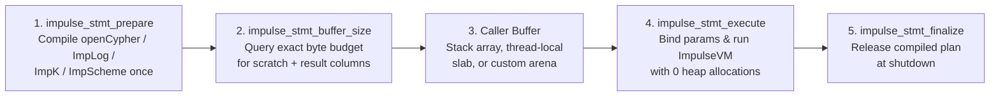

# Native Systems & Polyglot C-ABI Hub

The **Impulse Graph Engine C-ABI Kernel** (`impulse-graph-core/impulse-cpp`) is a zero-dependency C++20 runtime (`libimpulse_graph_static.a` / `impulse_graph_static.lib`) providing direct `mmap` `.imps` loading, dynamic SIMD target dispatch (`AVX-512`, `AVX2`, `ARM-NEON`, `WASM-SIMD128`), OpenMP intra-opcode parallelism, and a deterministic zero-`malloc` prepared-statement execution model for **C, C++20, Rust, Go, .NET 8+, and Node.js**.

---

## 1. Guide & Reference Map

| Guide / Reference | Target Audience |
| :--- | :--- |
| **[Native CLI Optimization, Deep Audits & Signing](cli-reference.md)** | Offline `--rcm` / `--vamana-locality` layout optimization, `--quick-check` vs. `--deep-audit` validation, and Ed25519 snapshot signing. |
| **[C-ABI & C++20 Reference](../../reference/c-abi.md)** | `impulse_graph.h`, `impulse_vm.h`, `impulse_index.h`, and C++20 `SnapshotView` / `MultiLaneBuilder` (`impulse_vm_fluent.hpp`). |
| **[Rust Crate Reference](../../reference/rust-api.md)** | `impulse-graph` crate (`SnapshotReader`, `Traversal`, `SnapshotWriter`, and `vamana` Section 2.6 ANN module). |
| **[Go, .NET & Node.js SDKs](../../reference/polyglot-sdks.md)** | Idiomatic bindings via Go `CGo`, .NET 8+ `P/Invoke`, and Node.js/Bun/TypeScript `N-API`. |
| **[CLI Reference (`impulse`)](../../reference/cli.md)** · **[Packages & Distribution](../../reference/packages.md)** | Complete command tree, static linking (`glibc` / `musl` / MSVC `/MT`), and SLSA Level 3 build attestations. |

---

## 2. Core C-ABI Architectural Contract

All native bindings link statically against `libimpulse_graph_static.a` and share three low-level invariants:

### 2.1 Zero External Dependencies & Dynamic SIMD Dispatch

* **Zero Runtime Dependencies**: `impulse-cpp` and `impulse-rust` depend only on the platform C/C++ standard library (`glibc >= 2.28` or static `musl-libc` on Linux, `libSystem.B.dylib` / `libc++.dylib` on macOS 11+, static `LIBCMT.lib` via `/MT` on Windows).
* **Sub-40-Microsecond `mmap` Cold Start**: `impulse_snapshot_open` maps the 6.04 GB `twitter-2010.imps` snapshot (`1.47B` edges, `41.65M` nodes) in `0.038 ms` (`38 µs`) via read-only OS `mmap` and executes a 10-thread full-graph direction-optimizing BFS in `145.00 ms` (see [Benchmarks](../../benchmarks.md)).
* **Hardware-Aligned Buffers**: Every CSR/CSC offset array, Structure-of-Arrays (SoA) column, validity bitmap, and Section 2.6 index slab is aligned to **128-byte file boundaries** for unaligned-penalty-free SIMD vector loads (`impulse_simd.h` / Highway) and GPU `cuFile` transfers.

### 2.2 Caller-Allocated Zero-`malloc` Prepared Statements (`impulse_vm.h`)

Inspired by SQLite's `sqlite3_stmt` lifecycle—extended with caller-owned scratch memory—`impulse_vm.h` separates query compilation from execution so the hot path performs **zero internal `malloc` or `free` calls**:



```c
#include "impulse_graph.h"
#include "impulse_vm.h"
#include <stdint.h>
#include <vector>

int run_prepared_query(const impulse_snapshot_t* snap, uint64_t seed_user_id) {
    impulse_stmt_t* stmt = nullptr;
    impulse_status_t st = impulse_stmt_prepare(
        snap,
        "MATCH (u:User)-[:OWNS]->(a:Account) WHERE u.id = $uid RETURN a",
        &stmt
    );
    if (st != IMPULSE_OK || !stmt) return -1;

    // Allocate exact workspace once per thread (or on stack/arena) and reuse across requests
    std::vector<uint8_t> workspace(impulse_stmt_buffer_size(stmt));

    impulse_stmt_bind_node(stmt, "$uid", seed_user_id);
    st = impulse_stmt_execute(stmt, workspace.data(), workspace.size());

    size_t word_count = impulse_stmt_row_count(stmt);
    const auto* bitset_words = static_cast<const uint64_t*>(impulse_stmt_column_data(stmt, 0));
    (void)word_count;
    (void)bitset_words;

    impulse_stmt_finalize(stmt);
    return (st == IMPULSE_OK) ? 0 : -1;
}
```

---

## 3. Language SDK Quick-Reference Idioms

In empirical benchmarks on the Hetionet biomedical graph (`47K` nodes, `2.25M` edges, 4-hop traversal returning `1,317` candidate compounds), thin FFI wrappers add single-digit microseconds over raw C++20:

| SDK | Binding Mechanism | 4-Hop Mean Latency | Overhead vs. C++20 | Full Reference |
| :--- | :--- | :---: | :---: | :--- |
| **C / C++20** (`impulse-cpp`) | Direct C-ABI / Header-only C++20 | `18.4 µs` | `0.0 µs` (Baseline) | [C-ABI & C++20 Reference](../../reference/c-abi.md) |
| **Rust** (`impulse-rust`) | Safe Rust + `ffi` crate (`0.10`) | `19.1 µs` | `+0.7 µs` | [Rust Crate Reference](../../reference/rust-api.md) |
| **Go** (`impulse-go`) | Static `CGo` (`libimpulse_graph_static.a`) | `21.5 µs` | `+3.1 µs` | [Go SDK Reference](../../reference/polyglot-sdks.md#1-go-sdk-impulse-go-via-cgo) |
| **.NET 8+** (`impulse-dotnet`) | `LibraryImport` P/Invoke (`IDisposable`) | `23.0 µs` | `+4.6 µs` | [.NET 8+ SDK Reference](../../reference/polyglot-sdks.md#2-net-8-c-sdk-impulsegraph-via-pinvoke) |
| **Node.js / TS** (`impulse-node`) | `N-API` (`node-addon-api`) | `26.8 µs` | `+8.4 µs` | [Node.js SDK Reference](../../reference/polyglot-sdks.md#3-nodejs-bun-typescript-sdk-impulse-graph-via-n-api) |

=== "C++20 (`SnapshotView` & Multi-Lane)"

    ```cpp
    #include "impulse_graph.h"
    #include "impulse_vm_fluent.hpp"

    impulse_status_t st = IMPULSE_OK;
    impulse_snapshot_t* snap = impulse_snapshot_open("biomedical.imps", &st);

    impulse::vm::SnapshotView view(snap);

    // Bit-sliced multi-lane traversal across 8 oncology target genes (0xC0..0xC9)
    auto result = view.domain("Gene").multiLane()
        .fromKeys({"BRCA1", "BRCA2", "EGFR", "MYC", "KRAS", "PIK3CA", "BRAF", "ERBB2"})
        .out("INTERACTS_GiG")
        .in("BINDS_CbG")
        .whereQuorum(4)
        .collect();

    auto candidate_compounds = result.keysWithQuorum(4);
    impulse_snapshot_close(snap);
    ```

    Full API: **[C-ABI & C++20 Reference](../../reference/c-abi.md)**

=== "Rust (`cargo add impulse-graph`)"

    ```rust
    use impulse_graph::reader::SnapshotReader;

    fn main() -> Result<(), Box<dyn std::error::Error>> {
        let reader = SnapshotReader::open("rbac.imps")?;

        // Direct zero-copy CSR slices (&[u32]) from mmap
        let row_offsets: &[u32] = reader.get_row_offsets(0)?;
        let col_indices: &[u32] = reader.get_col_indices(0)?;
        assert_eq!(row_offsets.len(), (reader.relations()[0].node_count + 1) as usize);
        let _ = col_indices;

        // Fluent multi-hop topology traversal
        let permissions: Vec<u64> = reader
            .traverse(0)
            .out("MEMBER_OF")
            .in_step("MANAGES")
            .out("HAS_PERMISSION")
            .to_vec()?;

        println!("Permissions count: {}", permissions.len());
        Ok(())
    }
    ```

    Full API: **[Rust Crate Reference](../../reference/rust-api.md)**

=== "Go (`CGo`)"

    ```go
    snap, err := impulse.OpenSnapshot("rbac.imps")
    if err != nil {
        log.Fatal(err)
    }
    defer snap.Close()

    ctx, _ := impulse.NewVMContext(snap)
    defer ctx.Close()
    state := impulse.NewVMState()
    state.SetQueryContext(ctx)

    code := impulse.NewQueryBuilder().
        InputNode(0).
        WalkEdge(0, 1).
        WalkEdge(1, 2).
        CollectBitset(2).
        Compile()

    _ = impulse.ExecuteVM(code, state, 10)
    ```

    Full API: **[Go, .NET & Node.js SDKs](../../reference/polyglot-sdks.md#1-go-sdk-impulse-go-via-cgo)**

=== ".NET 8+ (`C#`)"

    ```csharp
    using ImpulseGraph;
    using ImpulseGraph.Vm;

    using var snap = new Snapshot("rbac.imps");
    using var ctx = new VmContext(snap);

    Query query = new QueryBuilder()
        .InputNode(0)
        .WalkEdge(relationId: 0, dstReg: 1)
        .WalkEdge(relationId: 1, dstReg: 2)
        .CollectBitset(reg: 2)
        .Compile();

    ExecutionResult res = snap.ExecuteQuery(query, ctx, inputParam: 42UL);
    ```

    Full API: **[Go, .NET & Node.js SDKs](../../reference/polyglot-sdks.md#2-net-8-c-sdk-impulsegraph-via-pinvoke)**

=== "Node.js / TypeScript (`N-API`)"

    ```typescript
    import { Snapshot, VmContext, VmState, QueryBuilder } from 'impulse-graph';

    const snap = new Snapshot('rbac.imps');
    const ctx = new VmContext(snap);
    try {
      const state = new VmState();
      const query = new QueryBuilder()
        .inputNode(0)
        .walkEdge(0)
        .repeatUntilStable((b) => b.walkEdge(1))
        .collectBitset()
        .compile();

      const res = query.executeWithContext(ctx, state, 42);
      console.log('Group 7 reachable:', res.testBitset(ctx, 7));
    } finally {
      ctx.destroy();
      snap.close();
    }
    ```

    Full API: **[Go, .NET & Node.js SDKs](../../reference/polyglot-sdks.md#3-nodejs-bun-typescript-sdk-impulse-graph-via-n-api)**

---

## 4. Specification Boundary & Cross-Runtime Bitwise Parity (`ICTX` v1)

Impulse Graph is defined by **two normative specifications** rather than a single codebase:

1. **Binary Snapshot Format Specification (`.imps`)**: Fixed 4KB Page 0 header, Section 2 catalog, 128-byte-aligned CSR/CSC/SoA arrays, and Section 2.6 secondary/Vamana indices ([Format Specification](../../reference/spec/format-specification.md)).
2. **`ImpulseVM` & `impOps` Bytecode Specification**: 64-register (`R0`..`R63`) virtual machine with 188 formal opcode contracts (`0x00`..`0xCB`) and the **`ICTX` v1 Deterministic State Hash** (`impulse_vm_state_hash_hex`, [VM Specification](../../reference/spec/vm-specification.md)).

Because the format and VM semantics are specified independently of C++, the **[Pure Java 25 Engine](../java/index.md)** (`impulse-graph-java`) mounts the exact same `.imps` files via `java.lang.foreign.MemorySegment` without JNI and passes the **[Four-Way Polyglot Validation Suite](../../contributing/polyglot-validation.md)** with 100% bitwise-identical `ICTX` v1 state hashes alongside C++ (`-O3`), C++ (`-O0`), and the OCaml formal oracle. The same clean specification boundary also enables future standalone runtimes such as `wasm32-unknown-unknown` (`WASM-SIMD128`) or pure managed `.NET` without breaking `.imps` or `.impb` compatibility.

---

## Next Steps

* **[Native CLI Optimization, Deep Audits & Signing](cli-reference.md)** — Optimize `.imps` layouts (`--rcm`, `--vamana-locality`), run `--deep-audit`, and sign snapshots with Ed25519.
* **[C-ABI & C++20 Reference](../../reference/c-abi.md)** — Header-by-header C-ABI signatures and C++20 `SnapshotView` / `MultiLaneTraversal` guide.
* **[Rust Crate Reference](../../reference/rust-api.md)** — Safe Rust reader, writer, and Vamana ANN search APIs.
* **[Polyglot Workflow](../../getting-started/polyglot-workflow.md)** — Build once in Python/CLI and mount across C++, Rust, Go, and Java.
