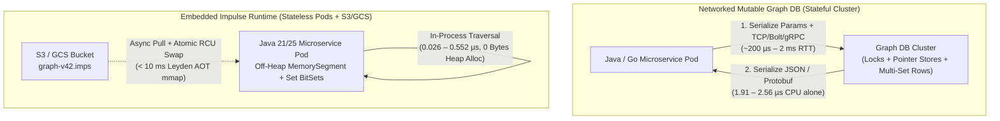

# Embedded `.imps` Runtime vs. Networked Graph Databases

Backend and JVM platform teams building **fine-grained authorization (ReBAC / Zanzibar)**, **payment fraud rings**, **bill-of-materials (BOM) dependency trees**, or **catalog hierarchies** commonly reach for a networked graph database (Neo4j, Amazon Neptune, OpenFGA, or RedisGraph)—only to discover two operational and latency bottlenecks:

1. **The Network & Serialization Tax Exceeds the Traversal**: Even when a remote graph server evaluates a 3-hop permission check quickly in its internal cache, your microservice still pays for connection-pool checkout, TCP/TLS/Bolt/gRPC framing, and JSON/Protobuf serialization on every request.
2. **Stateful Cluster Operations & Multi-Set Path Explosion**: Scaling read throughput requires operating a stateful distributed database cluster, tuning remote page caches, and guarding Cypher/Gremlin queries against exponential intermediate row explosion on dense hub nodes.

**Impulse Graph Engine** takes the SQLite / Apache Arrow approach instead: keep transactional OLTP writes in PostgreSQL or MySQL, compile read-optimized `.imps` snapshots on a periodic or near-real-time cadence, and **execute multi-hop traversals directly inside your stateless application pods via off-heap `mmap`**.

---

## 1. Request Path Comparison: Networked Graph DB vs. Embedded Impulse



### Empirical Evidence: JFR Profiling on a 600k-User Enterprise Directory

In a 100,000-request Java Flight Recorder (JFR) benchmark (`JsonVsCsrBenchmarkRunner`) over an enterprise ReBAC directory of 600,000 users, in-process Java 25 multi-hop CSR evaluation was measured directly against Jackson (`ObjectMapper`) JSON serialization to `/dev/null`—**before any socket or network hop** (see **[Benchmarks §3](../benchmarks.md#3-enterprise-service-reality-json-serialization-is-slower-than-the-graph-query)**):

| Operation (In-Process Java 25, Apple Silicon ARM64) | Mean Latency | Relative CPU Cost vs. `large` Traversal |
| :--- | :---: | :--- |
| **Impulse Java 25 Multi-Hop CSR Query (`small`, ~1.8k users)** | **`0.026 µs` (`26 ns`)** | `0.047x` (**`73.4x` faster than JSON stream**) |
| **Impulse Java 25 Multi-Hop CSR Query (`medium`, ~48k users)** | **`0.088 µs` (`88 ns`)** | `0.159x` (**`21.7x` faster than JSON stream**) |
| **Impulse Java 25 Multi-Hop CSR Query (`large`, 600k users)** | **`0.552 µs` (`552 ns`)** | **`1.00x` Baseline** |
| **Jackson Streaming JSON Serialization (`/dev/null`)** | **`1.908 µs` (`1,908 ns`)** | **`3.46x` more CPU than the graph query** |
| **Jackson JSON String + UTF-8 Byte Output (`/dev/null`)** | **`2.558 µs` (`2,558 ns`)** | **`4.63x` more CPU than the graph query** |

Even on the 6.04 GB, 1.47-billion-edge `twitter-2010.imps` graph, Pure Java 25 with JDK 25 Leyden AOT (`-XX:AOTCache`) maps the snapshot cold in **`9.748 ms`** (`14.557 ms` standard cold JVM) and executes targeted C2-warmed multi-hop BFS queries in **`4.13 µs`**—with **zero `java.lang.Object` allocations** in the hot loop and **zero JNI native libraries** in the container image.

---

## 2. Architectural Trade-Off Matrix

| Dimension | Networked Mutable Graph DB (Neo4j / Neptune / OpenFGA) | Embedded Impulse Graph (`.imps` + Pure Java / C-ABI) |
| :--- | :--- | :--- |
| **Write Freshness** | **Immediate (`< 10 ms` ACID read-your-own-writes)** | **Eventual / Micro-Batch (`5s – 5 min` rebuild + atomic swap)** |
| **Multi-Hop Read Latency** | `0.5 ms – 20+ ms` (network RTT + serialization + lock/cache overhead) | **`0.026 µs – 25 µs` in-process** (L1/L2/DRAM bandwidth speed) |
| **Intermediate Evaluation** | Multi-set path bags (vulnerable to hub-node path explosion) | **Set-reduced BitSets & monoids** (bounded memory known at `prepare` time) |
| **JVM GC & Heap Impact** | DTO deserialization & connection-pool buffers per request | **Zero hot-loop heap allocations** (`MemorySegment` off-heap `mmap`) |
| **Horizontal Scaling** | Stateful read replicas, cluster consensus, connection limits | **Stateless pods** pulling immutable `.imps` artifacts from S3/GCS |
| **Supply-Chain & CVE Surface** | Database driver + transitive networking/serialization dependencies | **Zero third-party runtime dependencies** in `impulse-core` / `impulse-vm` |
| **Point-in-Time Audit & Repro** | Requires backup restore or temporal audit tables | Every `.imps` generation is an immutable, SHA-256-checksummed artifact |

---

## 3. Recommended Production Pattern: Relational OLTP + Impulse Read Projection (CQRS)

Impulse Graph is **not** a replacement for your transactional system of record—it replaces the complex cache, recursive SQL CTE, or auxiliary graph cluster sitting beside it:

1. **System of Record (PostgreSQL / MySQL / CockroachDB)**: Handles point writes, ACID constraints, billing, and strict read-your-own-writes lookups on the mutating actor's immediate row.
2. **Periodic or CDC Snapshot Builder (`5s – 5 min`)**: Streams normalized tables or CDC compaction state through `SnapshotBuilder` (JDBC) or `impulse build` (Parquet) in $O(\text{chunk})$ RAM and uploads `authz-v104.imps` to S3/GCS.
3. **In-Process Stateless Service Pods**: Each Kubernetes pod polls S3/GCS, maps the new `.imps` file into a fresh Java `Arena` in milliseconds, atomically swaps the active pointer, and drains in-flight readers on the prior generation with zero locks:

```java
// Pure Java 21/25 in-process ReBAC check: zero network hop, zero JNI, zero hot-loop GC
boolean canAccess = snap.domain("User")
    .fromKey(request.userId())
    .out("MEMBER_OF")
    .repeatUntilStable("PARENT_GROUP")
    .out("GRANTED_ON", "edge.permission == 'READ'")
    .toBitSet()
    .get(targetResourceDenseId);
```

!!! tip "Hybrid Instant-Local-Write + Snapshot Pattern"
    If the mutating user needs immediate `< 10 ms` visibility of a single edge they *just* created before the next 30-second `.imps` swap arrives, evaluate the multi-hop graph check in Impulse (`< 1 µs`) and `OR` the result with a lightweight short-TTL session/outbox check for the caller's recent writes.

---

## Next Steps

* **[Java & JVM Ecosystem Hub](../ecosystems/java/index.md)**: Maven BOM (`v0.11`), JDK 21 vs. JDK 25 setup, Kotlin/Scala/Clojure DSLs, and Spring Boot integration.
* **[Kubernetes & Snapshot Lifecycle (`SnapshotLifecycleManager`)](../ecosystems/java/kubernetes-and-lifecycle.md)**: Production S3/GCS hot-reload, readiness probes, and safe `Arena` unmapping.
* **[Schema-First AOT Code Generation](../ecosystems/java/aot-codegen.md)**: Generate compile-time-checked Java traversal builders from `.imps.schema.yaml`.
* **[Changing Data & Live Updates](handling-mutations.md)** & **[Authorization (ReBAC) Showcase](../showcase/authz.md)**.
