# From NetworkX & Apache Parquet to `.imps` Snapshots

Python graph workflows typically start cleanly in DuckDB, Polars, or Pandas over Apache Parquet files—and then hit a wall the moment edges are loaded into memory for multi-hop traversal or GNN sampling:

1. **NetworkX Object Overhead (`MemoryError` & Multi-Second Reloads)**: `nx.from_pandas_edgelist(...)` materializes every vertex and edge as nested Python `dict`-of-`dict` heap objects (`PyObject` headers + hash table slots). A graph of a few million edges expands to gigabytes of RAM, takes seconds or minutes to reconstruct on every notebook restart, and executes multi-hop traversals in Python interpreter loops.
2. **In-Memory CSR Duplication Across Workers (SciPy / PyTorch Geometric)**: Converting Parquet tables into `scipy.sparse.csr_matrix` or PyG `Data` tensors eliminates `dict` overhead, but still decodes the entire graph into process-private RAM on startup—and under `torch.utils.data.DataLoader(num_workers=N)` (`spawn`), each worker process often pays a separate deserialization or copy penalty.

**Impulse Graph Engine** (`pip install impulse-graph`) solves this by treating `.imps` as a **compiled, memory-mapped companion to Apache Parquet**: you compile your Parquet/CSV node and edge tables once into a 128-byte-aligned `.imps` file, and every Python script, Jupyter kernel, or `DataLoader` worker mounts it directly from the OS page cache via `mmap`.

---

## 1. Architectural Comparison: Deserialized Python Graph vs. `.imps` `mmap`

```mermaid
flowchart TB
    subgraph Legacy["Standard Python Workflow (Every Script / Worker Run)"]
        P1["Parquet / CSV Files"] -->|"Decode Columns"| DF["Pandas / Polars DataFrame"]
        DF -->|"Allocate Dicts / Tensors\n(Seconds–Minutes, GBs of Heap)"| NX["NetworkX DiGraph / PyG CSR in RAM"]
        NX -->|"Python Loop or Tensor Copy"| OUT1["Traversal Result"]
    end

    subgraph Impulse["Impulse Graph Workflow (Compile Once, Mount Anywhere)"]
        P2["Parquet / CSV Files\n+ manifest.json"] -->|"impulse build\n(One-Time Build)"| IMPS["graph.imps\n(128B-Aligned CSR/CSC + SoA)"]
        IMPS -->|"OS mmap (38 µs)\nShared Page Cache"| SNAP["Snapshot('graph.imps')"]
        SNAP -->|"C++20 ImpulseVM + SIMD\nor Zero-Copy NumPy/PyTorch Views"| OUT2["Set-Reduced Frontier / Tensor"]
    end
```



### Empirical Baseline: Hetionet & `twitter-2010`

Measured on Apple Silicon ARM64 (Python 3.11, NetworkX 3.2.1, PyTorch Geometric 2.4.0; full methodology in **[Benchmarks](../benchmarks.md)**):

| Workload & Metric | Python NetworkX (`dict`-of-`dict`) | PyTorch Geometric (In-RAM CSR) | Impulse Graph Python (`Snapshot` `mmap`) |
| :--- | :---: | :---: | :---: |
| **Hetionet Cold Load** (`47K` nodes, `2.25M` edges) | `1,850 ms` | `450 ms` | **`0.038 ms` (`38 µs`)** (`mmap` open) |
| **Hetionet 4-Hop Drug-Repurposing Query** (`1,317` compounds) | `42,100.0 µs` (`42.1 ms`) | `850.0 µs` (`0.85 ms`) | **`24.2 µs`** (`18.4 µs` C++20 + `5.8 µs` `pybind11`) |
| **`twitter-2010` Cold Open** (`6.04 GB`, `41.65M` nodes, `1.47B` edges) | *OOM on standard workstations* | *Requires full CSR RAM decode* | **`0.038 ms` (`38 µs`)** (vs. `612.31 ms` Arrow IPC) |
| **`twitter-2010` Full-Graph 10-Thread BFS** (`1.47B` edges) | — | — | **`145.00 ms`** (Native C++20 / C-ABI kernel) |

---

## 2. End-to-End Workflow: DuckDB / Parquet $\to$ `impulse build` $\to$ Python

### Step 1: Export Node & Edge Parquet Tables (DuckDB / Polars / PyArrow)

Keep tabular cleaning, joins, and feature engineering in DuckDB, Polars, or PyArrow, and write standard `.parquet` files—including scalar columns and fixed-width embedding vectors:

```python
import duckdb

con = duckdb.connect()
con.execute("""
    COPY (
        SELECT user_id, age::INTEGER AS age, risk_score::FLOAT AS risk_score
        FROM 'raw_users/*.parquet'
    ) TO 'data/users.parquet' (FORMAT PARQUET);

    COPY (
        SELECT src_user_id, dst_user_id, weight::FLOAT AS weight
        FROM 'raw_interactions/*.parquet'
    ) TO 'data/interactions.parquet' (FORMAT PARQUET);
""")
```

### Step 2: Declare Domains & Relations in `manifest.json`

Every node domain (`User`, `Product`, `Paper`) gets an independent 0-indexed dense ID space ($0 \dots N_d - 1$). Create `data/manifest.json`:

```json
{
  "domains": [
    {
      "id": 0,
      "name": "User",
      "key_type": "string",
      "file": "users.parquet",
      "format": "parquet",
      "id_column": "user_id",
      "attributes": [
        { "name": "age", "column": "age", "type": "int32" },
        { "name": "risk_score", "column": "risk_score", "type": "float32" }
      ]
    }
  ],
  "relations": [
    {
      "name": "INTERACTED_WITH",
      "src_domain": 0,
      "tgt_domain": 0,
      "file": "interactions.parquet",
      "format": "parquet",
      "src_column": "src_user_id",
      "tgt_column": "dst_user_id",
      "include_csc": true,
      "attributes": [
        { "name": "weight", "column": "weight", "type": "float32" }
      ]
    }
  ]
}
```

Compile and validate the `.imps` snapshot once with the standalone `impulse` CLI (see [Installation](installation.md#developer-cli-toolchains-impulse-graph-impulse-j)):

```bash
impulse build --manifest data/manifest.json -o interactions.imps
impulse snapshot validate interactions.imps --strict-alignment
```

`impulse build` assigns dense IDs $0 \dots N - 1$, embeds a Minimal Perfect Hash index for `"user_id"` strings, sorts edges into forward CSR and reverse CSC (`"include_csc": true`), reorders `weight` in lockstep, and pads every array to 128-byte boundaries.

### Step 3: Traverse & Slice Tensors Zero-Copy in Python

Mount `interactions.imps` via `Snapshot`. Every traversal executes inside the embedded C++20 `ImpulseVM` using set-reduced bitset frontiers—never allocating Python dicts per hop:

```python
import numpy as np
import torch
from impulse_graph import Snapshot

with Snapshot("interactions.imps") as snap:
    # 1. Multi-hop set-reduced fluent traversal (forward CSR -> reverse CSC)
    two_hop_peers = (
        snap.traverse(start_node=0, catalog={"INTERACTED_WITH": 0})
            .out("INTERACTED_WITH")
            .in_("INTERACTED_WITH")
            .to_list()
    )

    # 2. Declarative parameterized openCypher
    direct_neighbors = snap.cypher(
        "MATCH (u:User)-[:INTERACTED_WITH]->(v:User) WHERE u.id = $uid RETURN v",
        params={"uid": 0},
        catalog={"INTERACTED_WITH": 0},
    )

    # 3. Zero-copy NumPy & PyTorch views directly over the mmap page cache
    row_offsets = snap.get_row_offsets_array(0)            # np.ndarray[uint32], zero-copy
    col_indices = snap.get_col_indices_array(0)            # np.ndarray[uint32], zero-copy
    csr_tensor = snap.to_torch_csr(0)                      # torch.sparse_csr_tensor

    # 4. Native SIMD neighborhood sampling for GNN mini-batches
    seeds = np.array([0, 1, 2], dtype=np.uint64)
    sampled_src, sampled_tgt = snap.sample_neighbors(
        relation_index=0, nodes=seeds, k_samples=15, seed=42
    )
```

!!! warning "Avoid Imperative Node-by-Node Python Loops"
    Do not write Python `for node in frontier:` loops calling point lookups on `snap`. Express multi-hop walks, CEL filters, and fixed-point loops directly through `snap.traverse(...)`, `snap.domain(...)`, `snap.cypher(...)`, or `impulse_graph.vm.QueryBuilder` so the entire pipeline executes inside `ImpulseVM` in a single C-ABI call.

---

## 3. When to Stay in NetworkX vs. Switch to Impulse Graph

| Scenario | Recommended Tool | Why |
| :--- | :--- | :--- |
| **Small (`< 10k` edges) interactive graph editing** (`G.add_edge`, `G.remove_node` inside an algorithm loop) | **NetworkX** | `.imps` snapshots are immutable; NetworkX excels at ad-hoc in-memory structural mutation on tiny graphs. *(Tip: `snap.to_networkx(rel_idx)` exports small relations when needed.)* |
| **Repeated notebook/job runs over Parquet or CSV exports** (`100k – 1B+` edges) | **Impulse Graph** | Compile `.imps` once; reopen in `38 µs` across kernel restarts without re-parsing Parquet or exhausting RAM. |
| **Multi-worker PyTorch `DataLoader` GNN training** | **Impulse Graph** | `N` worker processes `mmap` the same `.imps` file read-only (`MAP_SHARED`), sharing a single copy in the OS page cache. |
| **Productionizing a Python research graph into a Java/Rust/Go microservice** | **Impulse Graph** | Ship the exact `.imps` artifact to production services with bitwise-identical query results ([Polyglot Workflow](polyglot-workflow.md)). |

---

## Next Steps

* **[Python & PyTorch Ecosystem Hub](../ecosystems/python/index.md)**: Complete overview of Python installation, APIs, and ML integrations.
* **[Building Snapshots from Parquet & CSV](../ecosystems/python/snapshots-from-parquet-csv.md)**: Full `manifest.json` reference, fixed-size embedding columns, and Reverse Cuthill-McKee (`--rcm`) cache optimization.
* **[GNN Training & Vamana Vector Search](../ecosystems/python/gnn-and-vector-search.md)**: Multi-million-node neighborhood sampling and hybrid graph + ANN search (`0x08`, `0xCA`..`0xCB`).
* **[Python SDK Reference](../reference/python-api.md)**: Complete method signatures for `Snapshot`, `Traversal`, `vm.QueryBuilder`, and `Writer`.
