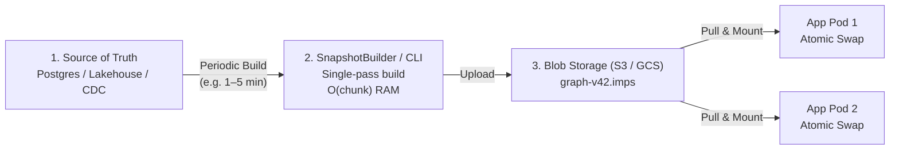

# Changing Data & Live Updates

Impulse Graph executes over immutable, read-only `.imps` snapshots. Whether that fits your system depends on your freshness requirement:

| Freshness Requirement | Fit? | Recommended Pattern |
| :--- | :---: | :--- |
| **Strict Real-Time OLTP (< 10 ms read-your-writes)** | Not as-shipped | Keep transactional writes in Postgres/MySQL/RocksDB; optionally pair with Impulse for heavy read traversals. |
| **Near Real-Time (5s – 5 min intervals)** | Yes | Periodically rebuild `.imps` from your DB or CDC stream, publish to blob storage, and swap in memory. |
| **Periodic Batch (Hourly / Nightly / Per-Deploy)** | Yes | Compile `.imps` in ETL or CI/CD, upload to S3/GCS, and mount across stateless pods. |
| **Static Reference & Simulation Graphs** | Yes | Compile once and mount directly from disk. |

---

## 1. Periodic Rebuild $\to$ Blob Storage $\to$ Blue/Green Swap

Because an `.imps` file is a set of flat primitive arrays (`row_offsets[]`, `col_indices[]`, and SoA columns) streamed in a single pass with no B-tree rebalancing or random disk seeks, graphs with millions of nodes and tens of millions of edges rebuild in seconds.



* **Offload multi-hop reads from OLTP**: Your relational database handles writes and sequential exports; Impulse handles traversals in-process.
* **Stateless horizontal scaling**: Scaling from 1 pod to 50 pods is downloading a single `.imps` file—no cluster consensus or cross-node hops.
* **Instant rollbacks & local repro**: Each snapshot is an immutable, SHA-256-verified file. Rolling back is swapping back to `graph-v41.imps`.

---

## 2. Zero-Downtime Blue/Green Swaps

Swapping to a new snapshot uses an atomic pointer swap plus RCU draining—no `ReadWriteLock` on reader threads:

```text
 Updater Thread                             Concurrent Reader Threads
 ──────────────                             ─────────────────────────
 1. Download new .imps from S3 / NVMe       • Core 0: Reading Snapshot A (lock-free)
 2. Open in a new Arena                     • Core 1: Reading Snapshot A (lock-free)
 3. AtomicReference.getAndSet(Snap B)  ───► • New queries route to Snapshot B
 4. Drain in-flight queries on Snap A       • In-flight queries on Snap A finish,
    and close Snapshot A's Arena              then Snapshot A is unmapped
```

```java
import org.impulsegraph.api.ImpulseGraphSnapshot;
import org.impulsegraph.storage.csr.BinarySnapshotLoader;

import java.lang.foreign.Arena;
import java.nio.file.Path;
import java.util.concurrent.CompletableFuture;
import java.util.concurrent.TimeUnit;
import java.util.concurrent.atomic.AtomicReference;

public class GraphSnapshotManager implements AutoCloseable {
    private final AtomicReference<ImpulseGraphSnapshot> currentSnapshot = new AtomicReference<>();

    public void swapToNewSnapshot(Path snapshotPath) throws Exception {
        Arena newArena = Arena.ofShared();
        ImpulseGraphSnapshot newSnapshot = BinarySnapshotLoader.loadSnapshot(snapshotPath, newArena).getGraph();

        ImpulseGraphSnapshot oldSnapshot = currentSnapshot.getAndSet(newSnapshot);

        if (oldSnapshot != null) {
            CompletableFuture.runAsync(() -> {
                try {
                    oldSnapshot.drainAndClose(30, TimeUnit.SECONDS);
                } catch (InterruptedException e) {
                    Thread.currentThread().interrupt();
                    oldSnapshot.close();
                }
            });
        }
    }

    public ImpulseGraphSnapshot getActiveSnapshot() {
        return currentSnapshot.get();
    }

    @Override
    public void close() {
        ImpulseGraphSnapshot snap = currentSnapshot.getAndSet(null);
        if (snap != null) snap.close();
    }
}
```

!!! tip "Production Lifecycle Management (`SnapshotLifecycleManager`)"
    For production Spring Boot and Kubernetes services requiring background S3/GCS ETag polling, SHA-256 verification before mounting, readiness probes, and automated `Arena` draining, see **[Kubernetes & Snapshot Lifecycle](../ecosystems/java/kubernetes-and-lifecycle.md)**.

---

## 3. Building Snapshots: Rust CLI vs. Java `SnapshotBuilder`

| Tool | Best For | Inputs | Runtime |
| :--- | :--- | :--- | :--- |
| **Rust CLI (`impulse build`)** | Python, C/C++, Go, Node.js, C#, and shell/Airflow pipelines | CSV, TSV, Parquet + `manifest.json` | Native binary (no JVM) |
| **Java `SnapshotBuilder`** | JVM services & streaming JDBC ETL | Java collections, JDBC `ResultSet`, `RelationDataSource` | Java 21/25 (`org.impulsegraph:impulse-builder`) |

### Rust CLI (`impulse build`)
```bash
impulse build --manifest manifest.json -o graph-v42.imps
impulse snapshot validate graph-v42.imps --strict-alignment
impulse snapshot inspect graph-v42.imps
```
*(See [Quickstart](quickstart.md#1-build-your-first-imps-snapshot) and [CLI Reference](../reference/cli.md).)*

### Java `SnapshotBuilder` (Bounded Memory Streaming)
`SnapshotBuilder` computes section offsets upfront from declared cardinalities and streams the file sequentially to a `FileChannel` or S3/GCS stream within a bounded staging RAM budget (`withStagingMemoryLimit`, default `64 MB`). If reverse (`CSC`) indices are enabled on source-sorted inputs, it automatically runs an external NVMe merge-sort within that budget. Watermarks (Kafka offsets, DB LSNs) can be embedded in footer metadata:

```java
try (FileChannel channel = FileChannel.open(outputPath,
        StandardOpenOption.CREATE, StandardOpenOption.WRITE, StandardOpenOption.TRUNCATE_EXISTING)) {

    SnapshotBuilder.create()
        .withStagingDirectory(Path.of("/tmp/impulse-staging"))
        .withStagingMemoryLimit(256 * 1024 * 1024L)
        .addDomain("User", userDomain)
        .addDomain("Account", accountDomain)
        .addRelation("OWNS", ownsRelation)
        .addFooterMetadata("sys.source.watermark_ts", "2026-10-24T20:00:00Z")
        .writeTo(channel);
}
```

---

## Next Steps

* **[Kubernetes & Snapshot Lifecycle (`SnapshotLifecycleManager`)](../ecosystems/java/kubernetes-and-lifecycle.md)** — Production S3/GCS polling, checksum verification, and automated Arena draining in JVM microservices.
* **[Building Snapshots (Java)](../ecosystems/java/building-snapshots.md)** — Full runnable JDBC/collection builder walkthrough.
* **[Building Snapshots (CLI & Python)](../ecosystems/python/snapshots-from-parquet-csv.md)** — CSV/Parquet manifest reference.
* **[Dynamic Service Deployment](../deployment/dynamic-service.md)** — Production Blue/Green swap patterns.
