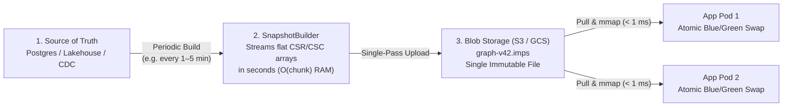

# Changing Data & Live Updates: "Wait—My Data Isn't Read-Only!"

When developers first hear that **Impulse Graph Engine** executes strictly over **immutable, read-only `.imps` snapshot files**, the very first question is almost always:

> **"Wait—my data isn't read-only! Is Impulse Graph for me?"**

Here is the honest, practical answer:

* **If you have a strict, millisecond real-time transactional requirement**: **As-shipped, probably not.** If a user clicks a button to add an edge and a query 2 milliseconds later *must* reflect that write with transactional read-your-own-writes ACID guarantees, Impulse Graph is not an OLTP database like PostgreSQL or Neo4j. It deliberately trades away in-place point mutations to eliminate locks, pointer chasing, and GC pauses on reads.
* **If your freshness requirement is "near real-time" (e.g., < 5 minutes, 1 minute, or even every few seconds) or periodic batch**: **Then you are very likely in luck.**

| Freshness Requirement | Is Impulse Graph a Fit? | Recommended Pattern |
| :--- | :---: | :--- |
| **Strict Real-Time OLTP (< 10 ms read-your-writes)** | ❌ **Not as-shipped** | Keep transactional writes in an OLTP database (Postgres, MySQL, RocksDB); optionally pair with Impulse for heavy multi-hop reads. |
| **Near Real-Time (< 1–5 minutes, or 5–30s intervals)** | ✅ **Sweet Spot** | Periodically rebuild the `.imps` file from your database or CDC stream, distribute via blob storage, and Blue/Green swap in memory. |
| **Periodic Batch (Hourly / Nightly / Per-Deploy)** | ✅ **Sweet Spot** | Compile `.imps` in your ETL or CI/CD pipeline, upload to S3/GCS, and `mmap` across stateless application pods. |
| **Static Reference & Simulation Graphs** | ✅ **Sweet Spot** | Compile `.imps` once; mount with `< 1 ms` cold start and zero heap overhead. |

---

## 1. Why Rebuilding from Scratch Takes Seconds, Not Hours

At first glance, *"periodically rebuild the entire graph snapshot"* sounds expensive. Traditional databases have trained us to believe that loading a graph takes hours—because a traditional database has to balance B-trees, write WAL segments, allocate millions of heap objects, and perform random disk seeks for every edge.

**Building an `.imps` file is completely different:**

* **It's Basically a Collection of Flat Arrays**: An `.imps` file is just contiguous primitive arrays—`row_offsets[]`, `col_indices[]`, and Structure-of-Arrays (`SoA`) attribute columns—written to disk or network in a **single sequential pass**.
* **No Heavy CPU Processing**: There are no B-trees to rebalance, no pointer graphs to serialize, and no heavy CPU compression required.
* **Rebuilt in Seconds**: Because `SnapshotBuilder` streams flat primitive chunks at disk/network bandwidth speed, **most reasonably sized graphs (millions of nodes and tens of millions of edges) can be rebuilt from scratch in just a few seconds.**

---

## 2. The Sweet Spot: Periodic Rebuild $\to$ Blob Storage $\to$ `mmap`

When you combine **fast, seconds-scale `.imps` builds** with **sub-millisecond `mmap` mounting**, a remarkably simple production architecture falls out: **periodically compile a fresh `.imps` file, drop it into Blob Storage (S3, GCS, Azure Blob), and let your application pods `mmap` and swap to it.**



### Why This Pattern Works So Well in Production
1. **Your OLTP Database Never Runs Expensive Graph Joins**: Postgres or your data lake stays focused on transactional writes and simple sequential exports, while Impulse Graph handles 100% of the multi-hop traversal load in-process.
2. **Stateless Horizontal Scaling (No Distributed Graph Cluster)**: Because an `.imps` snapshot is a single self-contained file, scaling from 1 pod to 50 Kubernetes pods is just downloading a file from S3/GCS and calling `mmap`—no Raft consensus, no distributed lock managers, and no cross-node network hops during traversals.
3. **Instant Rollbacks & Local Reproducibility**: Every `.imps` build is an immutable, SHA-256-verified artifact (`graph-v42.imps`). Rolling back a bad upstream data load is a one-line pointer swap to `graph-v41.imps`, and reproducing a production query locally is as simple as pulling that exact `.imps` file to your laptop.

---

## 3. Zero-Downtime Blue/Green Swaps in Your Application

When a new `.imps` file arrives on a running service pod, swapping to it requires **zero downtime** and **zero reader locks**:

```text
 Out-of-Band Updater Thread                      Concurrent Query Threads (Readers)
 ──────────────────────────                      ──────────────────────────────────
 1. Downloads new .imps from S3 / NVMe           • Core 0: Executing traversal on Snapshot A (Lock-Free)
 2. Calls mmap in a new Arena (< 1 ms)           • Core 1: Executing traversal on Snapshot A (Lock-Free)
 3. AtomicReference.getAndSet(Snapshot B)  ───►  • New queries immediately route to Snapshot B (0 ns pause)
 4. Drains in-flight queries on Snapshot A       • In-flight queries on Snapshot A finish normally,
    and unmaps Snapshot A's Arena                  then Snapshot A is unmapped from OS virtual memory
```

1. **Zero Reader Lock Contention**: Reader threads never acquire a `ReadWriteLock` (which would cause CPU cache-line bouncing across cores). They simply read the current `ImpulseGraphSnapshot` reference and increment an active-query counter (`enterQuery()` / `exitQuery()`).
2. **Atomic Pointer Swap (`0 ns`)**: The updater maps the new `.imps` file into a fresh off-heap `Arena.ofShared()` and atomically swaps the `AtomicReference`.
3. **Graceful RCU Draining (`drainAndClose`)**: Queries already in flight on the previous snapshot finish uninterrupted. Once the old snapshot's active query count hits zero, its `Arena` is closed and the OS immediately reclaims the virtual memory mapping.

```java
import org.impulsegraph.api.ImpulseGraphSnapshot;
import org.impulsegraph.storage.csr.BinarySnapshotLoader;

import java.lang.foreign.Arena;
import java.nio.file.Path;
import java.util.concurrent.CompletableFuture;
import java.util.concurrent.TimeUnit;
import java.util.concurrent.atomic.AtomicReference;

public class GraphSnapshotManager implements AutoCloseable {
    private final AtomicReference<ImpulseGraphSnapshot> currentSnapshot = new AtomicReference<>();

    public void swapToNewSnapshot(Path snapshotPath) throws Exception {
        // 1. Memory-map the new .imps file in a dedicated shared Arena (< 1 ms)
        Arena newArena = Arena.ofShared();
        ImpulseGraphSnapshot newSnapshot = BinarySnapshotLoader.loadSnapshot(snapshotPath, newArena).getGraph();

        // 2. Atomic pointer swap (zero lock overhead for active readers)
        ImpulseGraphSnapshot oldSnapshot = currentSnapshot.getAndSet(newSnapshot);

        // 3. Asynchronously drain in-flight queries and unmap the retired snapshot
        if (oldSnapshot != null) {
            CompletableFuture.runAsync(() -> {
                try {
                    oldSnapshot.drainAndClose(30, TimeUnit.SECONDS);
                } catch (InterruptedException e) {
                    Thread.currentThread().interrupt();
                    oldSnapshot.close();
                }
            });
        }
    }

    public ImpulseGraphSnapshot getActiveSnapshot() {
        return currentSnapshot.get();
    }

    @Override
    public void close() {
        ImpulseGraphSnapshot snap = currentSnapshot.getAndSet(null);
        if (snap != null) snap.close();
    }
}
```

---

## 4. Two Ways to Build `.imps` Snapshots: Rust CLI vs. Java `SnapshotBuilder`

Depending on your stack, you can compile `.imps` files using either the standalone **Rust CLI (`impulse build`)** or the programmatic **Java `SnapshotBuilder`**:

| Tool | Best For | Input Sources | Runtime Required |
| :--- | :--- | :--- | :--- |
| **1. Rust CLI Builder (`impulse build`)** | Python, C/C++, Node.js, Go, C#, and Airflow/dbt/shell pipelines | CSV, TSV, and Apache Parquet files via a declarative `manifest.json` | Standalone native binary / Docker container (**Zero JVM required**) |
| **2. Java `SnapshotBuilder`** | Enterprise Java 25 microservices & custom streaming ETL | In-memory Java collections, streaming JDBC `ResultSet`s, or custom `RelationDataSource` SPIs | Java 25 (`org.impulsegraph:impulse-builder`) |

### Option A: Building from CSV / Parquet with the Rust CLI (`impulse build`)
For C-ABI consumers (like Python data science workflows) or database `COPY TO CSV` / Parquet exports, pass a `manifest.json` to `impulse build`:

```bash
# Compile CSVs or Parquet files defined in manifest.json into a 128-byte-aligned .imps file
impulse build --manifest manifest.json -o graph-v42.imps

# Verify 128-byte alignment and inspect section catalogs
impulse snapshot validate graph-v42.imps --strict-alignment
impulse snapshot inspect graph-v42.imps
```
*(See [Quickstart](quickstart.md#1-build-your-first-imps-snapshot) for a complete CSV + `manifest.json` walkthrough and [CLI Reference](../reference/cli.md) for all subcommands.)*

### Option B: How `SnapshotBuilder` Compiles Snapshots in Bounded RAM (Java 25)

Whether your graph has 100,000 edges or 10 billion edges, `SnapshotBuilder` is designed to compile `.imps` files without blowing up memory:

* **Single-Pass Sequential Write (Direct to Disk or S3/GCS)**: Because domain cardinalities and edge counts are declared up front, `SnapshotBuilder` computes all 128-byte-aligned section offsets before writing a single byte. It then streams Page 0, Section 2 catalogs, CSR/CSC topologies, SoA attributes, and the SHA-256 footer in a **single sequential pass**—allowing it to write directly to an S3/GCS `WritableByteChannel` with zero random file seeks.
* **Bounded $O(\text{chunk})$ Memory Footprint**: Data is fed into the builder in chunks (`RelationDataSource`, `AttributeDataSource`). Builder RAM stays capped at your configured staging limit (`withStagingMemoryLimit`, default `64 MB`).
* **Automatic NVMe External Sort for Reverse (`CSC`) Indices**: If you enable reverse traversal indices (`Topology.CSC`) and your input edges are only sorted by source node ID, `SnapshotBuilder` automatically stages chunks to local NVMe disk and runs an external merge-sort within your memory limit.
* **Self-Describing Footer Metadata**: You can embed upstream watermarks (such as `sys.kafka.committed_offset`, database LSNs, or build timestamps) directly into the `.imps` footer so the next periodic build knows the exact watermark of the previous snapshot.

```java
try (FileChannel channel = FileChannel.open(outputPath,
        StandardOpenOption.CREATE, StandardOpenOption.WRITE, StandardOpenOption.TRUNCATE_EXISTING)) {

    SnapshotBuilder.create()
        .withStagingDirectory(Path.of("/tmp/impulse-staging"))
        .withStagingMemoryLimit(256 * 1024 * 1024L) // Bounded 256 MB RAM budget
        .addDomain("User", userDomain)
        .addDomain("Account", accountDomain)
        .addRelation("OWNS", ownsRelation)
        .addFooterMetadata("sys.source.watermark_ts", "2026-10-24T20:00:00Z")
        .writeTo(channel);
}
```

---

## Next Steps

* **[Building Snapshots Walkthrough (Java)](building-snapshots.md)**: Follow a complete, runnable example building an `.imps` snapshot from in-memory collections and streaming JDBC queries.
* **[Snapshot Builder Reference](snapshot-builder-reference.md)**: Full API reference for domains, primitive widths, topologies, and streaming data sources.
* **[Deployment Archetypes: Dynamic Service](../deployment/dynamic-service.md)**: Production patterns for running periodic Blue/Green snapshot swaps in microservices.
