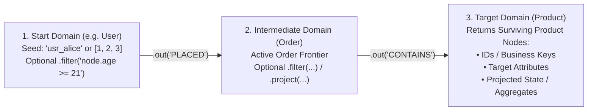

# Getting Started

> **"How fast can you traverse a graph?"**
>
> Turns out, really fast—once you throw away mutability, locking, memory allocations, and GC pauses.

Instead of running a heavyweight database server or deserializing files into millions of heap-allocated `Node` and `Edge` objects, Impulse Graph uses **[Data-Oriented Design](../concepts/data-oriented-design.md)** for **"mmap and go"** querying:

1. **You build an immutable `.imps` Binary Snapshot file** containing strongly-typed domains, 128-byte-aligned CSR/CSC adjacency matrices, and columnar Structure-of-Arrays (SoA) node and edge attributes.
2. **You memory-map (`mmap`) the `.imps` file** directly into your application in under a millisecond—with zero parsing and zero heap object allocation.
3. **You execute queries off-heap** using either of Impulse's **two equivalent, first-class engines**:
   - **Pure Java 25 Engine (`impulse-graph-java`)**: A 100% pure Java 25 implementation (FFM `MemorySegment`/`Arena`, Vector API, and `MethodHandle` JIT combinators) with **zero runtime dependencies (zero inherited CVEs)**, **zero JNI wrappers**, and **zero GC pauses**.
   - **Native C++20 / C-ABI Engine (`impulse-graph-core`)**: A zero-dependency C++20 and SQLite-style C-ABI kernel (`libimpulse_graph`) that powers Python, C/C++, Rust, Go, .NET/C#, and Node.js.

---

## How Queries Work: The Two Core Mechanics

Before writing your first query, it helps to understand two mechanics that make Impulse Graph fundamentally different from relational SQL joins and traditional graph databases:

### 1. Start in One Domain, Walk 0..N Edges, Finish in One Target Domain
Every query in Impulse Graph is a **directional pipeline that moves an active frontier of nodes from one Domain to another**:

* **Start with a Single Domain**: You anchor the traversal to one starting domain (e.g., `snap.domain("User")`) and choose your starting nodes (a single node, a list of IDs/keys, a bitset, or all nodes in the domain).
* **Walk Zero or More Edges**:
  * Walking **0 edges** simply filters or projects attributes within that starting domain (`User` $\to$ `User`).
  * Each `.out(...)` or `.in(...)` step transitions the active frontier across a directed relation into the next domain (`User` $\to$ `Order` $\to$ `Product`).
* **Finish in a Single Target Domain**: Unlike a SQL `JOIN` that returns a wide Cartesian table of columns from every intermediate hop at once, an Impulse traversal finishes at a **single target domain** (e.g., `Product`) and returns the surviving nodes in that domain—their **Dense IDs**, **External Business Keys**, **target domain attributes**, or **projected/aggregated state** carried along the walk.

### 2. Set Behavior (Not Multi-Sets) & Collapsing Intermediate Results
Most databases (SQL `JOIN`s, standard Cypher, Gremlin) operate on **multi-sets (bags of paths)**. If you start from 100 users who placed 5,000 orders that all point to the same 10 popular products, a traditional engine produces **5,000 duplicate intermediate rows**—and on the next hop (`Product -> Category`), it walks out of those same 10 products **5,000 separate times** ("path explosion").

**Impulse Graph operates on Sets, not Multi-Sets.** At every step, intermediate results converging on the same node are immediately **collapsed (reduced) together** before the next hop begins:

* **Pure Reachability (Set Union)**: The active frontier in a domain is a **BitSet** (1 bit per node). If 500 different edges land on `Product #42` during a hop, bit `42` is simply set to `1` via bitwise `OR`. On the next hop, Impulse walks out of `Product #42` **exactly once**.
* **Carrying Computed Values Across Hops (Monoidic Reduction)**: What if each incoming path carries a number—like an order `amount`, a hop `distance`, or a `risk_score`—and multiple paths land on the same target node? You specify a simple reduction rule (**a monoid**) that tells the engine how to collapse converging values into a single value per target node:
  * **`SUM` (`+`)**: Add converging values together (e.g., total money transferred into an account, or PageRank weight).
  * **`MIN`**: Keep the smallest value (e.g., shortest path distance or earliest timestamp).
  * **`MAX`**: Keep the largest value (e.g., maximum transaction size or highest confidence score).
  * **`ANY` / `OR`**: Boolean reachability.

Because intermediate results are collapsed into a fixed-size per-domain set at every hop, **queries never suffer from exponential path explosion**, and the engine knows the **exact memory required for the query before it even runs**.

---

## Step-by-Step Guide

1. **[Installation](installation.md)**: Add the Pure Java 25 Maven/Gradle dependencies, C/C++ CMake package, Python wheel, or standalone Rust CLI (`impulse`).
2. **[Quickstart](quickstart.md)**: Build an `.imps` file (from CSVs with `impulse build` or in Java) and run your first traversal in < 20 lines of code.
3. **[Core Concepts & Glossary](core-concepts.md)**: A visual primer on CSR/CSC matrices, per-domain dense IDs ($0 \dots N_d-1$), domain-to-domain set reduction, and SoA attributes.
4. **[Building Snapshots (Java)](building-snapshots.md)**: A step-by-step tutorial building `.imps` snapshots programmatically in Java and streaming from relational databases via JDBC.
5. **[Building Snapshots (CLI, CSV/Parquet & Python/PyTorch)](snapshot-builder-reference.md)**: Compile `.imps` snapshots from Apache Parquet and CSV files using the standalone `impulse` CLI and query/train on them in Python and PyTorch.
6. **[Changing Data & Live Updates](handling-mutations.md)**: Answering *"My data isn't read-only—is Impulse for me?"*, `< 5 min` near-real-time rebuilds, S3/GCS distribution, and zero-downtime Blue/Green swaps.
