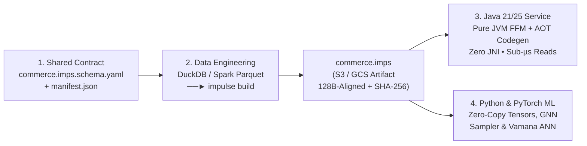

# Polyglot "Parquet for Graphs" Workflow

In many organizations, graph data crosses three distinct engineering stacks:

1. **Data Engineering** curates entity and event tables in Apache Spark, DuckDB, Snowflake, or Iceberg and exports **Apache Parquet**.
2. **Backend Platform Teams** serve high-QPS permission, fraud, or recommendation APIs in **Java 21/25 (Spring Boot)**, **Rust**, or **Go**.
3. **ML & Data Science Teams** train Graph Neural Networks (GNNs), compute embeddings, and run exploratory notebooks in **Python & PyTorch**.

Without a shared binary graph format, each team re-ingests the same Parquet tables into incompatible systems (a networked graph DB for production services, custom SciPy/PyG tensors for ML), causing schema drift and divergent traversal semantics.

With **Impulse Graph Engine**, `.imps` acts as the **portable binary contract** across all three stacks: compile the graph once from Parquet, publish to S3/GCS, and mount the exact same `.imps` file in both Pure Java 21/25 and Python/PyTorch with guaranteed bitwise-identical `ImpulseVM` results.



---

## Step 1: Define the Shared Schema Contract

Check a declarative schema contract (`commerce.imps.schema.yaml`, `v0.11` schema-first workflow; see [Schema & Manifest Spec](../reference/spec/schema-specification.md)) into version control alongside your ingestion `manifest.json`.

* **Per-Domain Dense IDs ($0 \dots N_d - 1$)**: `User` (`domain 0`) and `Product` (`domain 1`) maintain independent 0-indexed dense ID spaces.
* **Name-Based Evolution**: Queries and AOT-generated builders bind by domain, relation, and attribute **names** in Section 2, so adding attributes or running Reverse Cuthill-McKee (`--rcm`) node reordering never breaks downstream consumers.

=== "`commerce.imps.schema.yaml` (Shared Contract & Codegen Input)"
    ```yaml
    graphName: CommerceGraph
    package: com.acme.commerce.graph

    domains:
      User:
        denseId: uint32
        key: string
        attributes:
          segment:   "Int16"
          active:    "UInt8"

      Product:
        denseId: uint32
        key: string
        attributes:
          price:     "Float32"
          in_stock:  "UInt8"
          embedding: "Float32[128]"

    relations:
      PURCHASED:
        source: User
        target: Product
        direction: [out, in]
        cardinality: many_to_many
        attributes:
          amount: "Float32"
    ```

=== "`manifest.json` (Parquet Ingestion Mapping)"
    ```json
    {
      "domains": [
        {
          "id": 0,
          "name": "User",
          "key_type": "string",
          "file": "users.parquet",
          "format": "parquet",
          "id_column": "user_id",
          "attributes": [
            { "name": "segment", "column": "segment", "type": "int16" },
            { "name": "active", "column": "active", "type": "uint8" }
          ]
        },
        {
          "id": 1,
          "name": "Product",
          "key_type": "string",
          "file": "products.parquet",
          "format": "parquet",
          "id_column": "product_id",
          "attributes": [
            { "name": "price", "column": "price", "type": "float32" },
            { "name": "in_stock", "column": "in_stock", "type": "uint8" },
            { "name": "embedding", "column": "embedding", "type": "float32", "dimension": 128 }
          ]
        }
      ],
      "relations": [
        {
          "name": "PURCHASED",
          "src_domain": 0,
          "tgt_domain": 1,
          "file": "purchases.parquet",
          "format": "parquet",
          "src_column": "user_id",
          "tgt_column": "product_id",
          "include_csc": true,
          "attributes": [
            { "name": "amount", "column": "amount", "type": "float32" }
          ]
        }
      ]
    }
    ```

---

## Step 2: Build, Index & Publish `.imps` (Data Engineering)

In your Airflow, Dagster, dbt, or Spark job, export `users.parquet`, `products.parquet`, and `purchases.parquet`, compile `commerce.imps` with the standalone `impulse` CLI (including an optional Section 2.6 `IMP_INDEX_VAMANA_ANN` vector index over `Product.embedding`), verify alignment and checksums, and upload to object storage:

```bash
# 1. Compile Parquet tables + embedded SQ8 Vamana ANN index into a 128-byte-aligned .imps file
impulse build --manifest manifest.json -o commerce.imps \
    --vector-index "Product.embedding:R=32:L=64:alpha=1.2:metric=cosine:quant=sq8"

# 2. Validate 128-byte alignment, CSR/CSC monotonicity, and SHA-256 footer integrity
impulse snapshot validate commerce.imps --strict-alignment

# 3. Publish immutable generation to S3 / GCS
aws s3 cp commerce.imps s3://acme-graphs/commerce/commerce-2026-11-22T21-00Z.imps
```

---

## Step 3: Mount in a Pure Java 21/25 Enterprise Microservice

Your Java service pulls `commerce.imps` onto local NVMe and memory-maps it via `BinarySnapshotLoader` (or hot-reloads generations automatically via `SnapshotLifecycleManager`; see [Kubernetes & Lifecycle](../ecosystems/java/kubernetes-and-lifecycle.md)).

No native `.so`/`.dylib` libraries are loaded—the Pure JVM runtime reads the exact same 128-byte-aligned CSR/CSC and SoA segments via `java.lang.foreign.MemorySegment`:

```java
import org.impulsegraph.api.ImpulseGraphSnapshot;
import org.impulsegraph.storage.csr.BinarySnapshotLoader;

import java.lang.foreign.Arena;
import java.nio.file.Path;
import java.util.List;

try (Arena arena = Arena.ofShared()) {
    ImpulseGraphSnapshot snap = BinarySnapshotLoader
        .loadSnapshot(Path.of("/var/lib/impulse/commerce.imps"), arena)
        .getGraph();

    // Collaborative filtering: User -> out(PURCHASED) -> in(PURCHASED) -> out(PURCHASED)
    // Set semantics collapse duplicate co-purchasers at every hop automatically
    List<String> recommendedSkus = snap.domain("User")
        .fromKey("usr_90412")
        .out("PURCHASED")
        .in("PURCHASED")
        .out("PURCHASED", "tgt.in_stock == 1 && tgt.price <= 150.0")
        .toKeyList();
}
```

With `impulse-codegen` (`impulse-maven-plugin`, `v0.11`), `commerce.imps.schema.yaml` also generates compile-time-checked builders (`UserQueryBuilder`, `ProductQueryBuilder`) so misspelled relation or attribute names fail at `mvn compile` time rather than runtime (see [AOT Code Generation](../ecosystems/java/aot-codegen.md)).

---

## Step 4: Mount the Identical File in Python & PyTorch (ML / Research)

Your ML engineers pull the **exact same `commerce.imps` artifact** into Python (`pip install impulse-graph`) for training, offline evaluation, and hybrid graph + vector retrieval:

```python
import numpy as np
import torch
from impulse_graph import Snapshot

with Snapshot("commerce.imps") as snap:
    # 1. Bitwise-identical multi-hop traversal via embedded C++20 ImpulseVM
    candidate_product_ids = (
        snap.traverse(start_node=42, catalog={"PURCHASED": 0})
            .out("PURCHASED")
            .in_("PURCHASED")
            .out("PURCHASED")
            .to_list()
    )

    # 2. Zero-copy CSR topology & SIMD mini-batch neighborhood sampling for PyTorch
    purchases_csr: torch.Tensor = snap.to_torch_csr(0)
    seed_users = np.array([42, 108, 512], dtype=np.uint64)
    sampled_src, sampled_tgt = snap.sample_neighbors(
        relation_index=0, nodes=seed_users, k_samples=20, seed=7
    )

    # 3. Hybrid Vamana ANN vector search + exact SIMD dot-product reranking (v0.10.0)
    query_vec = np.random.default_rng(0).standard_normal(128, dtype=np.float32)
    nearest_products = (
        snap.domain("Product")
            .vector_search("embedding", query_vec, k=50, ef_search=128)
            .rerank("embedding", query_vec, top_k=10)
            .to_list()
    )
```

Because both the Pure JVM runtime and the Python/C++20 runtime are continuously verified against the [Four-Way Polyglot Validation Suite](../contributing/polyglot-validation.md) (`531` `.impas` vectors across `166/166` opcodes), feature logic developed in Python notebooks behaves identically when promoted to Java or Rust production services.

---

## Next Steps

* **[Java & JVM Ecosystem Hub](../ecosystems/java/index.md)** & **[AOT Code Generation](../ecosystems/java/aot-codegen.md)**
* **[Python & PyTorch Ecosystem Hub](../ecosystems/python/index.md)** & **[GNN & Vector Search](../ecosystems/python/gnn-and-vector-search.md)**
* **[Native, Rust & Polyglot Hub](../ecosystems/native/index.md)** & **[Native CLI Reference](../ecosystems/native/cli-reference.md)**
* **[Schema & Manifest Specification (`.yaml`)](../reference/spec/schema-specification.md)**
