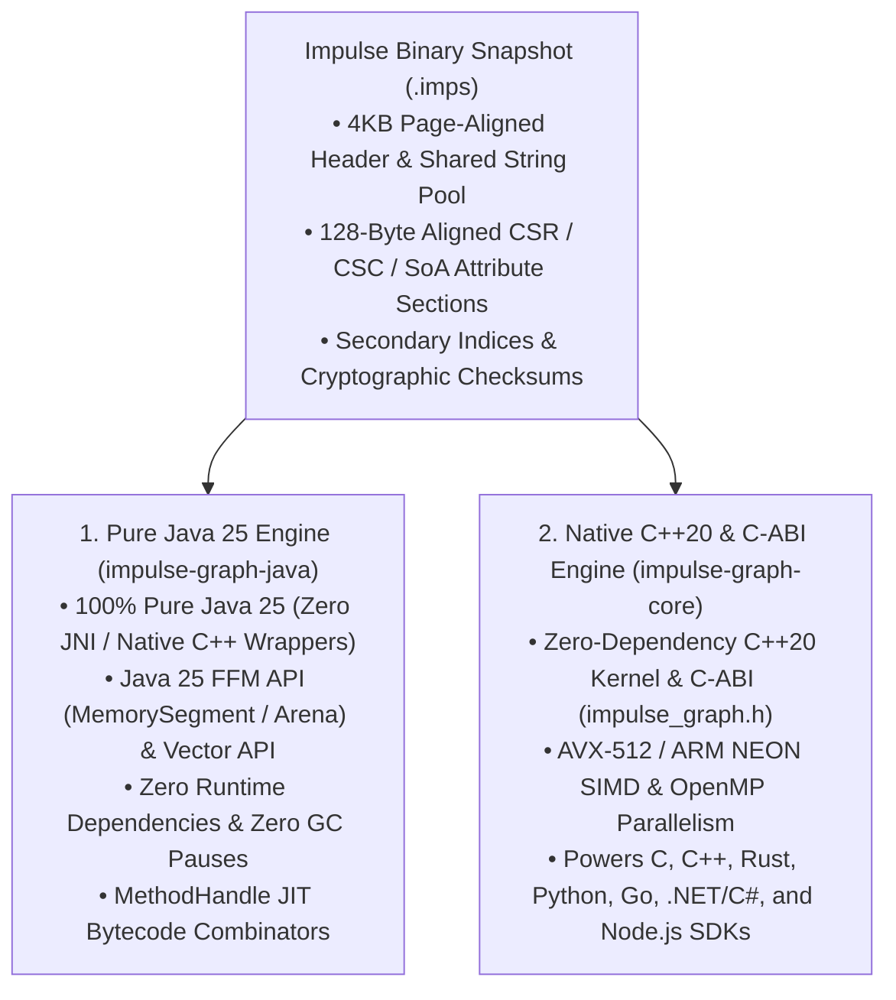
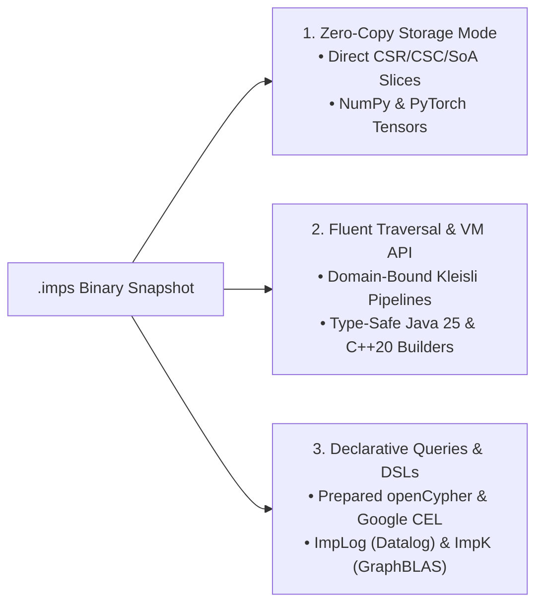

# Impulse Graph Engine

**Zero-copy binary snapshot graph format (`.imps`) with two equivalent, first-class execution engines: Pure Java 25 and Native C++20 / C-ABI.**

Impulse Graph acts as the **"Apache Arrow / Parquet equivalent for Graph Analytics"**. It decouples graph analytics from stateful database servers by pairing an **immutable, hardware-aligned binary snapshot format (`.imps`)** with a **register-based Virtual Machine (`ImpulseVM`)** that executes SIMD-vectorized traversals directly off-heap without data loading or garbage collection pauses.

---

## Architecture: One Binary Format, Two Equivalent Engines

Every `.imps` snapshot is a portable, 128-byte hardware-aligned binary file that mounts directly into virtual memory via OS `mmap`. Impulse Graph provides **two independent, bitwise-equivalent execution engines** that read the exact same `.imps` binary format and execute the exact same `impOps` bytecode ISA:

### 1. Pure Java 25 Engine (`impulse-graph-java`) — First-Class Enterprise Citizen
The Java 25 engine is a **100% pure Java implementation**—not a JNI or FFI wrapper around C++. It uses Java 25's standard Foreign Function & Memory (FFM) API (`MemorySegment` and `Arena`) to memory-map `.imps` files directly off-heap, paired with the Vector API and `MethodHandle` JIT compilation:

* **Zero External Runtime Dependencies**: Core execution modules (`impulse-spec`, `impulse-api`, `impulse-storage`, `impulse-vm`, `impulse-compiler`) have zero third-party runtime dependencies.
* **Zero GC Pauses**: Graph topologies, columnar attributes, bitsets, and the 640-byte `ImpulseVM` register frame reside strictly off-heap.
* **Zero Native Packaging Friction**: Runs as standard JVM bytecode without bundling platform-specific `.so` / `.dylib` / `.dll` native libraries.

### 2. Native C++20 & C-ABI Engine (`impulse-graph-core`)
The C++20 engine exposes a stable, zero-dependency **C-ABI interface** (`impulse_graph.h`, `impulse_vm.h`, `impulse_index.h`) alongside a C++20 Fluent API (`impulse_vm_fluent.hpp`):

* **Direct C-ABI Interoperability**: Provides a canonical C interface for snapshot mounting, CSR/CSC buffer access, in-kernel query compilation (`openCypher`, `CEL`, `ImpScheme`, `ImpK`, `ImpLog`), and SQLite-style prepared statements (`impulse_stmt_t`) with Apache Arrow-compatible columnar output buffers.
* **Polyglot SDK Foundation**: Powers native bindings across **Rust**, **Python** (with zero-copy NumPy and PyTorch tensor views), **Go** (`CGo`), **.NET / C#** (`P/Invoke`), and **Node.js / TypeScript** (`N-API`).

---

## Three Execution Paradigms

## Quick Links

- [**Getting Started & Architecture Primer**](getting-started/core-concepts.md)
- [**Java 25 API Reference & Aggregated Javadocs**](reference/java-api.md)
- [**C-ABI Kernel & VM Reference**](reference/c-abi.md)
- [**Binary Snapshot Format Specification (`.imps`)**](reference/spec/format-specification.md)
- [**ImpulseVM & `impOps` Instruction Set Specification**](reference/spec/vm-specification.md)
- [**Benchmarks & Performance Guide**](benchmarks.md)
