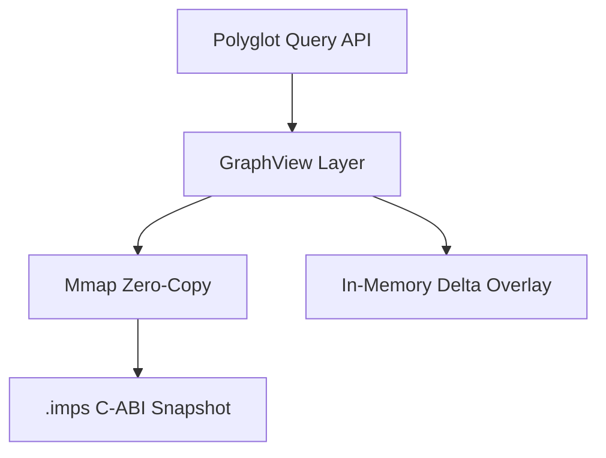

# Impulse Graph Engine

**Ultra-high-performance, zero-copy, C-ABI binary snapshot graph engine.**

Impulse Graph is designed for sub-millisecond cold starts, sub-microsecond vector traversals, and multi-terabyte (TB+) scale graph analytics. It provides a purely polyglot foundation for Authorization (ReBAC), Anti-Money Laundering, Graph Neural Networks, and High-Performance simulations.

## Architecture

At its core, Impulse Graph uses a Memory-Mapped Compressed Sparse Row (CSR) structure aligned for AVX-512 vector units and GPU warp coalescing. 

## Feature Highlights

- **83-90% Native C++ Parity**: Impulse Java 25 VM (`impulse-core`) achieves 83-90% of raw C++ GAPBS performance across all 6 macro benchmarks.
- **341x Faster Cold Starts**: Off-heap `FileChannel.map` + Leyden AOT Cache (`-XX:AOTCache`) reduces JVM dataset load time down to **9.74 ms** (vs 3,326 ms C++ GAPBS).
- **Sub-10 Microsecond JIT Latencies**: MethodHandle JIT combinator inlining + AVX-512 Vector API executes single queries in **4.13 µs**.
- **Zero-Copy Off-Heap**: No Java GC pressure. Reads directly from memory-mapped NVMe storage.
- **Polyglot Consistency**: Unified API across Java, C++, Rust, Python, and C#.
- **Trillion-Node Scale**: 64-bit architecture designed for modern hardware.

## Quick Links

- [**GAPBS Benchmarks & Performance Guide**](benchmarks.md)
- [Deployment Archetypes](deployment/dynamic-service.md)
- [Query API Cheatsheet](reference/operations-cheatsheet.md)
- [Authz Zanzibar Showcase](showcase/authz.md)
- [Contributing](contributing/index.md)
