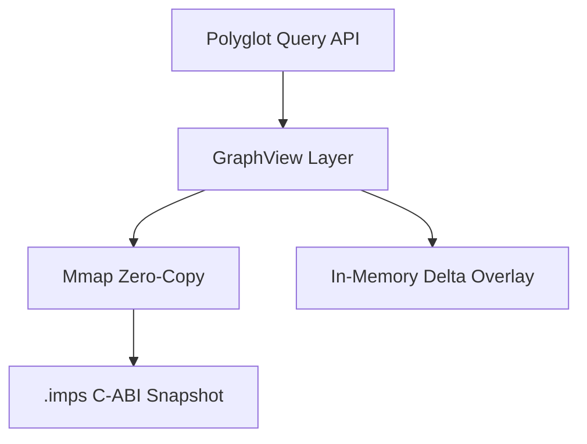

# Impulse Graph Engine

**Ultra-high-performance, zero-copy, C-ABI binary snapshot graph engine.**

Impulse Graph is designed for sub-millisecond cold starts, sub-microsecond vector traversals, and multi-terabyte (TB+) scale graph analytics. It provides a purely polyglot foundation for Authorization (ReBAC), Anti-Money Laundering, Graph Neural Networks, and High-Performance simulations.

## Architecture

At its core, Impulse Graph uses a Memory-Mapped Compressed Sparse Row (CSR) structure aligned for AVX-512 vector units and GPU warp coalescing. 

## Feature Highlights

- **Zero-Copy**: No Java GC pressure. Reads directly from memory-mapped NVMe storage.
- **Polyglot Consistency**: Unified API across Java, C++, Rust, Python, and C#.
- **Sub-microsecond P99**: Lock-free query execution paths optimized for concurrent throughput.
- **Hypothetical Contingencies**: Thread-safe delta overlays for "what-if" simulations without copying the base graph.
- **Trillion-Node Scale**: 64-bit architecture designed for modern hardware.

## Navigation

- [Deployment Archetypes](deployment/dynamic-service.md)
- [Query API Cheatsheet](reference/operations-cheatsheet.md)
- [Authz Zanzibar Showcase](showcase/authz.md)
- [Contributing](contributing/index.md)
