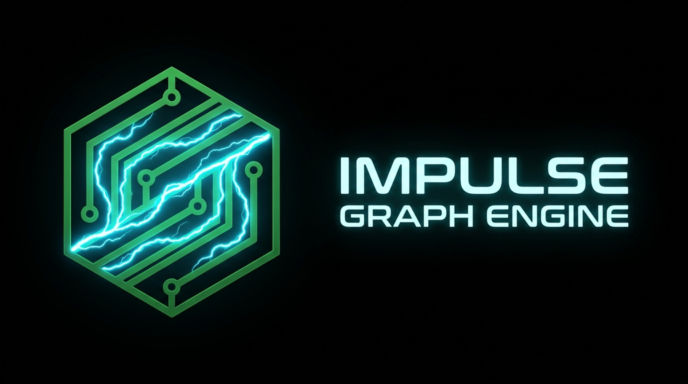
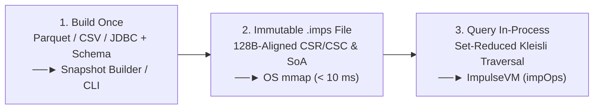

# Impulse Graph Engine



**Impulse Graph Engine** (`impulse-graph`) is an embedded, read-only graph engine built around an open, 128-byte-aligned binary snapshot format (**`.imps`**) and a 64-register bytecode virtual machine (**`ImpulseVM`**). It decouples static and micro-batch graph analytics from stateful database servers—acting as an **Apache Arrow / Parquet equivalent for multi-domain property graphs**.



---

## Start From Your Stack or Problem

| Your Stack or Problem | Problem-First Architectural Guide | Ecosystem Hub & Tooling |
| :--- | :--- | :--- |
| **Python, Data Science & PyTorch GNNs** | **[From NetworkX & Parquet to `.imps`](getting-started/from-networkx-and-parquet.md)** — Eliminate `dict` RAM blowups and multi-second CSV/Parquet reloads. | **[Python & PyTorch Hub](ecosystems/python/index.md)** |
| **Java & JVM Enterprise Services** | **[Embedded `.imps` vs. Networked Graph DB](getting-started/embedded-vs-graph-db.md)** — Remove TCP/JSON hops for ReBAC, fraud, and catalog hierarchies. | **[Java & JVM Hub](ecosystems/java/index.md)** |
| **C/C++20, Rust & Cross-Team Pipelines** | **[Polyglot "Parquet for Graphs" Workflow](getting-started/polyglot-workflow.md)** — Build once from Parquet, query identically in Java and Python. | **[Native, Rust & Polyglot Hub](ecosystems/native/index.md)** |
| **AI Coding Assistants & Agents** | Machine-readable context indices (`llms.txt`, `llms-full.txt`) and installable `SKILL.md` rules for Claude, Cursor, and Antigravity. | **[AI Assistants & Skills](ai/index.md)** |

*(Browse all language guides in the **[Ecosystems Overview](ecosystems/index.md)** or jump straight to the **[5-Minute Quickstart](getting-started/quickstart.md)**.)*

---

## 1. Core Design

* **Single-File `.imps` Snapshots**: Compile node domains, CSR/CSC adjacency matrices, and Structure-of-Arrays (SoA) columns once into a single immutable binary file and `mmap` it directly from disk (`0.038 ms` in C++20, `9.75 ms` in Java 25 with Leyden AOT on a 6.04 GB, 1.47B-edge graph)—no server process, no deserialization, and no heap loading.
* **Set-Reduced Frontiers & Pre-Calculated Buffers**: Intermediate traversals collapse converging paths into per-domain bitsets or monoidic state vectors at every hop. Because domain cardinalities ($0 \dots N_d - 1$) are fixed per snapshot, exact query scratch memory is known at `prepare` time (`impulse_stmt_buffer_size`), avoiding path explosion and hot-loop heap allocations.
* **One VM, Multiple Query Frontends**: Schema-generated AOT fluent builders, domain-bound traversals (`snap.domain(...)`), read-only parameterized **openCypher**, Datalog (**ImpLog**), GraphBLAS (**ImpK**), and **Google CEL** predicates all lower through `ImpScheme` IR into 64-bit `impOps` bytecode.
* **`v0.10.0` Capabilities**: 8/16/32/64-lane bit-sliced frontiers (`0xC0`..`0xC9`) for batched seeds and $N-1$ contingency walks, plus embedded Vamana ANN vector search (`0x08`, `0xCA`..`0xCB`).

For the architectural rationale, JFR/C++ empirical analysis, and foundational CS literature, see **[Why Impulse Graph?](concepts/why-impulse.md)**, **[Benchmarks](benchmarks.md)**, and **[Research Literature & Design Lineage](academic/literature-and-influences.md)**.

---

## 2. One Portable Specification & ISA, Pluggable Execution Runtimes

Impulse Graph separates the **normative data and bytecode contract** from the **execution runtimes** that evaluate it:

1. **Open Data & Bytecode Contract (`impulse-graph-spec`)**:
   * **`.imps` Binary Snapshot Format**: 128-byte-aligned sections containing per-domain key indices, CSR/CSC topologies, SoA columns, and Vamana ANN indices.
   * **`.imps.schema.yaml` / `manifest.json`**: Declarative schema contract defining independent node domains ($0 \dots N_d - 1$), integer widths (`uint16`/`uint32`/`uint64`), directed relations, and attribute types.
   * **`impOps` 64-Register ISA (`R0`..`R63`)**: Fixed-width 64-bit bytecode instructions verified by compliance test vectors (`tc01`–`tc38`, `vm-impas/`).
2. **Independent Execution Runtimes**:

| Runtime | Implementation & Memory Access | Language Ecosystem | Distribution (`0.10.0`) |
| :--- | :--- | :--- | :--- |
| **Pure JVM Engine** (`impulse-graph-java`) | 100% Java 21 LTS / 25 (`MemorySegment`, `Arena`, Vector API, `MethodHandle` JIT); zero JNI, zero third-party runtime dependencies | Java, Kotlin, Scala 3, Clojure | Maven Central (`org.impulsegraph`) |
| **Native C++20 / C-ABI Engine** (`impulse-graph-core`) | C++20 (`libimpulse_graph`, `impulse_graph.h`) with OS `mmap`, Google Highway SIMD, and OpenMP; zero third-party runtime dependencies | C, C++20, Rust, Python (NumPy/PyTorch), Go, .NET (P/Invoke), Node.js | PyPI (`impulse-graph`), crates.io (`impulse-graph`), GitHub Releases |
| **Formal Reference Oracle** (`impulse-ocaml`) | Pure functional OCaml implementation of `ImpulseVM` and `ICTX` v1 state hashing | Differential fuzzing & four-way parity verification | Source (`impulse-ocaml`) |

!!! note "Extensible Runtime Target Architecture"
    Because `.imps` layouts and `impOps` bytecode are self-contained and hardware-aligned with no engine-specific object headers, every compliant runtime produces bitwise-identical register state, status codes, and query outputs. Additional standalone runtimes—such as a pure managed `.NET` (`Span<T>` / `Vector512`) engine or an in-browser `WebAssembly` (`wasm64` / SIMD128) runtime—can implement the specification without modifying existing `.imps` files, `.imps.schema.yaml` contracts, or user queries.

---

## 3. When Impulse Graph Is — and Isn't — the Right Fit

| Workload Characteristic | Strong Fit for Impulse Graph | Not a Direct Replacement (Recommended Pattern) |
| :--- | :--- | :--- |
| **High-QPS Multi-Hop Service Reads** (ReBAC/Zanzibar authz, fraud rings, catalog/BOM hierarchies) | **Yes** — Sub-microsecond in-process traversals (`0.026 µs – 0.552 µs` on 600k-user ReBAC; `4.13 µs` targeted BFS on 1.47B edges) with zero network or JSON serialization overhead. | — |
| **Near-Real-Time (`5s – 5 min`) or Batch Updates** | **Yes** — Rebuild `.imps` out-of-band in seconds, publish to S3/GCS, and execute lock-free Blue/Green `Arena` swaps across stateless pods. | — |
| **Large-Scale Graph Analytics & GNN Sampling** | **Yes** — Mount multi-GB `.imps` files via `mmap` across Python/PyTorch `DataLoader` workers sharing a single OS page cache (`24.2 µs` 4-hop Hetionet query vs. `42.1 ms` in NetworkX). | — |
| **Strict OLTP Mutations (`< 10 ms` Read-Your-Own-Writes)** | — | **No** — `.imps` snapshots are immutable. Keep transactional writes in PostgreSQL, MySQL, or RocksDB and project read-heavy graph views into Impulse ([Changing Data & Live Updates](getting-started/handling-mutations.md)). |
| **Arbitrary Multi-Set Path Enumeration** | — | **By Design** — Impulse reduces converging paths into per-domain sets/monoids at every hop to guarantee bounded memory rather than enumerating exponential path bags. |

---

## 4. See It in Action

=== "Java 25 (Fluent API)"
    ```java
    try (Arena arena = Arena.ofShared()) {
        ImpulseGraphSnapshot snap = BinarySnapshotLoader.loadSnapshot(Path.of("social.imps"), arena).getGraph();

        List<Long> friends = snap.domain("User")
            .fromKey("usr_alice")
            .out("FOLLOWS")
            .filter("node.age >= 21 && node.active == true")
            .toList();
    }
    ```

=== "Java 25 (openCypher)"
    ```java
    try (ImpulseStatement stmt = snap.prepare(
            "MATCH (u:User)-[:FOLLOWS]->(f:User) WHERE u.id = $uid AND f.age >= $minAge RETURN f.id")) {
        stmt.bindNode("uid", 42L).bindLong("minAge", 21L);
        try (RowReader rows = stmt.execute()) {
            while (rows.next()) {
                long friendId = rows.getNodeId(0);
            }
        }
    }
    ```

=== "C / C++20 (C-ABI)"
    ```c
    impulse_stmt_t* stmt = NULL;
    impulse_stmt_prepare(snap, "MATCH (u:User)-[:FOLLOWS]->(f:User) WHERE u.id = $uid RETURN f.id", &stmt);

    size_t buf_size = impulse_stmt_buffer_size(stmt);
    impulse_stmt_bind_node(stmt, "uid", 42);
    impulse_stmt_execute(stmt, preallocated_buffer, buf_size);

    const uint64_t* ids = (const uint64_t*)impulse_stmt_column_data(stmt, 0);
    impulse_stmt_finalize(stmt);
    ```

=== "Python"
    ```python
    from impulse_graph import Snapshot

    with Snapshot("social.imps") as snap:
        followed = snap.traverse(start_node=42, catalog={"FOLLOWS": 0}).out("FOLLOWS").to_list()
        friend_ids = snap.cypher(
            "MATCH (u:User)-[:FOLLOWS]->(f:User) WHERE u.id = $uid RETURN f",
            params={"uid": 42},
            catalog={"FOLLOWS": 0},
        )
        row_offsets = snap.get_row_offsets_array(0)
        col_indices = snap.get_col_indices_array(0)
    ```

---

## Explore the Documentation

* **[Getting Started](getting-started/index.md)** & **[Ecosystem Hubs](ecosystems/index.md)**: Problem-first onboarding for [Java/JVM](ecosystems/java/index.md), [Python/PyTorch](ecosystems/python/index.md), and [C++/Rust/Polyglot](ecosystems/native/index.md).
* **[Querying & DSLs Decision Matrix](query-api/index.md)**: Choose between AOT/Fluent Java & Python APIs, Google CEL, openCypher, ImpLog, and ImpK.
* **[Why Impulse Graph?](concepts/why-impulse.md)** & **[Data-Oriented Design](concepts/data-oriented-design.md)**: CSR/CSC locality, per-domain dense IDs, pre-allocated query buffers, and Java vs. C++ performance analysis.
* **[SDK References](reference/java-api.md)**: [Java](reference/java-api.md) ([Javadocs](/javadoc/index.html)), [Python](reference/python-api.md), [C / C++20](reference/c-abi.md), [Rust](reference/rust-api.md), and [CLI](reference/cli.md).
* **[Specifications & Validation](reference/spec/format-specification.md)**: [`.imps` Format](reference/spec/format-specification.md), [ImpulseVM ISA](reference/spec/vm-specification.md), [Schema Spec](reference/spec/schema-specification.md), [Polyglot Validation](contributing/polyglot-validation.md), and [Benchmarks](benchmarks.md).
