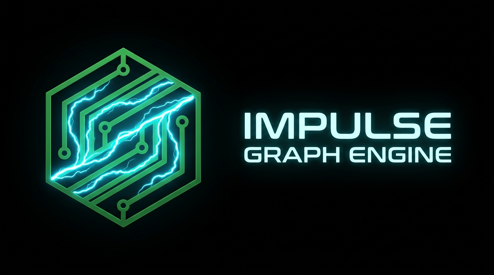
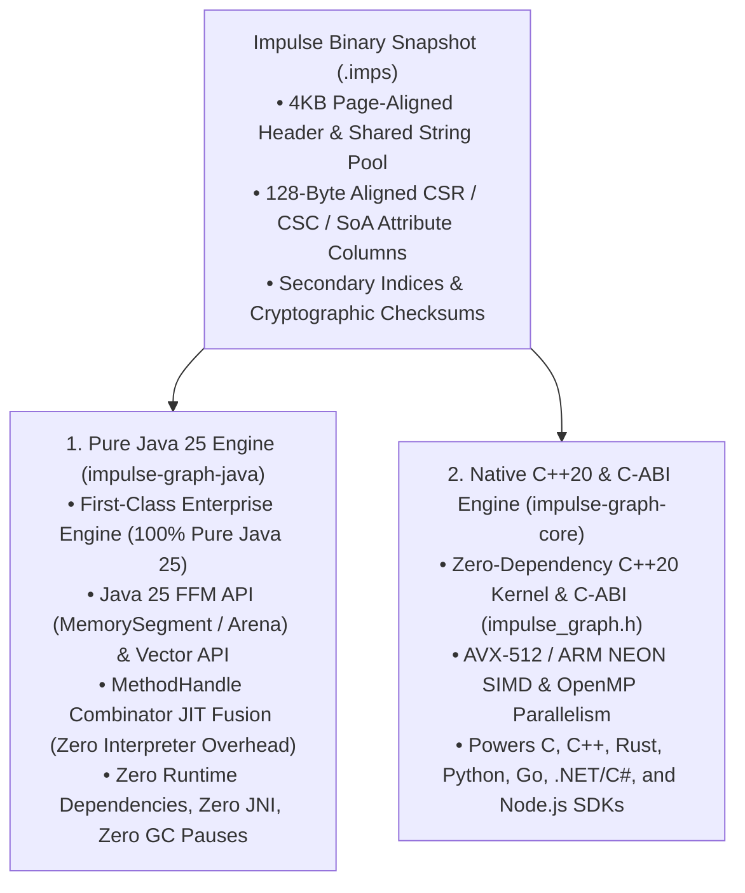

# Impulse Graph Engine



> **"How fast can a graph traversal possibly go?"**

Impulse Graph Engine started with that single question. Its goal is simple: **to provide world-class performance for traversing read-only graphs.**

Instead of paying the runtime overhead of mutable database locks, write-ahead logs, and pointer-chasing object heaps, Impulse Graph focuses 100% of its architecture on **immutable, read-only graph snapshots**. Built from the hardware up using **[Data-Oriented Design](concepts/data-oriented-design.md)**, it pairs the **Impulse Binary Snapshot Format (`.imps`)** with **two equivalent, first-class execution engines**—a **Pure Java 25 Engine** and a **Native C++20 / C-ABI Engine**.

---

## 1. The Foundation: Data-Oriented Design & The `.imps` Snapshot

Traditional graph databases store nodes and edges as heap-allocated objects connected by pointers. Every traversal hop triggers CPU cache misses, branch mispredictions, and garbage collection pauses.

Impulse Graph serializes the entire graph into a single **`.imps` binary snapshot file** whose on-disk byte layout is the exact in-memory layout required by the CPU:

* **Zero Cold-Start Loading (`mmap`)**: Mounting a 10 MB or 10 TB `.imps` snapshot is a single OS memory-map call (< 1 ms). No bytes are parsed or copied into heap objects.
* **Contiguous CSR & CSC Matrices**: Edges are packed into flat `row_offsets` and `col_indices` arrays so neighbors sit side-by-side in CPU cache lines.
* **Structure of Arrays (SoA) Attributes**: Node and edge properties are stored as isolated, 128-byte-aligned columnar vectors (`age[]`, `weight[]`), allowing SIMD instructions to filter 8–16 entities per cycle.
* **Per-Domain Dense IDs ($0 \dots N_d-1$)**: Every domain (`User`, `Account`, `Resource`) uses compact 0-indexed integer IDs (`uint16`, `uint32`, `uint64`) that act as direct $O(1)$ array offsets.

---

## 2. Two Equivalent, First-Class Execution Engines

Because the `.imps` binary layout is hardware-native, Impulse Graph provides **two independent, bitwise-identical engines** that execute the same **Lua-inspired register-based `ImpulseVM`** (`R0`..`R63`, fixed 64-bit `impOps` instructions, zero stack-traffic overhead) directly over memory-mapped `.imps` files:



| Capability | Pure Java 25 Engine (`impulse-graph-java`) | Native C++20 / C-ABI Engine (`impulse-graph-core`) |
| :--- | :--- | :--- |
| **Implementation** | **100% Pure Java 25** (no JNI or native `.so`/`.dll` wrappers) | **Native C++20** with canonical `extern "C"` ABI |
| **Off-Heap Memory** | Java 25 FFM (`MemorySegment`, `Arena`) | OS `mmap` & 64-byte aligned arena pools |
| **VM & JIT Execution** | Lua-style Register VM + **`MethodHandle` Combinator C2 JIT** | Lua-style Register VM + Computed-Goto / SIMD Dispatch |
| **SIMD Vectorization** | Java Vector API (`jdk.incubator.vector`) | Google Highway (`AVX-512`, `AVX2`, `ARM NEON`) & OpenMP |
| **Runtime Dependencies** | **Zero** third-party runtime dependencies | **Zero** third-party runtime dependencies |
| **GC Overhead** | **Zero GC pauses** (100% off-heap topology & VM state) | **Zero GC** (allocation-free hot path) |
| **Ecosystem Target** | Enterprise JVM services (Java 25, Kotlin, Scala 3) | C/C++, Rust, Python (PyTorch/NumPy), Go, .NET/C#, Node.js |

---

## 3. Simple, Composable Querying

Whether you query in Java 25, C++20, Rust, Python, Go, C#, or Node.js, you work with the same clean abstractions:

=== "Java 25 (Fluent Traversal)"
    ```java
    try (Arena arena = Arena.ofShared()) {
        ImpulseGraphSnapshot snap = BinarySnapshotLoader.loadSnapshot(Path.of("social.imps"), arena).getGraph();

        List<Long> friends = snap.domain("User")
            .fromKey("usr_alice")
            .out("FOLLOWS")
            .filter("node.age >= 21 && node.active == true")
            .toList();
    }
    ```

=== "Java 25 (Prepared openCypher)"
    ```java
    try (ImpulseStatement stmt = snap.prepare(
            "MATCH (u:User)-[:FOLLOWS]->(f:User) WHERE u.id = $uid AND f.age >= $minAge RETURN f.id")) {
        stmt.bindNode("uid", 42L).bindLong("minAge", 21L);
        try (RowReader rows = stmt.execute()) {
            while (rows.next()) {
                long friendId = rows.getNodeId(0);
            }
        }
    }
    ```

=== "C / C++20 (C-ABI Prepared Statement)"
    ```c
    impulse_stmt_t* stmt = NULL;
    impulse_stmt_prepare(snap, "MATCH (u:User)-[:FOLLOWS]->(f:User) WHERE u.id = $uid RETURN f.id", &stmt);
    impulse_stmt_bind_node(stmt, "uid", 42);
    impulse_stmt_execute(stmt, buffer, buffer_size);
    const uint64_t* ids = (const uint64_t*)impulse_stmt_column_data(stmt, 0);
    impulse_stmt_finalize(stmt);
    ```

---

## Explore the Documentation

- **[Getting Started](getting-started/index.md)**: Installation, Quickstart, and Snapshot Builder tutorial.
- **[Data-Oriented Design](concepts/data-oriented-design.md)**: How `.imps` and `ImpulseVM` eliminate pointer chasing and GC overhead.
- **[Pure Java 25 API Reference](reference/java-api.md)** & **[Hosted Javadocs](/javadoc/index.html)**
- **[C-ABI Kernel & VM Reference](reference/c-abi.md)** & **[C++20 API Reference](reference/cpp-api.md)**
- **[Binary Snapshot Format (`.imps`) Specification](reference/spec/format-specification.md)**
- **[Benchmarks & Empirical Performance](benchmarks.md)**
