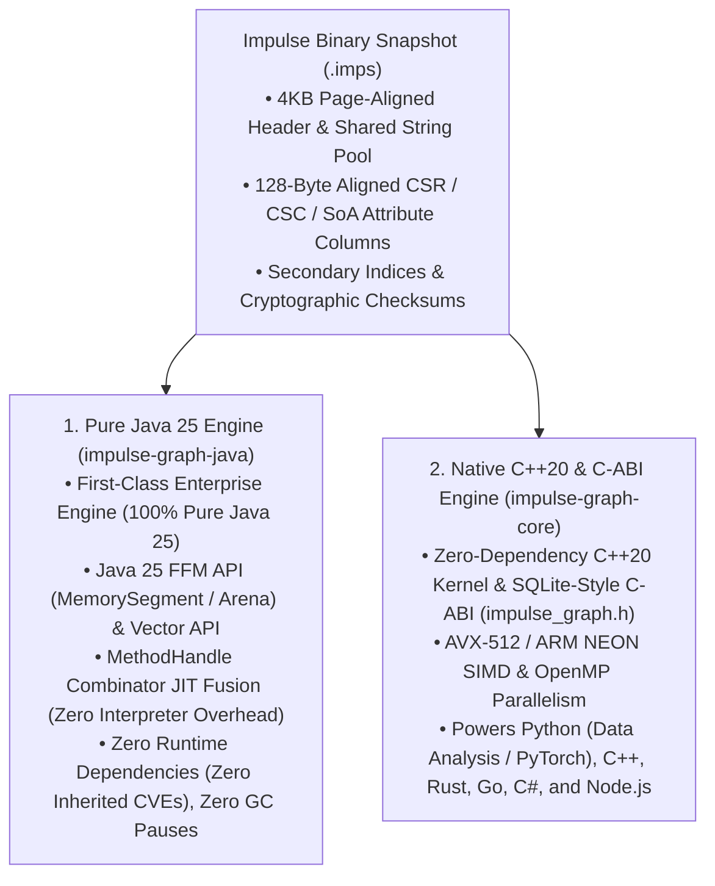

# Impulse Graph Engine


> **"How fast can you traverse a graph?"**
>
> Turns out, really fast—once you throw away the requirements that hold SQL table joins and traditional graph databases back: **in-place mutability, locking, heap allocations, and GC pauses**.

---

## 1. What Is Impulse Graph?

**Impulse Graph Engine** is an embedded, read-only, **"mmap and go"** graph engine built around an immutable binary snapshot format (**`.imps`**) and a register-based virtual machine (**`ImpulseVM`**).

Think of it as **"SQLite meets Apache Arrow for Graph Analytics"**:
* **Single-File, Zero-Copy Snapshots (`.imps`)**: Compile your graph once into a 128-byte-aligned `.imps` file. Mount 10 MB or 10 TB in **< 1 millisecond** via a single OS `mmap` call—no database server to manage, no deserialization, and no heap loading.
* **Zero Allocations in the Hot Query Path**: The exact memory required for a query is deterministically known at `prepare` time, pre-allocated, and passed in—enabling an **allocation-free, lock-free, GC-free hot query path** and massive concurrency.
* **Zero Runtime Dependencies (Zero Inherited CVEs)**: Both first-class engines—**100% Pure Java 25** and **Native C++20 / C-ABI**—have zero third-party runtime dependencies.

---

## 2. Why It's Different: The Four Core Shifts

| What Slows Traditional Engines Down | How Impulse Graph Works Instead | Why It Matters |
| :--- | :--- | :--- |
| **1. In-Place Mutability & Pointer Chasing**<br>Mutable databases use B-trees, heap `Node` objects, or `(source, target)` **COO** join tables. | **Immutable CSR, CSC & SoA Layouts**<br>Adjacency lists are packed into contiguous **Compressed Sparse Row/Column (CSR/CSC)** arrays and **Structure-of-Arrays (SoA)** columns. | Neighbors and attributes sit side-by-side in CPU L1 cache lines; SIMD instructions filter 8–16 entities per cycle. |
| **2. Deserialization & Startup Tax**<br>**Parquet** isn't memory-aligned on disk; **Arrow** is tabular rather than a multi-domain graph container. | **The `.imps` "Mmap and Go" Format**<br>Fills the open-source gap: a single file whose on-disk byte layout *is* the 128-byte-aligned in-memory C-ABI data structure. | Instant $O(1)$ cold starts (`mmap` and query immediately) across multi-domain property graphs. |
| **3. Dynamic Heap Allocations & GC Pauses**<br>Queries allocate resizing hash tables, queues, and boxed objects on every hop. | **Pre-Determined, Caller-Supplied Memory**<br>Domain sizes ($N_d$) are fixed, so exact scratch bitset + result memory is known at `prepare` time (`impulse_stmt_buffer_size`) and passed in. | **Zero heap allocations** in the hot query path, zero locks, zero GC pauses, and linear scaling across CPU cores or Java 25 Virtual Threads. |
| **4. Divergent Evaluators or Slow AST Interpreters**<br>Maintaining separate query engines per language or walking polymorphic AST trees. | **SQLite-Style Pipeline + Lua-Style VM**<br>Queries compile through `Frontend -> ImpScheme IR -> 64-bit impOps -> 64-Register ImpulseVM` (`640B` L1-aligned frame). | Two independent engines (**Pure Java 25** and **Native C++20/C-ABI**) execute the exact same 64-bit bytecode with **100% bitwise parity**. |

👉 *Read the full origin story and architectural rationale in **[Why Impulse Graph?](concepts/why-impulse.md)** and the hardware deep dive in **[Data-Oriented Design](concepts/data-oriented-design.md)**.*

---

## 3. Why You Should Care: What You Get in Practice

### Two First-Class, Zero-Dependency Execution Engines



| Capability | Pure Java 25 Engine (`impulse-graph-java`) | Native C++20 / C-ABI Engine (`impulse-graph-core`) |
| :--- | :--- | :--- |
| **Implementation** | **100% Pure Java 25** (no JNI or native `.so`/`.dll` wrappers) | **Native C++20** with canonical SQLite-style `extern "C"` ABI |
| **Off-Heap Memory** | Java 25 FFM (`MemorySegment`, `Arena`) | OS `mmap` & caller-supplied pre-allocated buffers |
| **VM & JIT Execution** | Lua-style Register VM + **`MethodHandle` Combinator C2 JIT** | Lua-style Register VM + Computed-Goto / SIMD Dispatch |
| **SIMD Vectorization** | Java Vector API (`jdk.incubator.vector`) | Google Highway (`AVX-512`, `AVX2`, `ARM NEON`) & OpenMP |
| **Runtime Dependencies** | **Zero** (Zero inherited CVEs) | **Zero** (Zero inherited CVEs) |
| **Hot-Path Allocations** | **Zero GC pauses** (100% off-heap topology & VM state) | **Zero heap allocations** (caller-allocated scratch + output buffer) |
| **Ecosystem Target** | **Java 25, Kotlin, Scala 3** | **Python (NumPy/PyTorch), C/C++, Rust, Go, C#/.NET, Node.js** |

!!! tip "Wait — Isn't Java Inherently Slower Than C++?"
    Traditional Java graph libraries are slow because they allocate millions of `Node` and `Edge` objects on the JVM heap, suffering from pointer chasing and Stop-The-World GC pauses.

    Once Impulse Graph moves the topology off-heap into 128-byte-aligned CSR/CSC arrays (`MemorySegment`) and scans them with the Java 25 Vector API (`jdk.incubator.vector`), **the limiting factor that dominates query speed is physical memory bandwidth and CPU cache-line transfers—not the language runtime:**

    * **Within `1.5x–2.0x` of Native C++20**: On the 1.47-billion-edge `twitter-2010` graph (10 threads), the Native C++20 kernel completes full-graph BFS in **`145.00 ms`** and the warmed Pure Java 25 engine completes it in **`240.29 ms` (`1.65x`)**—with **zero heap allocations** on the hot path (verified via Java Flight Recorder). The remaining `1.65x` delta comes down to JVM safepoint polls, `MemorySegment` bounds checks, and `ForkJoinPool` vs. OpenMP scheduling.
    * **JSON Serialization Takes Longer Than the Query**: In enterprise microservices, JFR profiling and benchmarks across 600,000 users show that evaluating a multi-hop authorization query takes **`0.026 µs – 0.552 µs`**, whereas **serializing the result into JSON via Jackson takes `1.91 µs – 2.56 µs` (`3.5x to 73x` longer than the graph query itself)**.
    * Pure Java 25 is wholly suitable for demanding enterprise workloads—delivering sub-microsecond traversals with zero JNI wrappers, zero GC pauses, and zero inherited CVEs. See **[Why Impulse Graph?](concepts/why-impulse.md)** and **[Benchmarks](benchmarks.md)**.

### One VM, Every Query Style & Language
Because the compiler pipeline cleanly separates frontends from the `ImpulseVM` bytecode engine, multiple query paradigms and language SDKs snap naturally onto the same core:
* **Query Frontends**: Idiomatic **Fluent Traversal API**, parameterized **openCypher** (read-only subset), declarative **Datalog (`ImpLog`)**, and **GraphBLAS matrix math (`ImpK`)**, with **Google CEL** for SIMD attribute filtering and projections.
* **Engineered with SQLite as the Quality North Star**: While we would never claim to be anywhere near SQLite's legendary maturity, SQLite's engineering discipline is our aspirational target—driving our spec-first assembly test vectors, 100% opcode coverage CI gate, and [Four-Way Polyglot Validation Suite](contributing/polyglot-validation.md) (C++ `-O3`, C++ `-O0`, Pure Java 25, and an OCaml Reference Oracle).

---

## 4. See It in Action

=== "Java 25 (Fluent Traversal)"
    ```java
    try (Arena arena = Arena.ofShared()) {
        ImpulseGraphSnapshot snap = BinarySnapshotLoader.loadSnapshot(Path.of("social.imps"), arena).getGraph();

        List<Long> friends = snap.domain("User")
            .fromKey("usr_alice")
            .out("FOLLOWS")
            .filter("node.age >= 21 && node.active == true")
            .toList();
    }
    ```

=== "Java 25 (Prepared openCypher)"
    ```java
    try (ImpulseStatement stmt = snap.prepare(
            "MATCH (u:User)-[:FOLLOWS]->(f:User) WHERE u.id = $uid AND f.age >= $minAge RETURN f.id")) {
        stmt.bindNode("uid", 42L).bindLong("minAge", 21L);
        try (RowReader rows = stmt.execute()) {
            while (rows.next()) {
                long friendId = rows.getNodeId(0);
            }
        }
    }
    ```

=== "C / C++20 (Caller-Allocated Prepared Statement)"
    ```c
    impulse_stmt_t* stmt = NULL;
    impulse_stmt_prepare(snap, "MATCH (u:User)-[:FOLLOWS]->(f:User) WHERE u.id = $uid RETURN f.id", &stmt);

    // Exact scratch + result footprint is known at prepare time; caller supplies pre-allocated buffer
    size_t buf_size = impulse_stmt_buffer_size(stmt);
    impulse_stmt_bind_node(stmt, "uid", 42);
    impulse_stmt_execute(stmt, preallocated_buffer, buf_size);

    const uint64_t* ids = (const uint64_t*)impulse_stmt_column_data(stmt, 0);
    impulse_stmt_finalize(stmt);
    ```

=== "Python (Zero-Copy SDK)"
    ```python
    from impulse_graph import Snapshot

    with Snapshot.mmap("social.imps") as snap:
        stmt = snap.prepare("MATCH (u:User)-[:FOLLOWS]->(f:User) WHERE u.id = $uid RETURN f.id")
        stmt.bind_node("uid", 42)
        friend_ids = stmt.execute_numpy()  # Zero-copy NumPy view over caller buffer
    ```

---

## Explore the Documentation

- **[Getting Started](getting-started/index.md)**: Installation, Quickstart, and Snapshot Builder tutorial.
- **[Why Impulse Graph? (The Story & Architecture)](concepts/why-impulse.md)**: How throwing away mutability led to `.imps`, `ImpulseVM`, and two zero-CVE engines.
- **[Data-Oriented Design](concepts/data-oriented-design.md)**: How Dense IDs, CSR/CSC, SoA columns, and pre-allocated buffers eliminate pointer chasing and GC overhead.
- **[Pure Java 25 API Reference](reference/java-api.md)** & **[Hosted Javadocs](/javadoc/index.html)**
- **[C-ABI & C++20 Reference](reference/c-abi.md)** & **[Python & PyTorch SDK](reference/python-api.md)**
- **[Binary Snapshot Format (`.imps`) Specification](reference/spec/format-specification.md)** & **[Benchmarks](benchmarks.md)**
