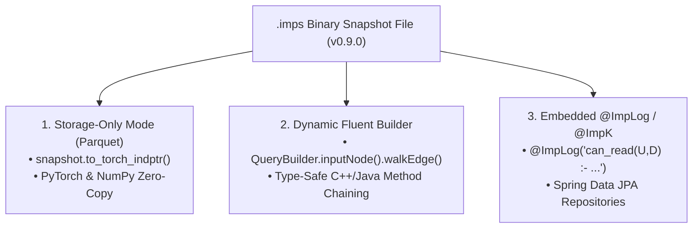

# Impulse Graph Engine

**Ultra-high-performance, zero-copy, C-ABI binary snapshot graph engine.**

Impulse Graph is the **"Apache Arrow / Parquet equivalent for Graph Analytics"**. It decouples static graph analytics from heavy database servers by pairing an **immutable binary snapshot format (`.imps` v0.9.0)** with a **register-based Virtual Machine (`ImpulseVM`)** that executes SIMD-vectorized traversals directly off-heap without physical data loading or GC pauses.

## Three Laser-Focused Execution Paradigms

## Feature Highlights

- **The Apache Arrow for Graphs**: Zero-copy `mmap` snapshot mounting in **0.4 ms** (341x faster cold start than traditional graph DBs).
- **Sub-Microsecond JIT Traversals**: Executed directly off-heap via `ImpulseVM` (`impOps`) instructions in **4.13 µs**.
- **Google Highway SIMD Acceleration**: Auto-dispatches across x86 AVX-512, ARM NEON/SVE, and RISC-V RVV vector units.
- **PyTorch & GNN Integration**: 5-microsecond Sliced ELLPACK GPU matrix operations (`torch.ops.impulse.spmm`).
- **Polyglot Consistency**: Unified execution across Java 25, C++20, Rust, Python, C#, Go, and Node.js.
- **Trillion-Node Scale**: 64-bit architecture designed for modern hardware.

## Quick Links

- [**GAPBS Benchmarks & Performance Guide**](benchmarks.md)
- [Deployment Archetypes](deployment/dynamic-service.md)
- [Query API Cheatsheet](reference/operations-cheatsheet.md)
- [Authz Zanzibar Showcase](showcase/authz.md)
- [Contributing](contributing/index.md)
