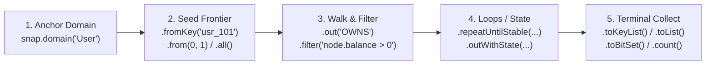

# Fluent Traversal API

The **Fluent Traversal API** provides a strongly-typed, allocation-free pipeline for stepping across domains, filtering node and edge attributes with [Google CEL](../dsl/cel.md), performing off-heap bitset algebra, and materializing results.

---

## 1. The Five Stages of a Fluent Traversal

Every fluent query follows the same five-stage lifecycle:



### Stage 1 & 2: Anchor Domain & Seed the Frontier
Because every Node Domain (`User`, `Account`, `Product`) has its own independent 0-indexed dense ID space ($0 \dots N_d - 1$), multi-domain queries in Java 25 begin by binding a domain via `snap.domain("DomainName")` and selecting the initial frontier (while Python and Rust provide `snap.traverse(start_node)` as well as low-level register `QueryBuilder`s):

| Seed Method (Java 25 `DomainView`) | Python / Rust Equivalent | Description |
| :--- | :--- | :--- |
| `.all()` | `QueryBuilder.init_input_bitset` | Seeds the frontier with **all $N_d$ nodes** ($0 \dots N_d - 1$) in the domain. |
| `.from(long id)` | `snap.traverse(id)` | Seeds a single dense node ID. |
| `.from(long... ids)` | `QueryBuilder` bitset seed | Seeds a batch of dense node IDs. |
| `.from(ImpulseBitSet bits)` | `QueryBuilder` bitset seed | Seeds from a pre-computed off-heap BitSet. |
| `.fromKey(String key)` | Key catalog lookup $\to$ `traverse(id)` | Resolves an external business key (`String`, `UUID`, `int64`) to its dense ID via the domain's key catalog. |
| `.fromKeys(String... keys)` | Key catalog lookup $\to$ bitset | Resolves a batch of external business keys to dense IDs. |

---

## 2. Cross-Language Method Reference

Each language SDK exposes an idiomatic traversal and/or VM `QueryBuilder` interface:

| Operation | Java 25 (`Traversal<T>`) | Python (`Traversal`) | Rust (`TraversalBuilder`) | C++20 (`vm::QueryBuilder`) | Go / C# / Node (`QueryBuilder`) |
| :--- | :--- | :--- | :--- | :--- | :--- |
| **Start Traversal** | `snap.domain(d).from(id)` | `snap.traverse(id)` | `snap.traverse(id)` | `qb.initInputNode(reg)` | `qb.initInputNode(reg)` |
| **Forward Walk (CSR)** | `.out(rel)` | `.out(rel)` | `.out(rel)` | `.walkEdge(src, dst, relId)` | `.walkEdge(src, dst, relId)` |
| **Reverse Walk (CSC)** | `.in(rel)` | `.in_(rel)` | `.in_step(rel)` | `.walkCsc(src, dst, relId)` | `.walkCsc(src, dst, relId)` |
| **Filtered Forward Walk** | `.out(rel, cel)` | `.out(rel)` + `.filter(...)` | `.out_filtered(rel, cel)` | `.walkEdgeFiltered(...)` | `.walkEdgeFiltered(...)` |
| **In-Domain Node Filter** | `.filter(cel)` | `.filter(filter_id)` | `.out_filtered(...)` | `.filterWithCel(src, dst, cel)` | `.filterNodes(...)` |
| **Bind Parameter** | `.withParam(k, v)` | `params={k: v}` | `.with_param(k, v)` | C-ABI `impulse_stmt_bind_*` | C-ABI `bind_*` |
| **Fixed-Point Loop** | `.repeatUntilStable(rel)` | `vm.QueryBuilder` | `QueryBuilder` | `.repeatUntilStable(...)` | `.repeatUntilStable(...)` |
| **Collect Dense IDs** | `.toList()` / `.toSet()` | `.to_list()` / `.to_set()` | `.to_vec()?` | `.collectNodes(dst, src)` | `.collectNodes(dst, src)` |
| **Collect Business Keys** | `.toKeyList()` | — (Java `DomainView`) | — (Java `DomainView`) | — | — |
| **Collect Off-Heap BitSet**| `.toBitSet()` | `vm.QueryBuilder` | `QueryBuilder` | `.collectBitset(dst, src)` | `.collectBitset(dst, src)` |
| **Count Surviving Nodes** | `.count()` | `.count()` | `.to_vec()?.len()` | `.collectScalar(dst, src)` | `.collectScalar(dst, src)` |
| **Test Single Target** | `.contains(id)` | `.contains(id)` | `snap.is_reachable(...)` | `impulse_snapshot_is_reachable` | `snap.isReachable(...)` |
| **Disassemble `.impas`** | `.toImpAsm()` | `.to_impas()` | — | `.toImpAsm()` | — |

!!! note
    **Why `.in_()` in Python and `.in_step()` in Rust?**
    Both Python and Rust reserve `in` as a language keyword (`for x in y`). Python follows PEP 8 with a trailing underscore (`.in_("REL")`), while Rust uses `.in_step("REL")`.

---

## 3. Filtering & Parameter Binding with Google CEL

Filters can be applied either **in-domain** via `.filter(celExpr)` (which scans only the active domain's Structure-of-Arrays attribute columns) or **inline during an edge walk** via `.out(rel, celExpr)` (which evaluates edge, source, and target attributes in a single fused pass):

* **`node.<attr>`**: Attribute on the currently active node domain (used in `.filter("node.age >= 21")`).
* **`src.<attr>`**: Attribute on the source node of a walk step.
* **`edge.<attr>`**: Attribute on the traversed edge (used in `.out("TRANSFERRED_TO", "edge.amount >= 1000.0")`).
* **`tgt.<attr>`**: Attribute on the candidate target node of a walk step.
* **`$param` or `@param`**: Named parameters bound via `.withParam("param", value)`.

```java
long qualifiedPurchases = snap.domain("User")
    .fromKeys("usr_alice", "usr_bob")
    .withParam("minScore", 700.0)
    .filter("node.credit_score >= $minScore && node.active == true")
    .out("PURCHASED", "edge.amount > 250.0 && tgt.in_stock == true")
    .count();
```

---

## 4. Off-Heap BitSet Set Algebra (`OR`, `AND`, `AND NOT`)

Because every domain's nodes are dense integers $0 \dots N_d - 1$, any frontier can be materialized into an off-heap **`ImpulseBitSet`** (`OffHeapBitSet`) and combined using word-level / SIMD bitwise operations—**provided both bitsets belong to the same domain**:

```java
var users = snap.domain("User");

try (Arena arena = Arena.ofConfined()) {
    ImpulseBitSet aliceFriends = users.fromKey("usr_alice").out("FOLLOWS").toBitSet();
    ImpulseBitSet bobFriends   = users.fromKey("usr_bob").out("FOLLOWS").toBitSet();

    // 1. Intersection (AND): Mutual friends of Alice and Bob
    ImpulseBitSet mutual = new OffHeapBitSet(arena, (int) users.nodeCount());
    mutual.or(aliceFriends);
    mutual.and(bobFriends);

    // 2. Difference (AND NOT): Friends of Alice who are NOT friends of Bob
    ImpulseBitSet exclusiveAlice = new OffHeapBitSet(arena, (int) users.nodeCount());
    exclusiveAlice.or(aliceFriends);
    exclusiveAlice.andNot(bobFriends);

    // 3. Re-seed a new traversal directly from the computed bitset
    List<String> recommendedProducts = users.from(mutual)
        .out("PURCHASED")
        .toKeyList();
}
```

---

## 5. Multi-Language End-to-End Examples

=== "Java 25"
    ```java
    var users = snap.domain("User");

    boolean hasAccess = users.fromKey("usr_alice")
        .out("MEMBER_OF")
        .repeatUntilStable("PARENT_GROUP")
        .out("HAS_PERMISSION", "edge.scope == $scope")
        .withParam("scope", "doc:write")
        .contains(targetDocumentDenseId);
    ```

=== "Python"
    ```python
    from impulse_graph import Snapshot

    with Snapshot("hetionet.imps") as snap:
        # Compound (ID 0) -> Gene <- Disease traversal
        indications = (
            snap.traverse(start_node=0)
                .out("Compound::binds::Gene")
                .in_("Disease::associates::Gene")
                .to_list()
        )
    ```

=== "Rust"
    ```rust
    use impulse_graph::reader::SnapshotReader;

    let snap = SnapshotReader::open("security.imps")?;
    let reachable_hosts = snap.traverse(0)
        .out("MEMBER_OF")
        .out_filtered("CAN_SSH", "edge.port == 22")
        .to_vec()?;
    ```

=== "C++20 (`impulse::vm::QueryBuilder`)"
    ```cpp
    #include "impulse_vm_fluent.hpp"

    using namespace impulse::vm;
    CompiledQuery query = QueryBuilder()
        .inputNode(0)                // R0 = seed User ID
        .walkEdge(/*MEMBER_OF=*/ 0)
        .repeatUntilStable([](QueryBuilder& b) {
            b.walkEdge(/*PARENT_GROUP=*/ 1);
        })
        .walkEdgeFiltered(/*HAS_PERMISSION=*/ 2, /*filter_id=*/ 1)
        .collectBitset()
        .compile();

    impulse_vm_context_t* ctx = nullptr;
    QueryResult res = query.execute(snap, /*input_param=*/ 42, &ctx);
    bool has_access = res.testBitset(ctx, target_doc_dense_id);
    if (ctx) impulse_vm_context_destroy(ctx);
    ```

=== "Node.js / TypeScript"
    ```typescript
    import { Snapshot, VmContext, VmState, QueryBuilder, ExecuteQuery } from 'impulse-graph';

    const snap = new Snapshot('ecommerce.imps');
    const ctx = new VmContext(snap);
    const state = new VmState();
    state.setQueryContext(ctx);

    const instructions = new QueryBuilder()
      .initInputNode(0)
      .walkEdge(0, 1, 0) // PURCHASED
      .walkCsc(1, 2, 0)  // <-PURCHASED
      .walkEdge(2, 3, 0) // PURCHASED
      .collectBitset(4, 3)
      .compile();

    ExecuteQuery(instructions, state, 42);
    ```

=== "C# (.NET)"
    ```csharp
    using ImpulseGraph;

    using var snap = new Snapshot("powergrid.imps");
    using var ctx = new VmContext(snap);
    var state = new VmState { QueryContext = ctx.DangerousGetHandle() };

    var query = new QueryBuilder()
        .InitInputNode(0)
        .WalkEdge(0, 1, 0)
        .RepeatUntilStable(1, 2, 0)
        .CollectBitset(3, 2)
        .Compile();

    query.Execute(state, 101);
    ```

---

## Next Steps

* **[State Projections, Reducers & Loops](advanced-querying.md)**: Carry computed weights/distances across hops with `.outWithState(...)`, `:MIN`/`:MAX`/`:SUM`/`:ARGMIN` reducers, and `.project(...)`.
* **[Google CEL (Filters & Math)](../dsl/cel.md)**: Full operator table and the 46 built-in SIMD math functions.
