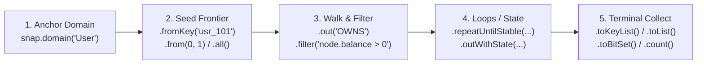

# Fluent Traversal API

The **Fluent Traversal API** provides a strongly-typed, allocation-free pipeline for stepping across domains, filtering node and edge attributes with [Google CEL](../dsl/cel.md), performing off-heap bitset algebra, and materializing results.

---

## 1. The Five Stages of a Fluent Traversal

Every fluent query follows the same five-stage lifecycle:



### Stage 1 & 2: Anchor Domain & Seed the Frontier
Because every Node Domain (`User`, `Account`, `Product`) has its own independent 0-indexed dense ID space ($0 \dots N_d - 1$), multi-domain queries always begin by binding a domain via `snap.domain("DomainName")` and selecting the initial frontier:

| Seed Method (Java 25) | Python Equivalent | Description |
| :--- | :--- | :--- |
| `.all()` | `.all()` | Seeds the frontier with **all $N_d$ nodes** ($0 \dots N_d - 1$) in the domain. |
| `.from(long id)` | `.from_id(id)` | Seeds a single dense node ID. |
| `.from(long... ids)` | `.from_ids([id1, id2])` | Seeds a batch of dense node IDs. |
| `.from(ImpulseBitSet bits)` | `.from_bitset(bits)` | Seeds from a pre-computed off-heap BitSet. |
| `.fromKey(String key)` | `.from_key(key)` | Resolves an external business key (`String`, `UUID`, `int64`) to its dense ID via the domain's key catalog. |
| `.fromKeys(String... keys)` | `.from_keys([k1, k2])` | Resolves a batch of external business keys to dense IDs. |

---

## 2. Cross-Language Method Reference

Method names follow idiomatic conventions in each language SDK:

| Operation | Java 25 | Python | C++20 | Rust | Node.js / TS | C# (.NET) |
| :--- | :--- | :--- | :--- | :--- | :--- | :--- |
| **Anchor Domain** | `snap.domain(d)` | `snap.domain(d)` | `snap.domain(d)` | `snap.domain(d)` | `snap.domain(d)` | `snap.Domain(d)` |
| **Forward Walk (CSR)** | `.out(rel)` | `.out(rel)` | `.out(rel)` | `.out(rel)` | `.out(rel)` | `.Out(rel)` |
| **Reverse Walk (CSC)** | `.in(rel)` | `.in_(rel)` | `.in_step(rel)` | `.in_step(rel)` | `.in(rel)` | `.In(rel)` |
| **Filtered Forward Walk** | `.out(rel, cel)` | `.out(rel, filter=cel)` | `.out_filtered(rel, cel)` | `.out_filtered(rel, cel)` | `.outFiltered(rel, cel)` | `.OutFiltered(rel, cel)` |
| **Filtered Reverse Walk** | `.in(rel, cel)` | `.in_(rel, filter=cel)` | `.in_filtered(rel, cel)` | `.in_filtered(rel, cel)` | `.inFiltered(rel, cel)` | `.InFiltered(rel, cel)` |
| **In-Domain Node Filter** | `.filter(cel)` | `.filter(cel)` | `.filter(cel)` | `.filter(cel)` | `.filter(cel)` | `.Filter(cel)` |
| **Bind Parameter** | `.withParam(k, v)` | `.with_param(k, v)` | `.with_param(k, v)` | `.with_param(k, v)` | `.withParam(k, v)` | `.WithParam(k, v)` |
| **Collect Dense IDs** | `.toList()` / `.toSet()` | `.to_list()` / `.to_set()` | `.to_vector()` | `.to_vec()` | `.toArray()` | `.ToList()` |
| **Collect Business Keys** | `.toKeyList()` | `.to_keys()` | `.to_keys()` | `.to_keys()` | `.toKeys()` | `.ToKeyList()` |
| **Collect Off-Heap BitSet**| `.toBitSet()` | `.to_bitset()` | `.to_bitset()` | `.to_bitset()` | `.toBitSet()` | `.ToBitSet()` |
| **Count Surviving Nodes** | `.count()` | `.count()` | `.count()` | `.count()` | `.count()` | `.Count()` |
| **Test Single Target** | `.contains(id)` | `.contains(id)` | `.contains(id)` | `.contains(id)` | `.contains(id)` | `.Contains(id)` |
| **Disassemble `.impas`** | `.toImpAsm()` | `.to_impas()` | `.to_impas()` | `.to_impas()` | `.toImpas()` | `.ToImpas()` |

!!! note
    **Why `.in_()` in Python and `.in_step()` in Rust?**
    Both Python and Rust reserve `in` as a language keyword (`for x in y`). Python follows PEP 8 with a trailing underscore (`.in_("REL")`), while Rust and C++ use `.in_step("REL")`.

---

## 3. Filtering & Parameter Binding with Google CEL

Filters can be applied either **in-domain** via `.filter(celExpr)` (which scans only the active domain's Structure-of-Arrays attribute columns) or **inline during an edge walk** via `.out(rel, celExpr)` (which evaluates edge, source, and target attributes in a single fused pass):

* **`node.<attr>`**: Attribute on the currently active node domain (used in `.filter("node.age >= 21")`).
* **`src.<attr>`**: Attribute on the source node of a walk step.
* **`edge.<attr>`**: Attribute on the traversed edge (used in `.out("TRANSFERRED_TO", "edge.amount >= 1000.0")`).
* **`tgt.<attr>`**: Attribute on the candidate target node of a walk step.
* **`$param` or `@param`**: Named parameters bound via `.withParam("param", value)`.

```java
long qualifiedPurchases = snap.domain("User")
    .fromKeys("usr_alice", "usr_bob")
    .withParam("minScore", 700.0)
    .filter("node.credit_score >= $minScore && node.active == true")
    .out("PURCHASED", "edge.amount > 250.0 && tgt.in_stock == true")
    .count();
```

---

## 4. Off-Heap BitSet Set Algebra (`OR`, `AND`, `AND NOT`)

Because every domain's nodes are dense integers $0 \dots N_d - 1$, any frontier can be materialized into an off-heap **`ImpulseBitSet`** (`OffHeapBitSet`) and combined using word-level / SIMD bitwise operations—**provided both bitsets belong to the same domain**:

```java
var users = snap.domain("User");

try (Arena arena = Arena.ofConfined()) {
    ImpulseBitSet aliceFriends = users.fromKey("usr_alice").out("FOLLOWS").toBitSet();
    ImpulseBitSet bobFriends   = users.fromKey("usr_bob").out("FOLLOWS").toBitSet();

    // 1. Intersection (AND): Mutual friends of Alice and Bob
    ImpulseBitSet mutual = new OffHeapBitSet(arena, (int) users.nodeCount());
    mutual.or(aliceFriends);
    mutual.and(bobFriends);

    // 2. Difference (AND NOT): Friends of Alice who are NOT friends of Bob
    ImpulseBitSet exclusiveAlice = new OffHeapBitSet(arena, (int) users.nodeCount());
    exclusiveAlice.or(aliceFriends);
    exclusiveAlice.andNot(bobFriends);

    // 3. Re-seed a new traversal directly from the computed bitset
    List<String> recommendedProducts = users.from(mutual)
        .out("PURCHASED")
        .toKeyList();
}
```

---

## 5. Multi-Language End-to-End Examples

=== "Java 25"
    ```java
    var users = snap.domain("User");

    boolean hasAccess = users.fromKey("usr_alice")
        .out("MEMBER_OF")
        .repeatUntilStable("PARENT_GROUP")
        .out("HAS_PERMISSION", "edge.scope == $scope")
        .withParam("scope", "doc:write")
        .contains(targetDocumentDenseId);
    ```

=== "Python"
    ```python
    from impulse_graph import Snapshot

    with Snapshot("hetionet.imps") as snap:
        # Compound -> Gene <- Disease with CEL filter
        indications = (
            snap.domain("Compound")
                .from_key("DB00945")  # Aspirin
                .out("Compound::binds::Gene")
                .in_("Disease::associates::Gene")
                .filter("node.severity > $min_sev")
                .with_param("min_sev", 3.5)
                .to_keys()
        )
    ```

=== "Rust"
    ```rust
    use impulse_graph::reader::SnapshotReader;

    let snap = SnapshotReader::open("security.imps")?;
    let reachable_hosts = snap.domain("User")
        .from_key("usr_alice")
        .out("MEMBER_OF")
        .out_filtered("CAN_SSH", "edge.port == 22")
        .to_keys()?;
    ```

=== "Node.js / TypeScript"
    ```typescript
    import { Snapshot } from 'impulse-graph';

    const snap = Snapshot.open('ecommerce.imps');
    const recommendations = snap.domain('User')
      .fromKey('usr_alice')
      .out('PURCHASED')
      .in('PURCHASED')
      .outFiltered('PURCHASED', 'edge.rating >= 4.5')
      .toKeys();
    ```

=== "C# (.NET)"
    ```csharp
    using ImpulseGraph;

    using var snap = Snapshot.Open("powergrid.imps");
    var energizedBuses = snap.Domain("Bus")
        .FromKey("BUS_101")
        .OutFiltered("CONNECTED_BRANCH", "edge.status == 1 && edge.kv >= @minKv")
        .WithParam("minKv", 115.0)
        .ToKeyList();
    ```

---

## Next Steps

* **[State Projections, Reducers & Loops](advanced-querying.md)**: Carry computed weights/distances across hops with `.outWithState(...)`, `:MIN`/`:MAX`/`:SUM`/`:ARGMIN` reducers, and `.project(...)`.
* **[Google CEL (Filters & Math)](../dsl/cel.md)**: Full operator table and the 46 built-in SIMD math functions.
