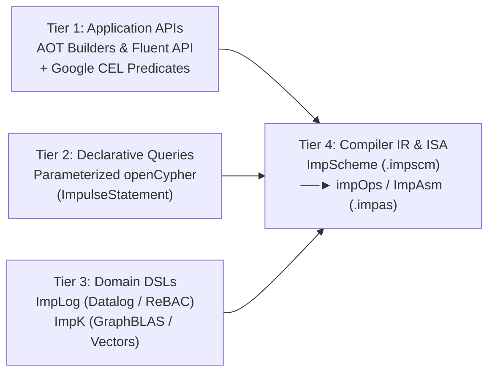

# Querying & DSLs Overview

Once an `.imps` snapshot is memory-mapped into your process, **all query interfaces in Impulse Graph compile through the same [ImpScheme $\to$ `impOps` bytecode pipeline](../concepts/compiler-architecture.md)** and execute on `ImpulseVM` with zero hot-loop heap allocations.

!!! note "You Do Not Need S-Expressions or Assembly to Use Impulse Graph"
    The navigation sidebar documents every layer of the compiler stack—including the internal S-expression IR (`ImpScheme`) and register assembly (`ImpAsm`). **95% of application code uses Tier 1 (Fluent / AOT API + CEL) or Tier 2 (openCypher).**

---

## Which Query Interface Should I Use?



| Tier | Interface / Language | When to Choose It | Primary Guide |
| :--- | :--- | :--- | :--- |
| **Tier 1 — Everyday Application Code *(Start Here)*** | **AOT Codegen (`impulse-codegen`) & Fluent Domain API** (`snap.domain(...)`) + **Google CEL** | Default choice for microservices and scripts: IDE auto-complete, multi-hop walks, off-heap bitset algebra, monoidic state projections, fixed-point loops, multi-lane batches, and Vamana ANN search. | **[Fluent Traversal API](fluent-api.md)**, **[State Projections & Loops](advanced-querying.md)**, **[AOT Codegen (Java)](../ecosystems/java/aot-codegen.md)** & **[Google CEL](../dsl/cel.md)** |
| **Tier 2 — Declarative Pattern Matching** | **Read-Only openCypher** (`ImpulseStatement` / `impulse_stmt_t`) | Teams familiar with `MATCH (a)-[:REL]->(b) WHERE ... RETURN ...` or C/FFI hosts binding `$param` values into pre-compiled SQLite-style prepared statements. | **[openCypher Guide](../dsl/opencypher.md)** |
| **Tier 3 — Specialized Policy & Matrix DSLs** | **ImpLog** (`.implog`) & **ImpK** (`.impk`) | Choose **ImpLog** for recursive Datalog rules and Zanzibar ReBAC policy files; choose **ImpK** for GraphBLAS sparse matrix-vector multiplication (`MxV`), PageRank, and Connected Components. | **[ImpLog (Datalog)](../dsl/implog.md)** & **[ImpK (GraphBLAS)](../dsl/impk.md)** |
| **Tier 4 — Compiler IR & Register Assembly *(Optional / Internals)*** | **ImpScheme** (`.impscm`) & **ImpAsm** (`.impas`) | Engine internals and advanced tooling: authoring custom AST macros, inspecting `.toImpAsm()` / `impulse disassemble` output, or writing `ImpulseVM` compliance test vectors. | **[ImpScheme IR](../dsl/impscm.md)** & **[ImpulseVM & ImpAsm Spec](../reference/spec/vm-specification.md)** |

*Working in PyTorch or SciPy? You can also mount CSR arrays (`row_offsets`, `col_indices`) and `[N, D]` embedding columns directly as zero-copy `torch.Tensor` / `np.ndarray` views—see **[GNN & Vector Search (Python)](../ecosystems/python/gnn-and-vector-search.md)** and the **[PyTorch & GNN Showcase](../showcase/gnn.md)**.*

---

## 1. Fluent Domain-to-Domain Traversals (Tier 1)

Every Fluent query anchors to a starting **Domain** (`snap.domain("User")`), seeds an initial frontier (`fromKey`, `from`, or `all`), walks zero or more directed relations (`.out(...)` / `.in(...)`), and collects the surviving nodes in the target domain:

=== "Java 25"
    ```java
    // 1. Multi-hop traversal with inline CEL filtering
    List<String> recipientAccounts = snap.domain("User")
        .fromKey("usr_101")
        .out("OWNS")
        .out("TRANSFERRED_TO", "edge.amount >= 1000.0")
        .toKeyList();

    // 2. Unbounded fixed-point reachability (transitive closure)
    ImpulseBitSet reachableGroups = snap.domain("User")
        .fromKey("usr_alice")
        .out("MEMBER_OF")
        .repeatUntilStable("PARENT_GROUP")
        .toBitSet();
    ```

=== "Python"
    ```python
    from impulse_graph import Snapshot

    with Snapshot("banking.imps") as snap:
        recipient_accounts = (
            snap.domain("User")
                .from_node(101)
                .out("OWNS")
                .out("TRANSFERRED_TO")
                .to_list()
        )
    ```

=== "C++20 (`impulse::vm::QueryBuilder`)"
    ```cpp
    using namespace impulse::vm;
    CompiledQuery query = QueryBuilder()
        .inputNode(0)
        .walkEdge(/*MEMBER_OF=*/ 0)
        .repeatUntilStable([](QueryBuilder& b) {
            b.walkEdge(/*PARENT_GROUP=*/ 1);
        })
        .collectBitset()
        .compile();

    impulse_vm_context_t* ctx = nullptr;
    QueryResult res = query.execute(snap, /*input_param=*/ 101, &ctx);
    if (ctx) impulse_vm_context_destroy(ctx);
    ```

---

## 2. Parameterized Prepared Statements (Tier 2: `ImpulseStatement` / `impulse_stmt_t`)

For declarative `openCypher` queries, prepare a statement once and execute it repeatedly with caller-bound parameters and pre-sized scratch buffers:

=== "Java 25 (`ImpulseStatement`)"
    ```java
    try (ImpulseStatement stmt = snap.prepare(
            "MATCH (u:User)-[:PURCHASED]->(p:Product) " +
            "WHERE u.id = $userId AND p.price <= 100.0 " +
            "RETURN p")) {

        stmt.bindNode("userId", 42L);

        try (RowReader rows = stmt.execute()) {
            while (rows.next()) {
                long productDenseId = rows.getNodeId(0);
            }
        }
    }
    ```

=== "C-ABI (`impulse_stmt_t`)"
    ```c
    impulse_stmt_t* stmt = NULL;
    impulse_stmt_prepare(
        snap,
        "MATCH (u:User)-[:PURCHASED]->(p:Product) WHERE u.id = $userId AND p.price <= 100.0 RETURN p",
        &stmt
    );

    size_t buf_len = impulse_stmt_buffer_size(stmt);
    void* buf = malloc(buf_len); // Reusable per-thread buffer

    impulse_stmt_bind_node(stmt, "$userId", 42);
    impulse_stmt_execute(stmt, buf, buf_len);

    size_t word_count = impulse_stmt_row_count(stmt);
    const uint64_t* bitset_words = (const uint64_t*)impulse_stmt_column_data(stmt, 0);

    impulse_stmt_finalize(stmt);
    free(buf);
    ```

!!! tip "Ad-Hoc Compilation vs. Pre-Prepared Statements"
    Because the Impulse compiler pipeline (AST $\to$ Stage 1 & 2 Optimizer $\to$ `impOps` Bytecode $\to$ Java 25 `MethodHandle` JIT) completes in microseconds, compiling analytical queries directly with concrete constants unlocks **compile-time Zone Map branch pruning** (`age > 250` $\to$ `FALSE`) and **constant folding** that generic `$param` placeholders cannot exploit until bind time. Use pre-prepared statements for high-QPS request handlers (100K+ QPS), and compile ad-hoc fluent or CEL queries freely for analytical sweeps.
