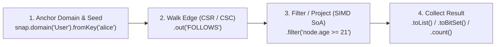

# Query API Overview

The Impulse Graph Query API lets you express multi-hop graph traversals, vectorized attribute filters, fixed-point reachability loops, and parameterized statements that compile directly to `ImpulseVM` (`impOps`) bytecode.

Every query executes identically on both primary engines—the **Pure Java 25 Engine** and the **Native C++20 / C-ABI Engine**—directly over memory-mapped `.imps` snapshots with zero heap allocations on the hot path.

---

## 1. Domain-Anchored Fluent Traversals

In Impulse Graph, every Node Domain (`User`, `Account`, `Product`) has its own independent 0-indexed dense ID space ($0 \dots N_d - 1$). Every traversal starts by anchoring to a domain (`snap.domain("User")`) and chaining operations:



=== "Java 25"
    ```java
    // 1. Multi-hop traversal with vectorized CEL filtering
    List<Long> friends = snap.domain("User")
        .fromKey("usr_alice")
        .out("FOLLOWS")
        .filter("node.age >= 21 && node.active == true")
        .toList();

    // 2. Unbounded fixed-point reachability (transitive closure)
    ImpulseBitSet reachableGroups = snap.domain("User")
        .from(42L)
        .out("MEMBER_OF")
        .repeatUntilStable(step -> step.out("PARENT_GROUP"))
        .toBitSet();
    ```

=== "C++20"
    ```cpp
    using namespace impulse::vm;

    CompiledQuery query = QueryBuilder()
        .inputNode(0)
        .walkEdge(0) // MEMBER_OF
        .repeatUntilStable([](QueryBuilder& q) {
            q.walkEdge(1); // PARENT_GROUP
        })
        .collectBitset()
        .compile();

    QueryResult result = query.execute(snap, 42);
    ```

=== "Rust"
    ```rust
    let friends: Vec<u64> = reader
        .traverse(42)
        .out("FOLLOWS")
        .to_vec();
    ```

---

## 2. Parameterized Prepared Statements (`ImpulseStatement` / `impulse_stmt_t`)

For declarative queries (`openCypher`, `ImpScheme`, `Google CEL`), prepare a statement once and execute it repeatedly with different parameter bindings—just like a SQLite prepared statement:

=== "Java 25 (`ImpulseStatement`)"
    ```java
    try (ImpulseStatement stmt = snap.prepare(
            "MATCH (u:User)-[:PURCHASED]->(p:Product) " +
            "WHERE u.id = $userId AND p.price <= $maxPrice " +
            "RETURN p.id, p.price")) {

        stmt.bindNode("userId", 42L)
            .bindDouble("maxPrice", 100.0);

        try (RowReader rows = stmt.execute()) {
            while (rows.next()) {
                long productId = rows.getNodeId(0);
                double price   = rows.getDouble(1);
            }
        }
    }
    ```

=== "C-ABI (`impulse_stmt_t`)"
    ```c
    impulse_stmt_t* stmt = NULL;
    impulse_stmt_prepare(
        snap,
        "MATCH (u:User)-[:PURCHASED]->(p:Product) WHERE u.id = $userId AND p.price <= $maxPrice RETURN p.id, p.price",
        &stmt
    );

    impulse_stmt_bind_node(stmt, "userId", 42);
    impulse_stmt_bind_float(stmt, "maxPrice", 100.0);
    impulse_stmt_execute(stmt, buffer, buffer_size);

    size_t row_count = impulse_stmt_row_count(stmt);
    const uint64_t* product_ids = (const uint64_t*)impulse_stmt_column_data(stmt, 0);
    const double* prices        = (const double*)impulse_stmt_column_data(stmt, 1);

    impulse_stmt_finalize(stmt);
    ```

---

## 3. Query API Sections

* **[Fluent API Specification](fluent-api.md)**: Complete reference for `DomainView`, `Traversal`, and monoidic `Reducer` semantics.
* **[Building Queries](building-queries.md)** & **[Advanced Querying](advanced-querying.md)**: Fixed-point loops (`repeatUntilStable`), state projections, and semiring reductions.
* **[Query Context](query-context.md)** & **[Execution Context](execution-context.md)**: Thread-safe off-heap arena lifecycles and zero-downtime snapshot rotation.
* **[Bytecode Virtual Machine (`impOps`)](bytecode-vm.md)**: How queries lower to 8-byte `impOps` instructions over the 640-byte register frame.
