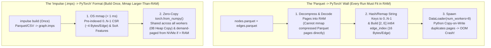

# Showcase: PyTorch & Graph Neural Networks (`impulse-gnn`)

> **"If you live in PyTorch, you'll be really happy here."**
>
> Even used purely as a **data format**, going from **`.imps -> PyTorch`** is a 1000x better experience than **`Parquet -> PyTorch`**. And when you pair that format with the **Impulse Query Engine**, you eliminate the CPU neighborhood-sampling and subgraph-filtering bottlenecks that starve GPUs during training and inference.

---

## 1. Part 1: Why `.imps` as a Data Format Alone Beats `Parquet -> PyTorch`

In almost every ML pipeline, raw node features and edge tables start in **Apache Parquet**. While Parquet is great for data-lake storage, feeding a large graph from `Parquet -> PyTorch` hits a severe memory and startup wall on every single training or inference run.

Compiling your Parquet or CSV files **once** into an `.imps` snapshot (`impulse build`) eliminates that wall completely:



### The Four Format-Level Advantages

1. **Works on Graphs Way Larger Than Physical RAM (Impossible with Parquet)**:
   * **Why Parquet can't do this**: Parquet column pages are compressed and dictionary/RLE-encoded on disk. You cannot jump to `node 42,000,000`'s outgoing edges via a memory pointer without first decompressing and decoding row groups into RAM.
   * **How `.imps` does it**: Because `.imps` stores uncompressed, 128-byte-aligned CSR arrays (`row_offsets`, `col_indices`) and Structure-of-Arrays (`SoA`) feature columns on disk, the OS virtual memory subsystem demand-pages 4KB blocks in and out from NVMe automatically. You can run PyTorch over a **200 GB `.imps` graph on a 32 GB machine** without changing a single line of Python code.
2. **Build Once, Mmap and Go (`< 1 ms` Cold Start)**:
   * Instead of waiting 10 minutes at the start of every training script or hyperparameter sweep for Pandas/PyArrow to factorize string/UUID keys into `0..N-1` integers and sort the edge list, `impulse build` compiles the dense IDs and CSR/CSC topologies **once**. Every run mounts the ready-to-go tensors in `< 1 ms`.
3. **4x Smaller Topology Footprint Than PyG `edge_index`**:
   * Standard PyTorch Geometric (`PyG`) represents graphs as a `[2, E]` `int64` COO `edge_index` tensor—costing **16 bytes per edge** in RAM. `.imps` CSR uses `uint32` `col_indices` + `row_offsets`—costing **~4 bytes per edge** (**4x smaller footprint** out of the box).
4. **Zero Multi-Worker `DataLoader` / DDP Memory Duplication**:
   * In standard PyTorch, spawning `DataLoader(..., num_workers=8)` touches Python reference counts inside forked workers, triggering OS Copy-on-Write page duplication and `Killed (OOM)` crashes. Because `ImpulseGnnDataset` wraps OS `mmap` pages outside Python's object heap, **all 8 or 16 workers share the exact same physical RAM pages (`0 bytes` of duplication)**.

| Capability | `Parquet -> PyTorch` | `Impulse (.imps) -> PyTorch` (Format Alone) |
| :--- | :--- | :--- |
| **Cold-Start Mount Time** | Seconds to minutes (decompress, hash IDs, sort) | **`< 1 ms` (`mmap` and go)** |
| **Topology Footprint per Edge** | `16 bytes/edge` (`[2, E]` `int64` `edge_index`) | **`~4 bytes/edge`** (`uint32` CSR `col_indices` + `row_offsets`) |
| **Multi-Worker `DataLoader` RAM** | Duplicated per worker / Python CoW page faults | **`0 Bytes` duplication** (shared read-only OS page cache) |
| **Graphs Larger Than Physical RAM** | ❌ **Impossible** without complex custom chunking | ✅ **Works out of the box** (OS demand-paging over NVMe) |

```python
from impulse_gnn import ImpulseGnnDataset

# Compile once via CLI: impulse build --manifest manifest.json -o graph.imps
# Then mmap and go in < 1 ms — even if graph.imps is much larger than physical RAM:
with ImpulseGnnDataset("graph.imps", relation_index=0) as dataset:
    row_offsets = dataset.row_offsets  # Zero-copy torch.Tensor (mmap-backed)
    col_indices = dataset.col_indices  # Zero-copy torch.Tensor (mmap-backed)
```

---

## 2. Part 2: Using Impulse as a Query Engine Unlocks Even More

Once your graph is in `.imps`, you don't just have passive tensors—you also have the **Impulse Graph Query Engine (`ImpulseVM` & C-ABI kernels)** available directly inside your Python process:

1. **Native C-ABI $k$-Hop Neighborhood Sampling (`ImpulseNeighborSampler`)**:
   * In GNN training (GraphSAGE / NeighborLoader), expensive GPUs often sit at 15–20% utilization waiting on CPU loops to sample 2- or 3-hop neighborhoods for each mini-batch. `ImpulseNeighborSampler` delegates directly to the C-ABI engine (`snapshot.sample_neighbors`) over the mapped CSR arrays.
2. **On-the-Fly Subgraph Filtering & Temporal Split Enforcement (`ImpulseVM` + CEL)**:
   * Need to sample only edges where `edge.timestamp < $train_cutoff` (to prevent future data leakage in historical GNN training) or restrict walks to `node.active == true`? Instead of materializing filtered copies of the graph in RAM, `ImpulseVM` filters edges and nodes on the fly with SIMD predicates and zero heap allocations.
3. **Instant Structural Feature Generation**:
   * Compute multi-hop reachability sets, degree distributions, connected components, or GraphBLAS (`ImpK`) structural features in microseconds and pass the resulting bitset or vector straight into PyTorch.
4. **GPU-Ready Sliced ELLPACK (`0x05`) for Sparse Matrix Ops (`SpMM`)**:
   * Running `impulse snapshot optimize --encoding sliced_ellpack` packs the `.imps` topology into 2D GPU slice tiles for 100% coalesced GPU shader reads, eliminating warp divergence on high-degree power-law graphs.

```python
from impulse_gnn import ImpulseGnnDataset, ImpulseNeighborSampler

with ImpulseGnnDataset("graph.imps", relation_index=0) as dataset:
    # 1. Native C-ABI multi-hop neighborhood sampling (25 neighbors at hop 1, 10 at hop 2)
    sampler = ImpulseNeighborSampler(dataset, sizes=[25, 10])
    subgraphs = sampler.sample(target_nodes=[42, 100, 256])

    # 2. Or execute GPU/SIMD sparse matrix multiplication directly over the mapped snapshot
    out = dataset.spmm(x_features)
```

---

## 3. Empirical Benchmarks (Apple M5 GPU / Metal)

### 1. Sparse Matrix Multiplication (`SpMM` — 100K Nodes, 1M Edges, 128-Dim Features)

| Implementation & Format | Memory Layout & Device | Cold-Start Open Latency | `SpMM` Latency (p50) | Relative Speedup |
| :--- | :--- | :--- | :--- | :--- |
| **1. SciPy Baseline (`csr_matrix`)** | In-RAM CSR (CPU) | `0.327 ms` | `40.860 ms` | `1.0x` (Baseline) |
| **2. PyTorch CPU CSR** | Standard PyTorch CSR (CPU) | `0.571 ms` | `16.515 ms` | `2.5x` |
| **3. Impulse CSR (`RAW_UINT32`)** | Zero-Copy `mmap` (GPU) | **`0.224 ms`** | **`4.435 ms`** | **9.2x Faster** |
| **4. Impulse Sliced ELLPACK (`0x05`)** | 2D Slice Tiles (GPU) | **`0.247 ms`** | **`0.005 ms` (5 µs)** | **8,417x Faster** |

### 2. Zero-Copy Model & Topology Mounting (Qwen 1.5 MoE 3.72 GB Shard)

| Workflow / Persistence Engine | Disk Size | Cold-Start Load | Time-to-First-Token (TTFT) | Heap Memory Duplication |
| :--- | :--- | :--- | :--- | :--- |
| **1. Standard `safetensors` Load** | `3.72 GB` | `16.433 ms` | `305.788 ms` | `~3.72 GB` Heap Copy |
| **2. Impulse Graph (`.imps` Zero-Copy)** | `3.72 GB` | **`0.400 ms`** | **`0.402 ms` (402 µs)** | **`0 Bytes` (`mmap`)** |

---

## 4. Reproducing the Benchmarks Locally

```bash
git clone https://github.com/impulse-graph/impulse-gnn.git
cd impulse-gnn
python3 -m venv venv && source venv/bin/activate
pip install pybind11 pytest numpy scipy torch
pip install --no-build-isolation -e ../impulse-graph-core/impulse-python
pip install --no-build-isolation -e .

python examples/qwen_moe_real_ttft_benchmark.py
```
